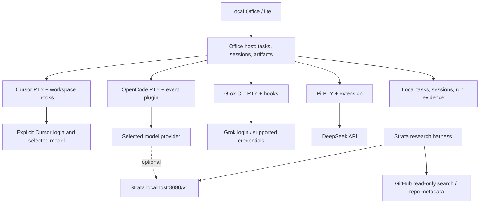

# Agent Office Lab — MVP SDD

> 公開匯入版：先依 [SETUP](SETUP.md) 設定環境（research 文件請見 ../docs/SETUP.md）。原 runs 的連結改指向歷史摘要，原始日誌及截圖不公開。

版本：0.1，2026-10-31。SDD 在此指規格驅動開發的設計文件（Software Design Description）。狀態：P0 基底已安裝、建置及通過 614 個測試與瀏覽器 smoke；四 provider 的 live integration 與 MVP 驗收尚未完成。見 [本機進度](OFFICE-LOCAL.md)。

最新：OpenCode、Grok、Pi + DeepSeek、Cursor 各有真實合成任務通過 AC-02／03／04／13；OpenCode 的權限、取消及恢復已有子集證據。T-0011 新增[唯讀結果入口](RESULTS.md)，核對既有產物並呈現四種模型來源。統一偵測／派工、其他 provider 的生命週期與完整 MVP 尚未完成；原 AC 條件不變。

2026-11-01 owner 擴充：新增 Cursor Agent 第四工位，沿用單執行佇列、原生 PTY／hooks、明確模型來源與禁止自動 fallback；新增 AC-13，不縮減既有 AC。

## 1. 目標與使用情境

在這台 Mac 的本地工作目錄，提供單人使用的 agent office：選擇專案、選擇工位，交給 OpenCode、Grok CLI、Pi 或 Cursor Agent 執行任務，看到真實狀態、終端輸出及交付檔案。Pi 必須接 DeepSeek API。Strata 作為可選本地模型，用於先驗證 GitHub 調研工具迴圈及後續 OpenCode 接入。

第一個端到端案例：使用者選擇 research 任務 → agent 搜尋 LLM agent office repositories → 抓取 README／整合文件 → 產生附來源的比較與 SDD 草稿 → 使用者從工位開啟產物。模型提出工具呼叫，host 執行搜尋；模型本身不等同於瀏覽器。

## 2. MVP 邊界

必要能力：

1. 本機單使用者、一個專案空間、四個固定 provider 工位。
2. 註冊／選擇明確的工作目錄；顯示 agent CLI 可用性、版本、模型及登入缺失。
3. 送出單一任務、串流查看輸出、看到等待輸入、完成、失敗與取消；可進入原生終端回覆問題。
4. 每個工位獨立 session；顯式恢復指定 session，避免把上一個 unrelated session 當成本次任務。
5. 任務及產物清單，保留日誌、來源 URL、版本與執行結果。
6. Pi + DeepSeek API 真實呼叫成功；OpenCode、Grok、Cursor 各至少一個真實任務成功。
7. 預設同時一個執行中任務；多張工位卡片不代表必須平行載入模型。

延後：多人協作、雲端部署、語音、遊戲化場景、排程、自動 hiring、多 agent 自主派工、跨專案 PR、成本精算。MVP 不強制製作新 3D 美術；使用上游 lite／現有 office 呈現。

## 3. 架構決策

**ADR-001：優先沿用 AgentSystemLabs/agent-office。** 四種 provider 已存在；先驗證固定 commit，再做 lab 專用設定與小幅修改，不從零重造 terminal／session 層。[調研與來源](../research/repositories.md)

基底 commit：`852e2ab28c4f3f31bffdf4b20353bd119c9d3270`。後續 checkout 放 `vendor/agent-office/`，記錄 Node／套件鎖／CLI 版本。上游文件及程式碼只證明實作存在，不能取代本機驗收。

**ADR-002：保留各 agent 原生協定。** MVP 使用上游 PTY + plugins/hooks/extensions。Pi RPC、Grok ACP 是後續機器操作選項，不與目前 PTY 設計同時開發。

**ADR-003：本地優先、隱私優先。** 依使用者後續要求，私人任務優先使用 Strata model backend；它不取代 Office 控制層。Strata 不可用時直接失敗，不能靜默改用雲端模型。Grok、Pi + DeepSeek 保留為明確選擇的遠端能力，使用公開／合成資料驗收；Pi 亦可另外配置 Strata。Codex CLI + Strata 的實際可用性另見 [本地工作實驗](LOCAL-CODEX.md)。



T-0012 加入[統一 CLI](DISPATCH.md)：真實斷網 detect、預設 plan、顯式 run 與四 runner 共用執行鎖。此為既有合成任務入口；T-0013 已完成本地 OpenCode 新入口真實任務、原生取消與 Ctrl+C 清理，遠端新入口及 UI 派工仍待驗。原生事件與生命週期契約不變。

## 4. Provider 接入契約

| Provider | MVP 路徑 | 驗證重點 | 狀態 |
|---|---|---|---|
| OpenCode | 原生 CLI + 上游 Office plugin；lab wrapper 保留本地 status plugin、固定 Strata | prompt、session、permission、question、error | 1.19.5 + Strata 真實檔案任務及取消通過；完整生命週期未驗收 |
| Grok CLI | 暫採官方版，原生 CLI + 上游 Office hooks、獨立 `GROK_HOME` | session 恢復、登入與等待提示、完成／錯誤；不得與社群 `grok-dev` 混用 | 官方 Grok 1.0.70；grok-4.6 真實任務 AC-03 通過，完整生命週期待驗 |
| Pi + DeepSeek | 原生 Pi + 上游 Office extension、每工位 session directory | DeepSeek model/provider 實際可用；`agent_settled` 才可結束任務 | Pi 1.4.0 + DeepSeek 有界真實任務通過（AC-04） |
| Cursor Agent | 官方 CLI + 上游 Office 的 workspace .cursor/hooks.json；隔離 HOME 與 CURSOR_CONFIG_DIR | session、模型、完成／錯誤、登入等待；不自動轉接 Grok host | 固定官方 2026.10.22-27dcf5f；Composer 2.5 真實任務 AC-13 通過，完整生命週期待驗 |

每個 provider 提供共通行為：`detect`、`launch`、`sendInput`、`cancel`、`resume`、`stop`，但不要求參數與事件名稱完全相同。`detect` 必須核對 executable 實際來源與 `--version`／`--help`，不能只看檔名 `grok`。

Pi 設定：使用 `DEEPSEEK_API_KEY`，候選預設 `deepseek-flash`；若實際 catalog 不支援則從 `models.json` 明確配置。環境插值語法依目前 Pi 文件使用 `$DEEPSEEK_API_KEY`。推理模式、tool-call 後 reasoning content 的傳回，需以所裝 Pi 版本的相容設定驗證。API 金鑰只交給對應子程序，不傳前端、不寫入 evidence。

Grok CLI 版別尚未決定前，不安裝任一同名套件；本設計的官方版是假設，若改為社群版只替換其 adapter，不變更其他兩種整合。

## 5. 任務、session 與事件

Lab 的邏輯資料契約（可映射既有上游資料，不要求新建重複 DB）：

```text
Project { id, rootPath }
Worker  { id, provider, executable, version, model, sessionId?, status }
Task    { id, workerId, projectId, prompt, state, createdAt, endedAt?, runId }
Run     { id, taskId, attempt, cwd, providerVersion, model, configHash, exitCode? }
Event   { runId, seq, timestamp, type, nativeSessionId?, payload }
Artifact{ runId, relativePath, kind, sha256 }
```

`seq` 由 host 為每個 run 單調遞增；輸出按事件保存、UI 斷線後可重播，不因瀏覽器重連重送 prompt。未知 token／cost 為 `null`，不能填 0。重試建立新 run，保留前次失敗。

```text
queued -> starting -> running -> completed
                     running -> waiting_input -> running
                     running / waiting_input -> cancelling -> cancelled
starting / running / waiting_input -> failed
host restart with unfinished run -> interrupted (manual resume only)
```

原生 CLI 可以在 turn 完成後繼續存活；task 的 completed 不等於程序退出。錯誤退出不能標 completed。Pi `prompt` accepted 或 `agent_end` 不等於任務 settled；若 extension 提示 handled 而未啟動 run，按對應結果結束，避免永遠等待不存在的事件。

Worker 的 idle／offline 與 Task 狀態分開。沒有事件時呈現 starting／unknown，不能從固定秒數或終端關鍵字猜成功。

## 6. 工作目錄、輸入與取消

每個 task 使用指定 workspace；MVP 串行，避免四個 agent 同時改同一檔。若後續啟用並行，必須改用獨立 git worktree 或複本，不能只加大 concurrency。

終端輸入只能送給所選 worker 的當前 session。使用 argv array 啟動程序，不把 prompt 拼入 shell 字串。取消先發原生中斷，再於 10 秒後終止本 run 擁有的程序與其子程序；不按程序名稱批量 kill。取消保留現有產物及日誌，不宣稱回滾檔案修改。

只監聽 loopback；hooks 使用上游每 worker token。產物路徑須解析 realpath 並限定 project/run root，阻擋 `..` 與 symlink 逃逸。工作目錄邊界不是 OS 沙箱；檔案、shell 權限仍由各 agent 原生機制執行。等待權限時在終端顯示，不加全域自動批准旗標。上游 Grok／Cursor `--trust` 必須在第一次 workspace 設定時揭露或移除，而非把工作目錄信任與每次工具授權混為一談。

## 7. Strata 調研實驗

沿用既有 Qwen3.8-Flash-Next Q2_0／Metal checkout 和權重。輕量自訂研究迴圈先 4096 context、串行請求、temperature 0、關閉 thinking，限制結果大小與 max_tokens；context 不足時另開 8192 實驗。真正的 Codex CLI 則使用獨立 32768 context 設定，因其初始 instructions/tools 已可能超過 4K。都不改寫既有 benchmark 設定。

最小工具為 `github_search_repositories(query)` 與 `github_get_repository(full_name)`；host 只允許唯讀 GitHub API，限制回傳欄位與筆數。不執行 repo README 中的命令，也不把搜尋片段當成系統指令。工具失敗回傳明確 error，不能生成假的成功結果。

完整成功門檻：模型真的發出 tool_call → host 執行搜尋 → 回傳對應 tool_call_id → 模型產生帶實際 URL 的比較；至少三個可驗證候選。保存 request／response／tool result／時間與模型 id。模型草稿存獨立檔案，經來源核對後才併入正式 SDD。

GitHub 調研實驗先前在 bind 階段被沙箱拒絕，AC-10 尚未通過。[實測紀錄](STRATA-EXPERIMENT.md)。後續 2026-10-31 已另外完成 Codex CLI → Strata 32K 的基本合成檔案工具迴圈，詳見 [本地工作驗證](LOCAL-CODEX.md)；這不替代 AC-10 或 Office MVP 驗收。

## 8. 驗收清單

| ID | 操作與預期 | 必要證據 |
|---|---|---|
| AC-01 | 四種 CLI detect 正確；缺失或不相容時不啟動 | 版本、help capability、缺失原因 |
| AC-02 | OpenCode 在 fixture workspace 寫一個指定內容的檔案 | 原生事件、session id、檔案 hash |
| AC-03 | 官方／確認版 Grok 完成同等任務 | 同上；記錄實際 CLI 身分 |
| AC-04 | Pi 透過 DeepSeek 完成同等任務 | provider/model、settled 事件、檔案 hash |
| AC-05 | 權限／使用者問題出現 waiting_input；回覆後繼續 | 原生問題及狀態序列 |
| AC-06 | 取消執行中任務，10 秒 grace 後清掉所擁有程序 | PID ownership、退出／取消事件 |
| AC-07 | 模擬 CLI crash／API 401／429，不顯示成功且無無限重試 | 失敗原因及最多 2 次顯式重試記錄 |
| AC-08 | browser refresh 不重跑；host 重啟後 unfinished 標 interrupted | run/session 不重複、恢復記錄 |
| AC-09 | OpenCode／Grok／Pi／Cursor 執行結果可分別開啟，模型與來源可辨識 | 四個真實 run 的 evidence |
| AC-10 | Strata 完成真實 GitHub tool loop | 模型 tool_call、API 結果、後續回答；獨立於 AC-02–AC-09 |
| AC-11 | 路徑逃逸、偽造 hook、含金鑰輸出測例被阻擋／遮蔽 | 針對性測試結果 |
| AC-13 | Cursor Agent 完成同等合成任務 | CLI 身分、session、model、原生完成事件、產物 hash |

MVP 完成要求 AC-01–AC-09、AC-11、AC-13 通過；Strata 實驗另以 AC-10 判定，不以 mock 代替 live。UI 收到狀態後 1 秒內更新、停止後無 orphan process，作為待量測目標，不是目前成績。

## 9. 實作順序與退出條件

1. **P0：基底驗證。** 固定上游 checkout、保留授權，啟動 lite/office；記錄 package lock 與 CLI 版本。核對四種 provider，特別是 Grok 版別與 Pi + DeepSeek。若現有 adapter 失效，先小範圍修 adapter；只有 host 無法支援生命週期才另寫輕量 host。
2. **P1：最小流程。** 只暴露四工位、單 workspace、單 run queue、原生終端、產物清單；完成 AC-01–AC-06、AC-13。
3. **P2：可靠性。** 完成 AC-07–AC-09、AC-11，補重連、取消與失敗 evidence。完成這一步才稱 MVP。
4. **P3：本地模型實驗。** 在可使用 loopback／Metal 的環境跑 AC-10，驗證後再把 Strata 配給 OpenCode。沿用既有資源 guard，與 Decider 不同時載入。

## 10. 待確認及限制

- Grok 官方版或社群版：已詢問；暫採官方版以便沿用基底。
- 尚未取得四種 CLI 的本機實際版本與 provider 登入成功證據。
- 預設執行沙箱無法取得 Metal；本次已對具體 runner 命令取得批准，成功使用 Metal／loopback／sysctl。模型工具本身仍使用 workspace-write 沙箱。
- 已有 SDD、調研、可重跑的 Strata 檔案／程式修復驗證，以及固定 Office 基底與本機預覽 launcher；不宣稱雲端 API 或三個 CLI 已整合完成。
