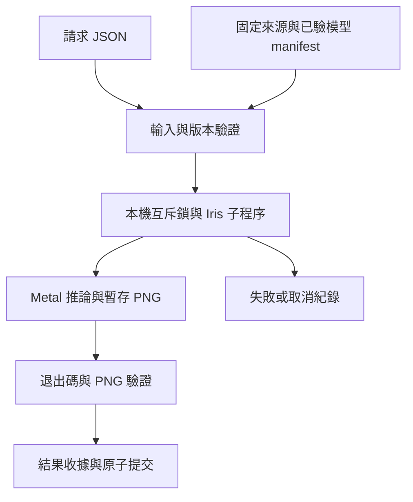

# Iris lab SDD

日期：2026-10-24。狀態：**M0 文件交付；下述 M1 runtime 設計尚未實作、建置或實機驗證。** 任務 T-0402；主線狀態見 [SUCCESS](SUCCESS.md)，工作進度見[任務板](docs/tasks/BOARD.md)。

## 1. 目的與問題

將 Iris 原生影像推論引擎變成一個可重現、可追查的本機實驗入口。使用者要知道同一份請求用了哪個模型、哪個 binary 與 backend，成功時取得有效圖片，失敗時取得有界且可判讀的結果。第一個實驗問題是：固定版本的 FLUX.2 Klein 4B 能否在 Apple Silicon Metal 路線完成這條單次 txt2img 流程，而推論不依賴 Python／PyTorch／Diffusers。

Iris 已提供主要推論能力。本項目負責固定來源、環境檢查、輸入驗證、程序生命週期及結果紀錄，不重新實作模型數學。減少 Python 推論環境只是其中一項收益；GPU libraries、模型格式、記憶體需求與平台限制仍存在。[平台與模型](docs/platform-models.md) 及[來源](docs/sources.md) 列出證據。

## 2. 範圍與里程碑

| 階段 | 交付與範圍 | 本輪狀態 |
| --- | --- | --- |
| M0 | 固定上游研究、教學整理、SDD、SUCCESS、能力入口、驗證計畫及索引；PR／CI／合併回讀 | 本輪授權範圍 |
| M1 | 本機單程序 wrapper、固定 4B distilled 模型、Metal、txt2img、PNG 與結果收據、錯誤／取消測試 | 待實作與實機驗收 |
| M2 | 逐一加入 Linux CUDA／ROCm／CPU 路線、img2img／多圖參考或其他模型 | 候選；每項另訂驗收 |

本次沒有模型下載、編譯、GPU 作業或部署。後續 M1 不包含 HTTP／MCP server、佇列、常駐服務、UI、聊天 LLM、影片、模型訓練或通用 LoRA／GGUF 支援。工作調度留給外部消費者；lab 只處理一次本機影像作業。原始碼與模型保留獨立 checkout／cache，不將上游大檔 vendor 進 monorepo。

### M0 驗收契約

這五條是 T-0402 的文件里程碑，不等同整個 lab 可用。

| AC ID | Given／When／Then | 證據入口 |
| --- | --- | --- |
| AC-01 | Given 指定 Iris 項目，When 建立 lab 規格，Then 用途、M0／M1 邊界、固定引擎與模型 revision、尚未驗證的權重內容均明確。 | 本文件、[lock](upstream.lock.json) |
| AC-02 | Given 上游固定版本，When 整理平台與模型，Then OS／backend、下載／建置／推論依賴及支援限制可分辨且附來源。 | [平台與模型](docs/platform-models.md) |
| AC-03 | Given 後續單次生圖需求，When 閱讀設計，Then 請求、結果、版本驗證、錯誤、取消與實機驗收有具體契約，未實作介面有標記。 | §4–8、[驗證計畫](docs/verification-plan.md) |
| AC-04 | Given 網路教學研究，When 閱讀來源表，Then 官方與第三方來源、查核日期、可採用內容、版本／硬體限制均可核對。 | [教學與來源](docs/sources.md) |
| AC-05 | Given 完整 M0 文件候選，When 執行文件契約／索引／連結與獨立審查，Then 無未解阻擋問題，且實際驗證範圍、PR 交付與合併回讀可以追查。 | [M0 證據](docs/evidence/m0-document-review.md)、任務板及交付 PR |

AC-05 的候選檢查先在 PR 前完成；Git 交付及合併時間以 PR 遠端狀態為準。主文件合併後，由獨立的 board-only PR 填入實際完成時間。

## 3. 固定版本與依賴

權威值放 [upstream.lock.json](upstream.lock.json)：

- 引擎：`antirez/iris.c` commit `ff97831282ecc6691710828604165da84b0616f5`。
- M1 模型：`black-forest-labs/FLUX.2-klein-4B`，revision `e7b7dc27f91deacad38e78976d1f2b499d76a294`，distilled；來源 revision 已查核，檔案內容尚未下載／驗證。
- 所有版本升級經可審查 PR 更新 lock 與相容性／實機結果；不在執行時自動追 `main` 或 `latest`。

三種依賴分開：**準備環境**需要 Git、編譯工具、平台 backend SDK／libraries 及下載器；上游 shell 下載器仍呼叫 `python3`，Python 下載器使用 Hugging Face Hub。**推論環境**需要已建好的對應 binary、模型完整目錄及必要原生動態 libraries／GPU driver，不需要 Python framework。**驗證工具**可使用 Python；上游測試還有 NumPy／Pillow 等依賴。不能用驗證環境有 Python 推導推論必須有 Python，也不能聲稱整個準備流程零 Python。

### 模型完整性契約（M1）

上游 shell 下載器使用 `resolve/main`，不能直接拿來滿足本項目的固定 revision 承諾。準備流程須使用支援指定 revision 的官方下載介面，或明確構造含固定 revision 的下載 URL，記錄實際來源與預期 digest／大小。

1. 驗證 checkout HEAD 等於 engine commit、工作樹乾淨，再建置；記錄 binary SHA-256、compiler、flags、OS／CPU 架構與 backend SDK 版本。
2. 模型以 transformer、text encoder、tokenizer、VAE 的目錄式 safetensors／config 檔案為單位；參照 shard index 展開完整檔案集合。不能只抓 root 同名單檔就視為完整目錄。
3. 準備階段產生 `model-manifest.json`，逐檔記相對路徑、位元組數、預期 digest 的 algorithm／value／來源，以及實測本地 SHA-256。[Hugging Face 官方下載文件](https://huggingface.co/docs/huggingface_hub/package_reference/file_download) 區分 Git 與 LFS 物件：LFS 權重比對來源 SHA-256；一般 Git config／tokenizer 檔比對固定 revision tree 的 Git blob OID（含 Git blob header，不是裸檔 SHA-1）。所有下載檔另算本地 SHA-256 作 receipt；排序後的 manifest 另有 SHA-256。來源 digest 缺失或不支援時明確標記，不能把下載成功寫成來源完整性已驗證。
4. 只有完整檔案清單、固定 revision、各檔來源對應演算法的預期／實際 digest 一致，才標記 `verified`。M0 lock 的 `weights_verified: false` 不能被 wrapper 接受為可執行 receipt；M1 首次正式驗收前須補完。
5. `generate` 不下載、不升級、不寫模型目錄。每次啟動至少核對已驗 manifest 及檔案內容；若將來採 cache，須另訂失效規則，不能只信可修改的檔案大小／mtime。

尚未量測下載量、磁碟高水位與記憶體峰值。模型名稱的 4B 不包含所有文字編碼器／VAE 元件；mmap 也不是量化或記憶體容量保證。

## 4. M1 架構與命令契約

以下全部是**待實作介面**。預計以 Go 標準函式庫實作薄 wrapper，直接啟動固定 Iris binary；Go 是 wrapper 建置依賴，不是模型推論 framework。正式寫程式前先確定工具鏈與 machine-readable request／result schema，沿用 repo 的 Go 規則。



| 擬定命令 | 行為 |
| --- | --- |
| `iris-lab doctor --profile <profile.json>` | 唯讀核對平台、binary receipt、模型 manifest 與輸出目錄條件；JSON 報告缺項，不自動安裝。 |
| `iris-lab generate --profile <profile.json> --request <request.json> --output-root <dir>` | 一次請求、一個子程序、一張圖片；stdout 只輸出最終 result JSON，進度與診斷到 stderr／run log。 |
| `iris-lab verify --run-dir <dir>` | 離線驗證結果收據、成功 PNG 尺寸／digest 與必要檔案，不能據此宣稱模型畫質或已使用 GPU。 |

下載與建置由明確的準備步驟完成，不藏在 `generate`。profile 是操作者提供的可信本機設定，包含 binary、模型目錄與 lock receipt 位置；請求不能覆寫可執行檔、模型路徑或任意命令列旗標。

### 請求 v1（規劃）

```json
{
  "schema_version": 1,
  "run_id": "iris-example-0001",
  "model": "flux2-klein-4b-distilled",
  "backend": "metal",
  "prompt": "A red ceramic mug on a wooden table, soft daylight",
  "width": 512,
  "height": 512,
  "seed": 42,
  "steps": 4,
  "guidance": 1.0,
  "timeout_seconds": 600
}
```

v1 嚴格拒絕未知欄位、重複 JSON keys、非有限數值及不符型別。`run_id` 是 1–64 字元 ASCII `[A-Za-z0-9_-]`，不能含路徑片段；已存在的 run 直接失敗，不覆寫或默默重跑。prompt 必須為非空 UTF-8、最多 4096 bytes；這是 wrapper 請求上限，不表示文字 encoder 一定不截斷，實際 tokenizer 行為需另記。

M1 allowlist 僅上述模型與 `metal`。`steps=4`、`guidance=1.0` 固定，不接受 base 模型參數混用。width／height 各為 64–1024 的 16 倍數，主線驗收固定 512×512；接受尺寸不代表特定硬體必然有足夠記憶體。seed 必填且為 `0..2147483647` 整數，timeout 為 `1..3600` 秒；timeout 從 Iris 子程序成功啟動時計時，包含其模型載入與生圖，不包含 wrapper 前置完整性檢查；端到端 wall_ms 另外包含該檢查。範例 600 秒是子程序上限，不是速度 SLO。第一版不含 image／mask／negative prompt／batch 參數。

wrapper 用獨立 argv 啟動 Iris，將 prompt 作為單一參數，不交 shell 解譯，不接受 `extra_args`。上游 flags 的映射以固定版本 CLI 為準，M1 測試應核對實際 argv 與模型選擇，不能只測 wrapper 自己的回應。

## 5. 執行、取消與檔案契約

同一 OS 使用者在同一 GPU 裝置上一次只容許一個 lab run。互斥鎖放在固定的使用者 cache 位置、按實際裝置資源識別，不能隨 output-root 或 profile 路徑改變而繞過；鎖只約束同一 OS 使用者的此工具協作程序，不承諾排除其他使用者或應用。採 OS 鎖，程序退出即釋放；鎖忙時回 `busy`，不建立隱藏排隊系統。

執行前核對不覆寫規則並建立專屬暫存 run 目錄。成功條件必須同時滿足子程序正常退出、輸出為可解碼 PNG、尺寸與請求一致、SHA-256 可計算；之後以同一檔案系統的原子 rename 提交最終 run 目錄。既有目標或 symlink 不可覆蓋。成功目錄包含 `request.json`、`result.json`、`image.png` 及日誌；原始 prompt／完整日誌屬本機資料，公開驗收只用合成 prompt 或明確整理過的內容。

錯誤結果保留 `status=failed` 或 `cancelled`、error code、退出／signal 資訊及診斷。失敗的暫存圖片不可標成成功 artifact；只保留有限診斷並寫入失敗收據。stdout 最終結果與落盤 result 一致；若輸出目錄不可寫，至少以 stderr 與非零 exit 表達，不能聲稱結果已落盤。程序被不可攔截終止或斷電時可能留下 `.partial`，下一次只報告殘留，不能當成功 run 或自動刪除使用者資料。

timeout 或取消只終止 wrapper 擁有的子程序群組：先正常終止，最多等 5 秒再強制終止並 reap；不按程序名稱殺掉他人作業。不得自動降低尺寸、換模型、換 backend 或重新抽 seed 來偽裝原請求成功；重試需要新 run ID。GPU／記憶體不足沿用真實錯誤及診斷，不猜測單一根因。

## 6. 結果與可重現性契約

result v1 至少包含：

| 欄位組 | 必要內容與語義 |
| --- | --- |
| 識別與狀態 | schema_version、run_id、status、error（成功時 null）、wrapper／Iris exit code；失敗也有 result |
| 來源 | wrapper source commit、engine source commit、binary SHA-256、model repo／revision、model manifest SHA-256 |
| 環境 | OS／版本、CPU 架構、GPU 型號、compiler／flags、backend SDK／driver 版本；未取得值為 null 並附原因 |
| 參數 | 請求參數快照；實際生效值僅在可觀測時填寫，否則 null；不得把請求值全數當成已觀測值 |
| backend | compiled_backend、requested_backend、effective_backend；未有可靠訊號時 effective_backend=`unknown` |
| 時間 | UTC 開始／結束、單調時鐘 wall_ms；整體含載入／檢查／輸出，若有 engine 分段時間另記來源與邊界 |
| 產物 | 成功 PNG 的相對路徑、bytes、width／height、SHA-256；失敗的 image 欄位為 null |
| 診斷 | 子程序退出／signal、timeout／取消原因、日誌位置；日誌有固定容量限制及截斷標記 |

上游可能因記憶體條件採用 CPU 路徑。`make mps`／編譯旗標、請求 metal 或程序 exit 0 均不能單獨證明每個計算階段使用 GPU。M1 首次試跑須評估固定版本可觀測訊號；無法可靠判定時仍可驗收圖片及記錄契約，但 **Metal 加速有效性的驗收保持 pending**，不能標成已證明。

重現的最低承諾是還原來源、權重、請求與執行環境。相同 seed 不保證跨 backend／硬體／compiler 逐像素一致；PNG hash 是 artifact 身分，不是跨平台畫質判準。固定同一環境時也先收集重跑結果再訂容忍範圍。第三方耗時、上游舊 benchmark 或單次均值不能轉成目標機的延遲保證。CPU RSS、統一記憶體與 GPU allocation 不混成同一個峰值欄位；沒有實際量測就記 unknown。

### 錯誤分類（規劃）

| code | 可觀察情況 | wrapper exit |
| --- | --- | --- |
| `invalid_request` | schema／allowlist／範圍不符 | 2 |
| `missing_dependency` | binary 或平台依賴缺失 | 3 |
| `source_mismatch`／`model_incomplete`／`integrity_failed` | 來源版本、模型檔案或 digest 不符 | 3 |
| `busy`／`output_exists` | 裝置鎖不可得或 run 目標已存在 | 4 |
| `process_failed`／`invalid_output`／`io_error` | 子程序失敗、PNG 不符或檔案寫入失敗 | 5 |
| `timeout` | 超過請求上限並已完成子程序清理 | 124 |
| `cancelled` | 使用者取消並已完成子程序清理 | 130 |

成功 exit 0。錯誤訊息保留根因資訊，不把所有 native errors 推定成記憶體不足；若清理不完整須明確記錄，不能沿用「已完成清理」的成功結論。

## 7. Runtime 主線驗收（尚未執行）

以下 AC 用於下一階段。實作前先在一台明確記錄 OS／晶片／記憶體的目標機完成原版參考試跑、固定驗證資料與可觀測方式；依結果補具體門檻並審查，不能執行後為了過關刪掉原 AC。

| AC ID | Given／When／Then | 本輪狀態 |
| --- | --- | --- |
| AC-101 | Given 固定乾淨 engine checkout 與已驗模型 manifest，When doctor／build preparation，Then 建置來源、平台依賴、binary 與每個模型檔案可核對，缺項在推論前被拒絕。 | pending |
| AC-102 | Given Apple Silicon 目標機與固定 4B 模型，When 512×512／seed 42／4 steps txt2img，Then 真實生圖得到可解碼且尺寸正確的 PNG，收據與 artifact 一致，並有可靠 Metal 使用證據。 | pending |
| AC-103 | Given 非法輸入、缺檔／錯 hash、已存在目標及競爭 run，When generate，Then 各案例以契約錯誤退出，既有檔案不被覆蓋，無不該啟動的推論。 | pending |
| AC-104 | Given 真實運行中的 Iris 子程序，When 取消或 timeout，Then 只清理該作業、釋放鎖、保留失敗收據，不產生成功 artifact；程序死亡殘留另行識別。 | pending |
| AC-105 | Given 同一已記錄環境，When 至少 1 次 cold 與 2 次 warm 執行，Then 來源／參數可重現，時間與記憶體有量測方法，圖片可檢查，差異與未知值如實保存。 | pending |
| AC-106 | Given 已準備 binary／模型及原生依賴，When 在不依賴 Python framework 的推論入口執行，Then 真實生圖成功，準備與測試依賴另列且未藏入 runtime。 | pending |

驗證細節見[驗證計畫](docs/verification-plan.md)。M1 全部核心 AC、必要測試／CI 與審查未完成前，`mainline: incomplete`、`usable_tag: none` 維持不變。文件 M0 完成可獨立結案，不代表 M1 通過。

## 8. 決策、風險與待驗證事項

- 首選 4B distilled：上游有直接支援，採 Apache-2.0 模型，4 steps 的單次 txt2img 範圍易固定；仍須實測記憶體與畫質，不保證任何特定 RAM 容量可用。
- 先以 CLI 子程序整合，避免先承諾常駐模型／C ABI 嵌入；代價是每次載入成本。只有實測證明載入成為瓶頸後才評估持久程序。
- backend 偵測、tokenizer 截斷、最大可用尺寸、實際記憶體峰值與重跑差異需 M1 觀測，M0 不填假數值。
- 原生 Windows 尚不在本基準支援範圍；WSL2 只是後續 Linux 路徑候選。CUDA／ROCm 要匹配 GPU、OS、driver 與 toolkit，不由「C 寫的」推導任意平台通用 binary。
- Iris 程式 MIT 不覆蓋模型授權；新模型／權重更新須重新核對其 model card 與使用條款。4B 路線不泛化成 9B 或 FLUX.3 的授權承諾。
- 本設計不承諾跨機逐像素一致、不從 mmap 推導省掉全部 RAM／VRAM、不從載入 Qwen encoder 推導有聊天服務。

變更這些決策須附需求、固定來源差異及受影響 AC；已有能力與規劃能力在 README／llms／SUCCESS 保持一致。
