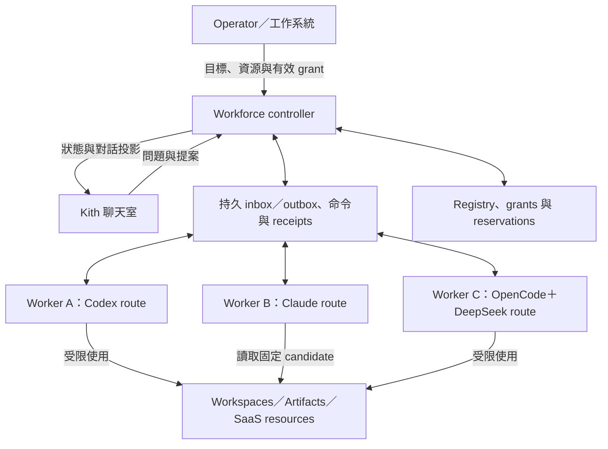
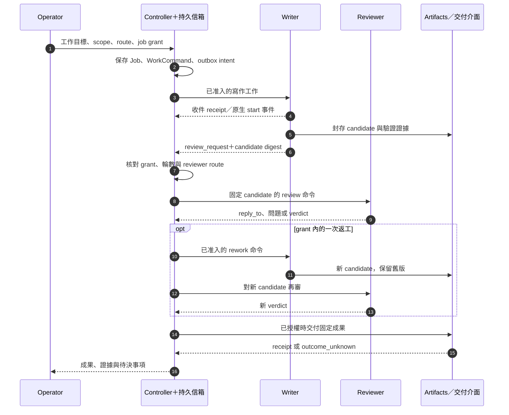
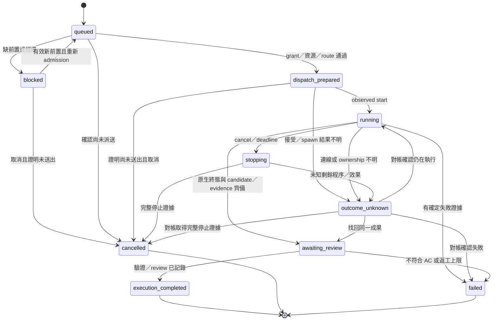

# Agent Workforce — Software Design Document

- 版本：0.1；日期：2026-10-11。
- 狀態：**Proposed / SDD-only**。本文件固定設計方向與驗收要求，沒有宣稱程式、接入、帳號配置或部署已完成。
- 範圍：單一 owner 的跨產品、多帳號數位工作者；六類原生 agent 產品，以及可由 harness 使用的 DeepSeek API。
- 讀者入口：[README](README.md)；供應商事實：[能力表](docs/provider-capabilities.md)；執行場景：[first-scenario](docs/first-scenario.md)；AC：[verification](docs/verification.md)。

## 1. 核心理念與問題

**把成熟 agent 產品當作可調用的工作能力，將持久身分、通信、資源授權與工作延續掌握在自己的控制層。** 工作者可以接收委派、提出問題、使用工具、交接成果並接受審查；產品帳號、模型、原生會話、程序和電腦可以有不同生命週期。

「像真實人類工作／二重身」在本設計中的具體意思是：有可追溯身分、職責、收件入口、工作材料、有限權限和交付責任。Worker persona 不等於自然人、SaaS 人類帳號、付款主體或安全隔離。原生 agent 的工具循環、檔案操作、skills、MCP、瀏覽器和記憶等能力，按已驗證的路線重用；本層不重寫每家產品內部的 agent loop。

需要補齊的缺口是：同一 owner 的多產品／多帳號如何分配給工作者；訊息如何成為有效工作；每次呼叫用哪份權益與哪些資源；程序中斷後怎麼找回進度；如何避免重複副作用、無限互聊與不可追蹤的費用。

### 1.1 從 Yobiru 借鑑什麼

來源固定為 [chekusu/yobiru@422f40e9497dd0a842c83e6a89a6528568706fdd](https://github.com/chekusu/yobiru/tree/422f40e9497dd0a842c83e6a89a6528568706fdd)，查核日 2026-10-11。Yobiru 以可尋址訊息、檔案 inbox、喚醒 adapter、回覆關聯與附件交接，把既有 agents 接起來；[SPEC](https://github.com/chekusu/yobiru/blob/422f40e9497dd0a842c83e6a89a6528568706fdd/SPEC.md) 與 [Codex bridge](https://github.com/chekusu/yobiru/blob/422f40e9497dd0a842c83e6a89a6528568706fdd/codex_bridge.py) 分別界定基礎 transport 與可恢復的本地 bridge。

本設計借用「薄通信層＋既有原生 agent」與「離線收件、按需喚醒」的方式。Yobiru 本機檔案 inbox 與 Grok Bot 的 Internet email 是不同東西；基礎 transport 不提供通用持久重送或 exactly-once execution。主機認證也不自動驗證同機的每個 agent 名稱。這些是新設計需要另立契約的邊界，不能因上游示例存在就宣稱整合可用。

### 1.2 本次目標與非目標

| 本次固定的框架 | 後續才執行的工作 |
| --- | --- |
| Worker／帳號／權益／資源／route 的關係 | 真實帳號清單、credential 與機器配置 |
| 訊息與工作命令分離、durable inbox/outbox | 實作 controller、daemon、CLI/API adapters |
| 會話綁定、上下文重建、恢復與停止 | 真 CLI/API smoke、故障注入、長時間運作 |
| 兩個 native agents 的工程協作場景 | 實際工單、模型費用、branch／Draft PR 操作 |
| 供應商文件查核與 route promotion gate | 帳號註冊、Cloudflare DNS／email、SaaS 接入 |

首版不提供多租戶訂閱池、任意模型反向代理、帳號買賣、通用 SaaS 註冊機器人、無界 agent 社交、全新聊天室或第二份工作完成權威。

## 2. 系統邊界與唯一權威

| 狀態／資源 | 權威 | Workforce 的責任 |
| --- | --- | --- |
| 工作目標、AC、優先序、Done | 外部工作／交付系統或 operator 的版本化工作指令 | 保存 `work_ref` 與輸入 revision，回報 candidate／evidence／acceptance_ref |
| 聊天成員、房間與歷史 | Kith 或其他 channel | 綁定 `worker_id ↔ member_id`，去重投影與接收提案 |
| 工作者、route、工作命令與本層 execution 狀態 | Workforce controller | 綁定、admission、有限協作、持久狀態與恢復 |
| 原生 session／turn | 對應 agent runtime | 保存 opaque ID 和可觀測事件；不猜隱藏的原生狀態 |
| Sandbox／隔離 Run | 選定 ExecutionBackend | 以 backend run_ref 對帳；backend 擁有執行 lease 時本層只投影 |
| 帳號權益、實際 billing、限流 | 供應商／帳號管理方 | 保存有時間戳的觀測與本地 reservation；不偽造餘額 |
| GitHub／Notion／mail 等外部副作用 | 外部服務 | 有限 ServiceAdapter、意圖／receipt／reconcile |

同一筆 dispatch 恰好選一個 ExecutionBackend。使用既有 backend 時，它擁有 process、lease 和 attempt；Workforce 不再建立競爭的執行 owner。NativeWorkerBackend 則需要自行實作下述本地程序生命週期。

### 2.1 既有元件的接合方式

**Kith** 已有 member、provider connection、runtime 類型與 quota_class，但它不是本層的工作 scheduler。[Kith v2 runtime](../../products/kith/docs/v2/03-agent-runtime.md) 與 [W6](../../products/kith/docs/v2/milestones/W6.md) 明定聊天 replay 不執行工作；目前 [runner adapters](../../products/kith/runner/adapters.ts) 的 Codex 使用 `--ephemeral`，Claude 使用 `--no-session-persistence`。因此新框架需要自己的 Inbox／WorkCommand／SessionBinding，不以 room cursor 代替 durable queue。

個人訂閱的 Kith INV-13 維持：agent mention 不能喚醒 operator_personal route。Workforce 接受 operator 另外授權的 job，再直接向已合格的 native route 排定工作；Kith 顯示真實 worker 身分與結果，不把 bot 偽裝為 operator。若將來要改 Kith 自身的喚醒契約，必須另有版本化設計與驗收，本次不修改。

**Agent Platform** 的 [SDD](../agent-platform/SDD.md) 已有 Task／Run／Attempt／Conversation、隔離、lease/fencing 與恢復。它是未來可選 backend，不要求先把現有 OpenHands／sandbox MVP 改成六產品 runtime。

**HAI Taskboard** 的 [SDD](../../products/hai-taskboard/docs/SDD.md) 擁有 Work Graph／AC／review／evidence／完成條件；其現行 Fake-only 邊界保持。對它或其他工單系統的整合使用外部 references 與 service port，不寫其 domain tables，也不把 Workforce `execution_completed` 當作對方 Done。

## 3. 工作者如何互相聊天

圖中的工作者代表邏輯身分；箭頭由可信 channel／runtime adapters 承接，不表示三個 LLM 可直接改資料庫或持有彼此的 credential。Grok、Cursor、Antigravity 都能作候選 route，與圖中的角色位置無固定對應。

工作者的「聊天」是有 `reply_to`、工作關聯和產物引用的非同步對話。一般訊息先進 inbox；只有受可信 grant 覆蓋且符合流程的意圖，才成為可花費模型額度或執行工具的 WorkCommand。

## 4. 領域模型：各自的身分與生命週期

下表是待實作契約；名稱不是已發布的 schema 或 API。

| 物件 | 主要欄位／關係 | 不能混同的東西 |
| --- | --- | --- |
| `WorkerIdentity` | worker_id、owner、角色／persona revision、能力需求、inbox address、lifecycle | 模型、產品帳號、OS process、email |
| `ProviderProduct` | vendor、產品、harness、介面家族 | 同品牌的 consumer chat、Build CLI、Bot、API 可能不同 |
| `ProviderAccount` | account_ref、owner、產品／workspace、account revision | 一個角色；憑證值不存此物件 |
| `Entitlement` | entitlement_ref、account_ref、billing_source、quota_pool_ref、期限、使用條件與證據 | 有 key 就可任意轉售；多 route 不代表多份額度 |
| `InvocationRoute` | route_id／revision、product、harness/version、model、account／entitlement、auth_mode、transport、profile、evidence | 模型名稱或任意 command string |
| `InvocationProfile` | 工具、MCP、network、可讀寫 scope、sandbox、輸出 dialect、timeout | Agent 的自我描述；必須有實際執行限制 |
| `ResourceBinding` | resource_ref、種類、owner／service principal、用途、scope、grant refs、共享／獨占模式 | 一個帳號或一台電腦就有全部權限 |
| `ServiceIdentity` | service、principal_ref、account/application/install identity、credential_ref | Worker persona 或 Internet alias |
| `OperationGrant` | grant_id／revision、issuer、subject/job、resource／route scope、操作、預算、expiry、revocation epoch | 訊息內自報的授權 |
| `CollaborationJob` | job_id、work_ref、input／AC revision、參與者、流程位置、deadline、grant | 外部工單的另一份 Done 真相 |
| `WorkCommand` | command_id、job_id、step_id、不可變輸入 digest、target worker、route_policy_ref、grant_ref | 每則聊天都可執行；receipt 等於受理工作 |
| `RunAttempt` | attempt_id、command_id、operation_id、固定實際 route／grant revision、backend run_ref、fence、觀測狀態、usage、result refs | 工作者本人、會話或業務驗收 |
| `SessionBinding` | session_binding_id、worker／purpose／job、route／account、native ID、workspace、context revision、resume evidence | 全域 latest session 或共用登入狀態 |
| `MessageEnvelope` | message_id、sender／recipients、kind、reply_to、job／command refs、body／artifact refs、expiry | 真實 sender 僅由 body 宣告；訊息本身可擴權 |
| `ContextPack` | 目標、已決事項、待做、來源／版本、candidate refs、未知項、可見範圍／預算 | 完整聊天、授權本體、不可審查的模型記憶 |
| `ArtifactRef` | artifact_id、size、SHA-256、type、ACL、retention、來源 attempt | 可任意抓取的 URL 或可變 latest 檔案 |

### 4.1 基數與分配

- 一個 owner 可以有同產品多個 ProviderAccount；每個 account 可有多種 Entitlement 和多個 ResourceBinding。LLM account 與 GitHub／Notion service identity 用顯式 binding 關聯，不要求相同 email。
- 一個 account 可服務多個 worker／route；若共享訂閱或 API billing pool，所有 route 共用同一 `quota_pool_ref` 和原子 reservation，不能各算一份完整餘額。
- 一個 worker 可有多條候選 route；**每次 RunAttempt 固定一條**。故障換帳號、模型或產品要重新 admission，建立新 attempt／session lineage，不悄悄接續原 session。
- 一個 worker 可以使用多個資源，資源也可被多個 worker 授權使用；共享 workspace 寫入仍須獨占 claim。獨立 worktree 不保證語意沒有衝突。
- SessionBinding 的 active turn 並行度為 1；worker 可以有入口 triage 與不同 job sessions，但每個 session 各有作用域。入口持久存在不要求有一條永不關閉的 LLM 對話。

### 4.2 工作者與帳號 onboarding

生命週期為 `draft → configured → verified → active → suspended → retired`。Operator 指定角色、現有帳號別名、候選 route、資源和最小 scope；可信 adapter 驗證認證、能力和權益，通過後才 active。缺失資料保持 unknown，不掃描其他帳號登入來補齊。

退役先停止新工作、排空或保存未決命令、證明相關程序停止，然後撤銷資源 grants／service tokens／mail routing binding。保留已交付成果及必要審計；別名重新分配要增加 identity revision，不能讓舊信或舊 grant 轉交新工作者。

## 5. 調用策略與能力准入

對每條 route 分別記錄三種狀態：`documentation_status`、`runtime_status`、`actual_entitlement`；初始為 `documented / runtime_unverified / unknown`。官方有文件只提升第一項。需要的能力採 `supported / unsupported / unknown`，例如 structured events、explicit resume、cancel、tool restrictions、usage、headless approvals、remote receipts；不將無法確認寫成 false 或 true。

調用方式按契約選擇，不按品牌 hardcode：

| 路線類型 | 使用方式 | 本層補的能力 |
| --- | --- | --- |
| 原生 CLI | 子程序或有界非互動執行，使用原生登入與已驗證 argv | session mapping、事件解析、process ownership、停止與恢復 |
| Agent SDK／server／ACP | 官方 agent lifecycle 介面 | 版本相容、acceptance／completion 事件、權限 bridge |
| 官方訂閱授權 API | 例如符合资格的 SIWC 路線 | scope／應用資格、帳號／workspace、API 能力與 billing pool |
| 純 model API | 付費 API key／supported cloud provider | 由自有或既有 harness 提供 agent loop、工具及 context |
| Native Bot／人工交接 | 只有已知產品入口，通用程式契約未確認 | 保持 manual_handoff，不猜測 webhook 或假裝已受理 |

詳細官方例證、CLI flags 和政策適用範圍以 [provider-capabilities](docs/provider-capabilities.md) 為準。個人 CLI 託管、訂閱授權與第三方產品中介是不同情境；CLI 技術上能啟動，不自動證明該使用方式適用。

Admission 的順序為：有效 operator/job grant → 產品／使用模式的適用證據 → 版本及所需能力 → 精確 account／entitlement → 工具／資料 scope → 配額與併發 reservation → session／workspace 相容 → 保存 dispatch intent。任一步不符合都不 dispatch；LLM 可以提出候選 route，不能自己修改 allowlist 或 grant。

Runtime adapter port 至少定義 `describeCapabilities`、`prepare`、`start`、`observe`、`resume`、`cancel`、`reconcile` 和 result normalization。方法可返回 unsupported；通用介面不承諾各供應商具備全部語意。使用 argv array，不用 eval 或拼接模型生成的 shell 命令來選 credential／binary。

## 6. 訊息、命令與有限委派

### 6.1 MessageEnvelope

V1 envelope 必填 schema_version、message_id、sender binding、recipient bindings、kind、created_at／expires_at、body 或 ArtifactRefs。工作對話另帶 job_id、correlation_id、reply_to、candidate／command refs；授權與預算只帶 reference，由 controller 讀可信紀錄核對。

Sender 由已認證的 node／service principal 與 worker binding 推導。訊息裡的 from_worker 只可與該 binding 相符，不能憑自報成為他人。首版本機用 OS／service boundary 驗證；跨節點需 mutual authentication 加 receiver/worker allowlist。Tailnet 身分可保護 transport，但共享主機上仍要區分 worker capabilities。

Kind 包含 `question`、`answer`、`review_request`、`review_result`、`result`、`notice`、`receipt`。Receipt 不能引發另一封自動回信；收到一般訊息也不預設啟動模型。內容屬不可信資料，不能覆蓋 system policy、執行設定、secret lookup 或批准狀態。

訊息預設上限 64 KiB；附件採引用，建議起始 profile 每件 20 MiB、每封總量 50 MiB。這些是可下調的設計值，實作要明確設定與測量，不能在資料超限時靜默截斷工作要求。Attachment 由可信 store 拉取，驗證 ACL／size／hash／expiry，不接受任意 URL 或路徑穿越。

### 6.2 語義與去重

1. 發件端在同一交易保存業務意圖與 outbox row；通知只是加速提示。
2. 收件端原子保存 inbox 與 dedupe 記錄，再回 durable receipt。唯一 key 為 `(authenticated_sender, message_id, recipient)`；相同 key／相同 payload digest 返回原 receipt，不同 digest 拒絕。
3. 保存收件不代表接受工作。可信 admission 另建立 WorkCommand，邏輯唯一 key 為 `(job_id, step_id)`；step_id 包含由可信流程分配的有限 iteration，agent 不可自行增加。同 key、同不可變輸入返回原 command；同 key、不同輸入拒絕，不以 payload digest 或 grant 續期創建並行工作。
4. Outbox 只對未取得持久 receipt 的訊息，以同一 message_id 有界重送。邏輯訊息 transport 可採 at-least-once；provider/tool execution 不因此可以自動重播。
5. 不保證全域排序。每個 job/session 由 command 狀態、causal refs 和單一 turn lease 決定下一步；遲到訊息不能覆蓋較新 candidate 或 workflow step。
6. Dedup tombstone 至少保留到訊息 expiry＋最大 retry window；有未知 operation 時保留至對帳／退役規則允許刪除，不能因 archive 讓舊訊息再次執行。

Receipt states 分為 `stored`、`work_accepted`、`started_observed`、`result_produced`、`externally_accepted`。最後一種只記外部 acceptance reference；缺少該證據時不得從前面任何狀態推導。

WorkCommand 的 `route_policy_ref` 固定允許的 route 集合與約束；每個 RunAttempt 固定實際 route、當次有效 grant revision 和一個穩定 operation_id。一個 command 同時最多一個 nonterminal 或 outcome_unknown attempt。Grant 續期不改 command identity；改輸入／AC 或合法返工必須由可信流程建立顯式 superseding step，先處理舊 in-flight 工作。

同意圖的 route fallback 可以是同一 command 的新 attempt，但前一實體執行須已停止、未決 effects 已完成對帳、新 route 在 policy 範圍內且重新 admission 通過。僅邏輯 terminal 不足以釋放資源。新 attempt 才分配新 operation_id 和必要的新 session lineage；對原 attempt 的重送／inspect／reconcile 全沿用原 operation_id。

### 6.3 Job-bound OperationGrant

Grant 綁定 issuer／job／worker／route allowlist、資源 scope、操作種類、input／AC revision、expiry、revocation epoch 和預算。每次由本層准入的新 agent turn，以及經可信 tool／service adapter 的敏感操作與外部交付都重查。模型不能透過轉述另一個 agent 的批准取得權限。原生 CLI 內部的工具由已驗證的原生限制、OS sandbox 與資源端 ACL 強制；不能在沒有攔截介面時宣稱 controller 逐次核准了其內部操作。

第一場景的兩個 native personal route 各自接受 operator 的工作授權；review/rework 是該授權內的有限步驟，不經 Kith mention 啟動。個人訂閱的產品使用限制另需 route admission。API entitlement class 可支援 agent 提出後續工作，由 controller 檢查 delegated scope 後接受；同樣不能擴大資源或自行更換帳號。

建議起始協作 profile：最多 12 封可引發工作的訊息、6 個已准入的 agent turns、2 次 review、1 次 rework、delegation depth 2。`agent_turn` 是本層一次 CLI invocation 或一次原生 turn/start，內部可能包含多個 `provider_model_requests`，兩者分開計數。Receipt／狀態投影不消耗新 turn，也不得形成 loop。每個 job 必須指定 deadline；有金額 cap 時同時執行。這些是待實作預設值，不是已配置帳號的實測容量；operator 可在 admission 前另選更小或明確授權的值，執行中不能由 agent 自行提高。

不透明的原生 CLI 只能強制已驗證的 invocation／併發／工具 scope／wall-time 等上限；沒有逐請求 admission hook 時，不能宣稱 provider request 或 token 的硬上限已受保證。只有提供此能力且實測通過的 API／SDK route 才可啟用 `max_provider_requests` 或精確 token reservation。預算不足阻擋新 turn，已接受的原生 turn 如何取消及其未確認費用按 §7／§10 處理。

## 7. 持久化、狀態機與重啟

### 7.1 首版部署模型

單一可信 controller 與可替換 worker processes；SQLite 保存 registry revisions、jobs、commands、inbox/outbox、dedupe、attempt intents、receipts、leases、reservations、effect intents、audit events 和 ArtifactRefs。Artifact bytes 放獨立 store。首版只允許一個 controller 寫入資料庫，使用 OS instance lock、交易和持久儲存；不宣稱多節點高可用。

常駐的是輕量 controller／收件入口與持久狀態。Idle worker 以事件或有界補掃等待，不需要 LLM 心跳或空白 prompt。通知丟失由 outbox/inbox reconciliation 補回；模型與可拋棄 workspace 依工作啟動，native session 可按支援情況休眠。

### 7.2 RunAttempt 状態

`blocked → queued` 必須重查當前 grant、期限與 route，不由舊訊息重播自動恢復。`dispatch_prepared` 若無法證明尚未送出，取消請求轉 `outcome_unknown` 並先對帳，不能直接標 cancelled。圖中的 cancelled 只證明受控執行已停止；外部副作用是否完成另由 effect state 表示。

返工是新 WorkCommand／RunAttempt，不把舊 candidate 原地改成新結果。外部交付的 `pending / applied / outcome_unknown / rejected` 狀態獨立於本圖；只有外部工作權威決定是否 Done。

### 7.3 Spawn、lease 與不明副作用

保存 `dispatch_prepared` 後才允許 start。資料庫 commit 與 OS spawn／遠端 start 不具通用原子性；worker 需記 operation_id、process incarnation、node boot identity、start evidence 和原生 session/run ID。只有 PID 不足以證明 ownership。

若已 spawn 卻未寫 receipt，控制層重啟後先 reconcile；查不到完整證據則保持 `outcome_unknown`。Lease 到期只撤銷舊 fence 發布當前狀態的資格，**不等於舊程序停止**。未有 stop proof 前不釋放其 account/session/workspace reservation，也不開替代 writer。

可由舊 worker 提供不可變證據給 reconciler，但它不能繞過 current fence 改 workflow 狀態。外部工具可能無法遵守 fence，因此不能保證它們不再產生副作用；需要隔離、撤銷可撤權能力、對帳及可能的人類判斷。

重试分三類：訊息可同 ID 重送；已確定未送出的 dispatch 可重試原 operation；provider 已接受或可能執行的 operation 只能先對帳。換 route／account 不是對帳。任何回應遺失都不直接變成「沒做過」。

### 7.4 恢復與備份

啟動時先取得 controller lock／incarnation，讀取非終態 commands 和 unresolved effects；恢復 projections 和收件狀態不執行模型。逐筆對帳 lease、process、provider receipt、artifact 與有效 grant，再允許可證明尚未開始的工作 admission。

SQLite 和 artifact store 需有一致 backup manifest（schema version、watermark、hash、保留範圍）。冷還原於新 controller epoch 啟動；舊 node 必須隔離或取得停止證據。Backup 之前已送出、但 snapshot 中缺失的外部 receipt 是未知區域，還原後不能直接重送。未證明外部對帳、artifact 完整及 grant 現況以前，只允許 read-only recovery。

## 8. Session、記憶與 context

原生 resume 需要完全匹配的 account、route/profile revision、harness version、worker purpose、workspace 和已驗證 resume 能力；以明確 native session ID 指定，不能使用全域 latest。單一 SessionBinding 同時最多一個 turn。若前一 turn 有未知副作用，不能用 resume 發新工作來掩蓋未知。

不支援 resume 或版本不相容時，先確認舊 turn 停止，建立新 SessionBinding，以 ContextPack 重建。記錄 lineage、切換原因、已完成／未完成工作；這稱 reconstruct，不假稱原生對話接續。換產品／帳號不能攜帶舊 token 或原生 session ID 作通用會話。

ContextPack 分成 worker persona／職責、job brief、固定來源、已驗證結果、待決問題及下一步。每項帶 provenance、revision、audience、有效期與大小預算；從 artifacts／工作權威重新載入必要材料。私有工具輸出先按 scope 篩選，不能把 writer 的所有登入和歷史對話複製給 reviewer。摘要不得把 unknown 變成 done，也不能成為批准來源。

持久資料類別：persona 與 capability 設定屬可版本化配置；工作意圖、操作與 receipts 屬運作狀態；可重用知識進既有知識系統；原始 transcripts／秘密屬受控或短期資料。Workforce 不建另一個全域知識庫。

## 9. 資源、SaaS 身分與秘密

| 資源類型 | Binding 要保存的能力 | 隔離／操作界線 |
| --- | --- | --- |
| Repo／workspace | repo_ref、base、read/write paths、worktree owner | 一個可寫工作區一個 writer；reviewer 看固定副本 |
| Host／sandbox／browser profile | backend、execution identity、可見工具／網路、共享模式 | 同 UID 或相同登入 profile 不構成 agent 隔離 |
| LLM account／quota | account、entitlement、quota_pool、併發與觀測 | 共享額度不重複計算；不能自動輪替帳號規避拒絕 |
| Internet email | domain alias、inbound destination、outbound binding、audience | 收件轉寄、完整 mailbox 和寄件能力分開 |
| GitHub | App installation／適用 machine or user identity、repo permissions | 綁定真實授權 principal；不按每個 worker 自動註冊人類帳號 |
| Notion | connection bot／PAT principal、page scope、capabilities | bot 與使用者權限不同；頁面範圍明確 |

Cloudflare domain alias 可作收件路由；它不能保證 SaaS 接受註冊或授予產品席位。Sending 是另一項能力，不能從 Routing 的設定推導可任意寄信。GitHub／Notion 的官方身分與帳號限制見 [能力表](docs/provider-capabilities.md)；先優先使用既有合法 service identities，需新帳號時由人依該服務流程建立。

Secret references 指向既有受控 credential store，由可信 adapter 在必要邊界解析。模型不接收 raw key、auth file、refresh token 或可任意查 secret 的工具。原生 CLI 可能必須持有登入材料，故與不可信 shell／MCP 程式碼隔離；0600 和角色 prompt 本身不算沙箱。無法達到必要隔離時該 profile 不可宣稱可處理高權限工作。

對外操作先保存 effect intent，綁 target、operation kind、subject digest、grant revision、idempotency／correlation。Receipt 遺失時以原 reference 查詢；服務不提供足夠對帳能力就保持 unknown，不能自動重寄 email、重建帳號或重建 PR。首版工程流程停在已授權的 branch／Draft PR；merge、release、部署由該工作另有授權決定。

撤權立即阻止新 admission；對已發生或 in-flight 操作只能依實際 cancel／stop／reconcile 證據處理，不能宣稱跨服務即時回滾。

## 10. 預算、用量與排程

每次 dispatch 原子取得 job、account/quota_pool、session、workspace 四層 reservation。已知硬上限先扣本地保留量，觀測使用量後結算；cumulative usage 以事件 offset 做差量，避免把整條會話累積量重複計費。

記 `observed_at`、來源、精確度、freshness、used／remaining／reset_at 和 billing account。無法觀測的 token／費用是 null，不是 0；訂閱、prepaid API、metered API 或混合 entitlement 不以品牌猜測。既有 quota collectors 僅可作唯讀 advisory inputs。

若無可靠剩餘配額，不能捏造精準的金額 admission：只有在 operator 已授權有限 agent turns／deadline／concurrency 並接受該觀測缺口時，才可用保守 profile 執行；不能宣稱嚴格 dollar cap 已受保障。原生 turn 內不可觀測的 provider requests 保持 null，不能用一次 CLI 啟動估算成一次模型請求。預付餘額不是所有 in-flight 呼叫的原子預留；本地 limits 不能超越供應商 billing 真相。

限流／額度不足進 cooldown 或 blocked，依供應商語意記錄下一個可查時間。只有已證明未送出且仍符合 grant 的步驟能排重試；不因 429、auth failure 或超時自動改 account。Quota reset 也不自動批准原 scope 外的新工作。

## 11. 可觀測性與使用者可見狀態

每筆事件關聯 work_ref、job、command、attempt、worker、route revision、message、artifact、effect operation 和 observation time。記錄原始觀測的來源與缺口；不把從聊天推測的忙碌狀態顯示成已認證 runtime 狀態。

Operator 至少能看到：工作者可用／未驗證／暫停原因；排隊與執行中工作；等待對方、等待批准或等待對帳；當前 candidate 與 review；額度 freshness 與 unknown；停止、撤權和恢复入口。Kith／其他 UI 是可重建投影，丟失顯示不丟失 command。

敏感資料按 audience 分離，公開文件和房間不展示真實 account ID、native session ID、secret paths、原始登入事件或未篩選私有檔案。訊息正文、raw trace 和 artifacts 各自設定 retention；必要的去重／effect tombstones 不隨聊天清理一起刪除。

## 12. 不變量

| ID | 必須成立的契約 | AC |
| --- | --- | --- |
| WF-INV-01 | Worker、產品、account、entitlement、resource、session、attempt 分開識別 | 01、06 |
| WF-INV-02 | 有效 job grant 和所需 route evidence 才可建立可執行命令 | 02、04、10 |
| WF-INV-03 | 訊息先持久化才回 stored receipt；重送不創第二份命令 | 03 |
| WF-INV-04 | 未知 acceptance／process／effect 不自動 replacement 或換 ID 重試 | 05、16 |
| WF-INV-05 | 一個 command 一個未結束／unknown attempt；一個 session 一個 turn；一個可寫 workspace 一個 writer；lease expiry 不等於 stop | 03、07、08 |
| WF-INV-06 | Native resume 匹配 binding；reconstruct 用新 lineage，不搬 credential | 06、15 |
| WF-INV-07 | Exit 0、stored、run success 都不等於外部工作 Done | 09、14 |
| WF-INV-08 | Kith 個人 quota gate／replay／sender 身分保持 | 12 |
| WF-INV-09 | 共用 quota_pool 原子保留；unknown cost 不當零；對話有有限預算 | 01、13 |
| WF-INV-10 | Artifact、review、驗證、approval 對同一 candidate/input revision | 09、11、14 |
| WF-INV-11 | Secrets 留可信邊界；訊息／context 不增加權限 | 04、10、15 |
| WF-INV-12 | 文檔／fake／native／API／live／soak 證據不可互相冒充 | 全部 |

## 13. 分階段開發與停止點

| 階段 | 有界成果 | 通過後能說什麼 | 仍不能說什麼 |
| --- | --- | --- | --- |
| M0：本次 SDD | 主設計、產品能力來源、第一場景、AC／故障矩陣 | 框架可審查、介面與未知項明確 | 有任一 runtime 接通、帳號已配置或已上線 |
| M1：離線控制核心 | registry、grant/admission、SQLite inbox/outbox、commands、fake backend、去重／重啟 | deterministic 契約在 fake 下成立 | 真 CLI／SaaS／付費 API 可用 |
| M2：兩條 native route | Codex writer、Claude reviewer、session／process／tool denial／恢復的逐 route 證據 | 指定環境的有界原生工作可執行 | 任意帳號／版本或六產品通用 |
| M3：第一條真實協作 | 核心：固定工單、問答／review/rework、artifact、已授權 Draft PR；可選子切片：Kith projection adapter | 核心工程流程實測成立；只有另通過 LIVE-03 才宣稱 Kith 接通 | 長時間營運、未驗證產品整合或尚未驗收的 Kith 接線 |
| M4：API 與資源擴展 | OpenCode＋DeepSeek、可行時 SIWC、Cursor／agy／Grok routes；逐條promotion；email/SaaS binding | 已驗證的指定 route 與資源可加入同一框架 | 新買方案必定可用、任意訂閱可共享 |
| M5：持久營運 | 明確時長 soak、backup/restore、撤權／退役、跨節點 auth／容量 | 實測條件下可持續運作與接手 | 未測負载的 SLA 或零失敗承諾 |

每個階段由新的明確工作範圍啟動，不因本 SDD 存在就自動開發下一階段。語言、依賴和部署方式在有實作任務時固定。先在單機證明契約與真實收益，再以實測需要決定分散式 DB／多 controller；不先擴建集群。

## 14. 驗收與尚待決定

[Verification](docs/verification.md) 是 WF-AC-01～16 和各層測試 oracle 的唯一詳細清單；[第一場景](docs/first-scenario.md) 把要求對到完整工作。M0 只做 DOC 層核對；其餘層目前 NotRun。

下一階段須固定：一張真實小工單；兩個 native routes 的實際帳號／版本／profile；可接受的訂閱使用模式與資料可見性；controller 所在受控節點與 credential boundary；job deadline／成本或 turn cap；Kith 接線能力；外部工作權威與交付授權。這些資料使用受控配置和工作指令，不補入公開帳號 inventory。

本設計選擇的理由是減少第一條流程的前置：重用成熟 agents、用現有工作系統決定目標與完成、先做單機 durable coordination，再以兩條原生路線證明協作。若原生 runtime 無法提供某項可靠 resume/cancel/identity 語意，對應能力降為 unknown／unsupported，採有界 fresh-session 或人工對帳；不把缺口藏在通用 adapter 後。

## 15. 來源與查核範圍

- Yobiru 固定 commit 與 SPEC／bridge 連結見 §1.1；此為來源研究，沒有執行上游整合。
- 相鄰公開元件讀取基準：newclear@5b4dd565d4f269ce49e08a5381eb60943312d87f；當前整合基準為 82ee784c3329acdf640c9f4867afe64cbf8b1b8a。來源狀態以各元件文件／程式為準；本次不推定線上環境狀態。
- 供應商官方來源、2026-10-11 查核結果與政策適用限制集中在 [provider-capabilities](docs/provider-capabilities.md)，實機 promotion 證據仍為未驗證。
- 設計中的物件、上限、儲存選擇、責任分工和里程碑是本項目提案；不視為供應商保證，也不代表已進行帳號／資源／部署操作。
