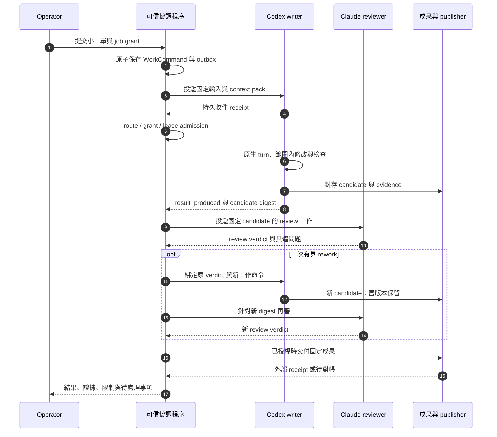

# 第一場景：一張工程工單，兩種原生 Agent，交付可審查成果

- 狀態：Proposed；僅設計，未實作、未呼叫真實 Agent、未部署。
- 設計日期：2026-10-11。
- 主規格：[SDD](../SDD.md)；驗收對照：[verification](verification.md)。

## 1. 這一輪要證明什麼

Operator 給定一張範圍清楚的小型工程工單，由 Codex 原生呼叫路徑完成修改，再由 Claude Code 原生呼叫路徑獨立審查。兩者可以提出問題、回覆、交接固定成果；控制程序重啟後仍能知道訊息是否收到、工作是否開始、哪一個候選成果待審，以及下一步是否已獲授權。

第一輪交付是一份固定的 candidate、驗收證據、review 結論與可追溯的工作歷史。任務已授權遠端交付時，再由可信 publisher 建立 branch／Draft PR。先前授權仍有效且足以涵蓋固定成果時，機械核對即可，不要求 operator 為同一範圍重複批准；沒有相應授權時，遠端操作保持待處理。

這是實作階段的目標場景，不表示本 repository 已有 worker daemon、CLI adapter、publisher 或可執行命令。Codex／Claude 的具體調用接口、方案許可、版本、登入與 tool capabilities，必須先通過該 route 的查證與實機驗收；產品名稱本身不構成可用性證據。

## 2. 固定場景與前置輸入

選擇一個已存在、operator 有權操作的 repository：修復一個可以用現有檢查重現的小缺陷，修改限制在單一 component。此設計不虛構 repository、缺陷、檔案路徑、測試命令或已存在的帳號；執行時必須以真實工單填滿以下輸入。

| 輸入 | 必須固定的內容 |
| --- | --- |
| 工作目標 | 問題、預期行為、可驗收條件及不在範圍內的修改 |
| 原始碼 | repository reference、完整 base commit SHA、允許讀寫的相對路徑 |
| 驗證方式 | 既有檢查的精確 argv／版本、預期輸出、是否允許執行專案程式碼 |
| Writer route | Codex 的產品、帳號別名、harness 版本、model、調用方式、profile revision |
| Reviewer route | Claude Code 對應的完整 route；不同 reviewer role 與唯讀 candidate workspace |
| 資源 | 獨立 writer workspace、reviewer 讀取副本、產物儲存、可信憑證／服務引用 |
| 限額 | 帳號並行限制、每次呼叫期限、job 總期限、訊息數、review 次數及已知費用上限 |
| 對外操作 | 若包含 branch／Draft PR，固定 target、base、允許操作及候選成果綁定規則 |
| 恢復政策 | 哪些 route 允許以明確 native session ID resume；哪些只能重建新 session |

第一輪預設最多兩次完整 review：初次審查加至多一次 rework 後再審。每個 native session 同時最多一個有效 turn。其他數值由 job 與主 SDD 的 cap 決定，限額不足就停止新 admission，不擅自放大或增加帳號。Agent turn 是一次 CLI invocation／原生 turn/start，可含多次 provider model requests；不透明 CLI 不宣稱具逐模型請求或 token 硬上限。

## 3. 角色與權威

| 角色 | 責任 | 不能由它自行決定的事 |
| --- | --- | --- |
| Operator | 指定目標、資源、route 集合與有效授權 | 不用以聊天中貼出憑證來完成配置 |
| 可信協調程序 | 驗證 grant、保存工作命令、分派、關聯結果、限制輪數及恢復 | 不將 agent 文字當成新的授權或已完成驗收 |
| Codex writer | 在授權 workspace 修改、檢查、提出 candidate、回覆 reviewer | 不修改 reviewer 結論或擴大可寫範圍 |
| Claude reviewer | 讀取固定 candidate、獨立判斷 AC 與證據、提出具體返工項 | 不修改 writer workspace，不替 operator 批准外部副作用 |
| Publisher／service adapter | 依固定成果和有效操作 grant 交付外部服務 | 不接受 agent 提供任意 URL、secret path 或原始 credential |
| Kith channel adapter | 顯示真實 agent 身份、澄清、進度與產物引用 | 不改 Kith quota 規則、不把聊天 replay 當工作佇列 |

Workforce 的 execution completion 只表示這次執行和產物已被記錄。若接外部工單／交付系統，工作是否 Done 由該系統依自己的 AC、review 與 completion gate 決定；本層不寫入另一個系統的 domain tables。

## 4. Job-bound grant 與訊息的關係

**SC-GRANT-01**：Operator 的授權先在可信管理入口保存，綁定 `job_id`、operator principal、允許的 worker／route、account、repository scope、profile revision、操作種類、期限、用量／輪數限制及撤權版本。Agent 收到的訊息不能替換這份權威。

**SC-GRANT-02**：兩個 agents 可以交換問題和 review 結果；新的 CLI invocation／原生 agent turn 必須由可信程序准入 WorkCommand。經可信 tool／service adapter 的操作另核對有效 grant；原生 CLI 內部操作依已驗證 profile、OS 限制與資源 ACL 執行，不能在沒有 hook 時假稱逐次被 controller 攔截。訊息中的 `grant_ref` 只是引用；caller identity 與有效授權由可信紀錄取得。

**SC-GRANT-03**：第一場景的個人 CLI 工作是 operator 所授權 job 的執行。它不經 Kith 的 agent mention 去喚醒個人訂閱，也不把 bot sender 改成人類 operator。Kith INV-13 保持原樣，投影中的作者仍是真實 worker 身份。

**SC-GRANT-04**：後續 API entitlement class 可允許明確的 agent→agent 觸發，但須符合 route 使用規則、已授權 delegation 範圍、recipient allowlist、訊息／hop／turn 上限及 job 期限。不允許因兩端可互相回覆就無限對話。

**SC-GRANT-05**：拿到 email alias、API key reference 或某個帳號名，都不自動增加資源存取權。此場景不註冊新 email、GitHub 或 Notion 帳號。

## 5. 一次完整工作如何進行

### SC-01：接收工單

可信程序驗證來源、scope、route policy 與輸入版本，在同一 transaction 保存 job／WorkCommand／idempotency 記錄／outbox intent。提交前崩潰不留下「已受理」狀態；提交後即使通知失敗，仍可由 outbox 繼續投遞。Command 以 `(job_id, step_id)` 唯一；相同 key 加相同不可變輸入返回原結果，不同輸入拒絕。Grant 續期不新增 command，一個 command 最多一個未結束或 unknown attempt。

### SC-02：送信與收信

每封訊息有穩定 `message_id`、真實 sender／recipient、`job_id`、`reply_to`／correlation、內容或 artifact digest、expiry 及剩餘輪數。接收端先保存 inbox 與去重紀錄，再回傳持久 receipt。喚醒只是「有信可處理」的提示，遺失喚醒可由有界補掃修復；不能因重送同一信啟動第二個工作命令。

大產物用有界 ArtifactRef，接收者驗證 ACL、大小、hash 和 expiry；不把原始憑證或整個私人環境包放進附件。

### SC-03：排定一次原生呼叫

Dispatcher 在啟動前再次核對 route evidence、帳號／entitlement、grant revision、期限、workspace claim、account limit 和 SessionBinding。保存 `dispatch_prepared` 與 `operation_id` 後交給 worker。未取得 runtime 的 observed start 以前，不能顯示 `running`。

保存 dispatch intent 和 OS spawn 之間沒有通用原子交易。Worker 若已 spawn 卻沒寫 receipt，恢復時必須核對可證明 ownership 的 process／native session／operation journal；核對不了就保留 `outcome_unknown`，不以新 operation ID 重啟。

### SC-04：Writer 產出候選成果

Writer 只修改分配的 worktree／workspace。工作範圍與驗證輸入版本固定；看到 base 漂移、AC 變更或 scope conflict 就提出問題並停止受影響步驟。輸出封存包括 base SHA、diff／candidate digest、實際檢查結果、未跑原因和必要產物。CLI exit 0 或模型說「完成」僅為觀測；只有原生終態與已封存的 candidate／evidence 齊備，才進入 `awaiting_review`。

### SC-05：獨立審查與往返

Reviewer 收到不可變 candidate 及匹配的 AC／policy／verify evidence，在不同 role 和只讀副本審查。它不能改寫原 evidence、把另一個 candidate 的成功檢查挪來使用，或以自己的輸出宣布外部 WorkItem Done。

澄清與返工訊息用 `reply_to`／candidate digest 關聯。每次可執行返工由可信程序驗證仍在 grant 內，建立新 WorkCommand；超出範圍只形成待決問題。第二個 candidate 保留第一個 candidate 與其 review，不原地覆寫。

### SC-06：交付與回報

必要 review 和驗證均對到同一 candidate 後，產出本次 execution 的可審查摘要。已授權外部交付時，publisher 固定 target／base／branch／candidate digest，先保存 operation intent 再呼叫外部服務；不 force-push、不自動 merge 或 deploy。遠端可能成功但 receipt 丟失時，只作讀取對帳，不能盲目重建 branch／PR。

Kith 只投影必要狀態、澄清和結果引用；歷史重放不產生模型呼叫。展示層可以重新生成，但不能以其是否顯示推斷工作是否已交付。

## 6. 原生 resume 與重建新會話

SessionBinding 最少保存 worker、role、account、route/profile revision、harness version、native session ID、workspace、已送 WorkCommand、已確認 native event／receipt、context pack revision 及最後觀測時間。帳號或 native session ID 不公開到聊天室。

| 觀測情況 | 允許的行為 | 必須保留的證據 |
| --- | --- | --- |
| 版本、帳號、profile、workspace 仍匹配，native resume 已驗證，無未知 in-flight 動作 | 以明確 native session ID 接續 | 原 binding、新 command、resume receipt；不得使用含糊的 latest／continue |
| 供應商不支援可驗證的 resume，但前一 turn 已確定停止 | 建立新 session，由 bounded ContextPack 重建背景 | 新舊 session lineage、已完成與待做工作、產物／驗證 refs；不得聲稱是原生 resume |
| 原 CLI／服務可能仍在執行，或前次副作用未知 | quarantine、inspect／reconcile；必要時等待 operator 決策 | 原 operation、可能存在的程序／遠端工作、資源 reservation；不開 replacement |
| account、provider、model 或不相容的 profile 需要變更 | 符合授權後新建 route/run/session | 變更原因、新 input／grant revision；不把新帳號接到舊 session |
| grant／credential 過期或撤權 | 停止新 admission，依已授權的停止策略收尾 | 未決工作、停止證據及未知副作用；不能把撤權當作已終止證據 |

固定入口的持久性來自可恢復的身份、信箱、SessionBinding 和工作狀態，不要求模型程序無限常駐。Idle worker 等待訊息時不必持續產生推理 turn。Provider 原生歷史只是一種資產，不能作跨產品恢復的唯一資料來源。

## 7. 第一輪必測故障

故障注入只對隔離測試資源與本次建立的程序執行。下列為未來驗收設計，目前全部 NotRun。

| 故障位置 | 正確恢復結果 |
| --- | --- |
| outbox transaction 前／後、網路發送前／後 | 沒 commit 不受理；有 commit 可按同 message ID 重送；沒有多一個 WorkCommand |
| 收件已持久化，但 ACK 丟失 | 發送端重送取得原 receipt；收件／dispatch 不重複 |
| CLI 已 spawn，但 observed start receipt 尚未保存 | 保留未知並對帳，不能看到 pending 就 spawn 第二個 CLI |
| worker lease 失聯或舊 worker 遲到回報 | 舊 epoch 不能推進 current state；未證明舊程序停止，不釋放 account/workspace reservation |
| credential／grant 在排隊或執行中過期 | 送出前再核對；停止新 admission；in-flight 結果依已發生／未知分類，不能假裝回滾 |
| Kith／其他 channel 重播同一事件 | 只更新 projection；零新 CLI/API dispatch，個人 quota gate 不變 |
| candidate 已封存、review 訊息投遞中斷 | 按同 artifact digest 與 message ID 接續，不重新跑 writer |
| 外部 branch／PR 可能已建但回應遺失 | 用既有 operation correlation 讀取對帳；保留 uncertain，不換 ID 重送 |

## 8. OpenCode＋DeepSeek 第三 route 擴展

第一條 Codex／Claude 路徑完成後，新增 OpenCode harness 使用 DeepSeek API entitlement 的有界 writer／分析工作。新增的是 InvocationRoute 和其 adapter evidence，job、MessageEnvelope、WorkCommand、ArtifactRef、review 和恢復契約保持一致。

此切片要證明：同一控制層可以區分「原生個人 CLI」和「付費 API 模型由另一個 harness 使用」。OpenCode 的版本、provider 設定、精確模型、API 使用權、token／成本 coverage、auth error、429 與工具限制須獨立驗收。API class 的 agents 可以在有效 job grant 內明確互相觸發，但不能借它轉發個人訂閱、跨帳號規避限額或放寬 Kith INV-13。

其他產品各以獨立 route 納入候選，未驗證時保持 `unverified`／`unsupported`／`unknown` 的真實狀態，不能用 generic command adapter 存在當作六產品整合證據。

## 9. 成功與停止條件

此場景的成功需要 [WF-AC-01～WF-AC-16](verification.md#2-驗收條件追溯) 中適用項有相應 evidence；本文件存在、fake 測試通過或一則聊天回覆都不足以宣布真實場景成功。

沒有可用且獲授權的 writer／reviewer route、來源或候選成果漂移、必需檢查未執行、超過輪數／期限、權限不足或未知副作用時，只停止受影響階段，保存可接續狀態。不得把故障改成較寬 profile、自動改 model／account、略過 review，或把人機聊天展示當成交付完成。

## 10. 既有 Kith 契約依據

- [Kith v2 domain](https://github.com/fallrising/newclear/blob/5b4dd565d4f269ce49e08a5381eb60943312d87f/products/kith/docs/v2/01-domain.md)：BR-43 與權限矩陣，個人 quota 只有 operator 可以喚醒。
- [Kith v2 runtime](https://github.com/fallrising/newclear/blob/5b4dd565d4f269ce49e08a5381eb60943312d87f/products/kith/docs/v2/03-agent-runtime.md)：runtime、外部 client 邊界與 replay 規則。
- [Kith runner adapters](https://github.com/fallrising/newclear/blob/5b4dd565d4f269ce49e08a5381eb60943312d87f/products/kith/runner/adapters.ts)：既有 Codex ephemeral／Claude no-session-persistence 與第一場景所需持久 SessionBinding 的差別。
- [Kith W6](https://github.com/fallrising/newclear/blob/5b4dd565d4f269ce49e08a5381eb60943312d87f/products/kith/docs/v2/milestones/W6.md)：離線期間 mention 的 replay 不執行。Workforce 沒有在本次修改這些契約。
