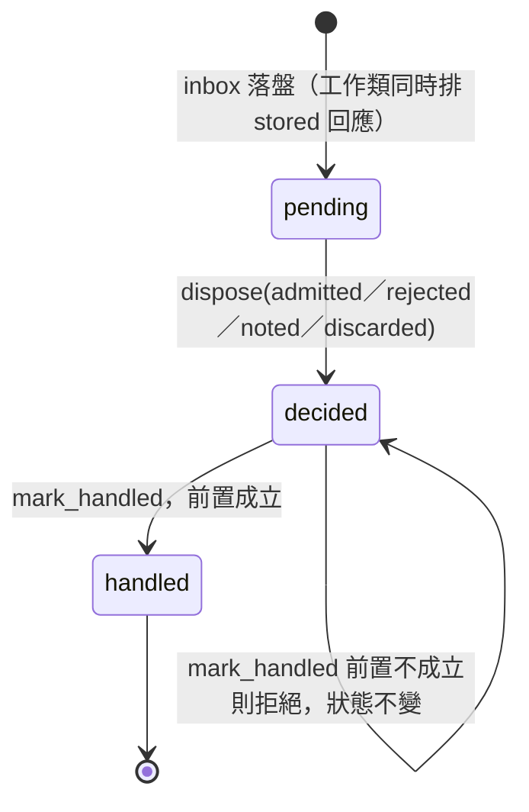
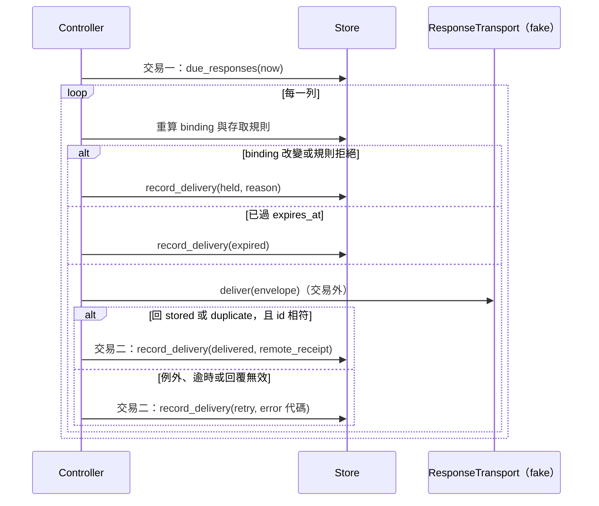

# XN 第一片技術設計：協議回應、處理狀態與存取規則（單機）

- 狀態：**設計已定（owner 2026-10-20 依建議採納 §10 各項），未實作**。合併本頁與 [verification §12](verification.md#12-xn-第一片fake設計中) 後，即可依任務板開始實作。
- 範圍：[跨節點傳輸](cross-node-transport.md) §4 的 XN-01、XN-03、XN-04、XN-06，落在現有 M1 控制核心（Python 3.11 標準庫、SQLite、單一可信 controller、fake transport）。
- 不做：XN-02、XN-05、XN-07；任何真實網路、Tailscale、daemon、帳號或部署；不改 SDD 的不變量與里程碑。
- 任務：desk T-0366；技術任務在 [tasks/BOARD.md](tasks/BOARD.md)。
- 對照的程式基準：newclear `main`@4423245（`storage_base.py`、`store.py`、`runtime_store.py`、`controller.py`）。

## 1. 現況與缺口

| 現有行為（M1） | 程式位置 | 與 XN 的缺口 |
| --- | --- | --- |
| `receive_message` 以 `(sender, message_id, recipient)` 去重並回 `stored` receipt；receipt 只回傳給呼叫端，不持久投遞 | `store.py` `receive_message` | XN-01：receipt 本身沒有 outbox，回執丟了發件方就只剩逾時 |
| `inbox` 表沒有「已處理」欄位；`inbox_rows()` 一律回 `state: stored` | `storage_base.py` DDL、`store.py` `inbox_rows` | XN-03：無法表達「已處理」，也就無法要求先有結果 |
| `kind` 是任意非空字串，`receipt` 也會進普通 inbox | `store.py` `_validated_envelope` | XN-04：協議回應和工作訊息混在一起 |
| `Controller.receive` 只核對 envelope sender 等於已認證 sender，沒有存取規則 | `controller.py` `receive` | XN-06：沒有 deny、沒有規則版本 |
| 既有 `outbox` 有 `receipt_id` 欄位作 ACK，沒有重試計數、期限或暫停狀態 | `storage_base.py` DDL | XN-01 需要的重試邊界與暫停原因不存在 |

M1 目前沒有喚醒機制，也沒有網路 transport。本片的「不喚醒」以「零 backend 呼叫、零 command、零 inbox 列」驗證；「投遞」以注入的 fake transport port 驗證。

## 2. 設計決定

| ID | 決定 | 理由 |
| --- | --- | --- |
| D-1 | 協議回應用**新表**（`protocol_outbox`、`protocol_inbox`），不擴充既有 `outbox`／`inbox` | 既有表的語意、測試與 WF-AC-03 不變；協議回應有自己的生命周期與重試欄位 |
| D-2 | 處理狀態用**新表** `inbox_disposition`，一則 inbox 訊息最多一列 | 不改既有 `inbox` 欄位；決定、結果連結與已處理時間集中一處 |
| D-3 | 存取規則存在既有 `records` 表，`kind="access_policy"`、`key="local"`，沿用版本化 `put_record` | 不新增表；revision 單調、審計沿用 `record.put` |
| D-4 | 沒有存取規則時維持 M1 現況（`legacy_open`），並寫審計；一旦安裝規則就不能移除，只能替換 | 升級不改變既有行為，也就不擴權；跨節點 adapter（第二片）必須在有規則時才允許啟用。owner 2026-10-20 已採納 |
| D-5 | 回應的 message_id 由 `(原 receipt_id, state)` 決定，同一狀態最多一封；`seq` 在同一交易內取該 receipt 的最大值加一 | 固定 ID 讓重送冪等；`seq` 讓收方判斷新舊 |
| D-6 | 本片回應只帶結構化欄位，不帶模型產生的文字 | 避免回執夾帶未審內容；結果正文走既有 ArtifactRef |
| D-7 | 投遞在交易外呼叫 transport，前後各一個交易記帳，沿用 `dispatch` 的模式 | 不在持有 SQLite 鎖時做 I/O；回應遺失時以同 ID 重試 |
| D-8 | Schema 從 `user_version=1` 升到 `2`，只新增表 | 舊程式開到新資料庫會因版本不符而拒絕（fail closed）；新程式開舊資料庫只建新表 |

## 3. 資料模型

```sql
-- user_version 2：只新增，不改既有表
CREATE TABLE IF NOT EXISTS inbox_disposition (
  receipt_id   TEXT PRIMARY KEY REFERENCES inbox(receipt_id),
  disposition  TEXT NOT NULL CHECK (disposition IN ('admitted','rejected','noted','discarded')),
  command_id   TEXT REFERENCES commands(command_id),  -- 只有 admitted 必填
  reason       TEXT,                                   -- 只有 rejected／discarded 必填；短代碼
  decided_by   TEXT NOT NULL,                          -- 可信 operator
  decided_at   REAL NOT NULL,
  handled_at   REAL                                    -- NULL＝未處理
);

CREATE TABLE IF NOT EXISTS protocol_outbox (
  response_id       TEXT PRIMARY KEY,          -- "rsp:" + sha256({receipt_id, state})
  receipt_id        TEXT NOT NULL REFERENCES inbox(receipt_id),
  state             TEXT NOT NULL,              -- 見 §4 回應狀態
  seq               INTEGER NOT NULL,
  recipient         TEXT NOT NULL,              -- 原訊息的已認證 sender
  recipient_binding TEXT NOT NULL,              -- JSON 快照，見 §5.1
  envelope          TEXT NOT NULL,              -- 固定內容，重送逐位元相同
  delivery          TEXT NOT NULL DEFAULT 'pending'
                    CHECK (delivery IN ('pending','delivered','held','expired')),
  attempts          INTEGER NOT NULL DEFAULT 0,
  next_attempt_at   REAL NOT NULL,
  expires_at        REAL NOT NULL,
  last_error        TEXT,                       -- 短代碼，不存遠端錯誤正文
  hold_reason       TEXT,
  remote_receipt    TEXT,
  UNIQUE (receipt_id, state),
  UNIQUE (receipt_id, seq)
);

CREATE TABLE IF NOT EXISTS protocol_inbox (
  response_id     TEXT PRIMARY KEY,
  sender          TEXT NOT NULL,                -- 已認證 sender
  for_message_id  TEXT NOT NULL,                -- 我方原訊息的 message_id
  state           TEXT NOT NULL,
  seq             INTEGER NOT NULL,
  payload_digest  TEXT NOT NULL,
  envelope        TEXT NOT NULL,
  received_at     REAL NOT NULL,
  UNIQUE (sender, response_id)
);
```

上限：回應 envelope 走既有 `_json` 的 64 KiB／深度 40 限制；本片回應 body 實際只有幾個欄位。

## 4. 狀態與對應

### 4.1 回應狀態

回應狀態沿用 [SDD §6.2](../SDD.md#62-語義與去重) 的 receipt states，加上負面終態：

| 回應 state | 何時產生 | 對應 |
| --- | --- | --- |
| `stored` | 工作類訊息首次落入 inbox（同一交易） | §6.2 `stored` |
| `work_accepted` | disposition 記為 `admitted` | §6.2 `work_accepted` |
| `rejected` | disposition 記為 `rejected` | 新增負面終態 |
| `result_produced` | 連結 command 的最新 attempt 進入 `awaiting_review` 或 `execution_completed` | §6.2 `result_produced` |
| `failed` | 最新 attempt 為 `failed` | RunAttempt `failed` |
| `cancelled` | 最新 attempt 為 `cancelled` | RunAttempt `cancelled` |
| `outcome_unknown` | 最新 attempt 為 `outcome_unknown` | RunAttempt `outcome_unknown` |

`started_observed` 不在本片產生（需要 backend 觀測事件，留待之後）。`externally_accepted` 永遠不由 workforce 發出：外部 Done 只屬於外部工作權威（WF-INV-07）。

`outcome_unknown` 之後若 attempt 對帳成 `awaiting_review`、`failed` 或 `cancelled`，會再發一封對應狀態的回應（seq 更大），等同 Yobiru 的 late result。同一 state 不會發兩次。

### 4.2 訊息分類

| `kind` | 類別 | 進 `inbox`？ | 需要回應？ | 可用的 disposition |
| --- | --- | --- | --- | --- |
| `receipt` | 協議回應 | 否，進 `protocol_inbox` | 否 | 無（不能 dispose） |
| `notice` | 通知 | 是 | 否 | `noted`、`discarded` |
| 其他（含缺少 `kind`） | 工作類 | 是 | 是 | `admitted`、`rejected`、`discarded` |

缺少 `kind` 一律當工作類，fail closed。升級前已存在、`kind="receipt"` 的舊 inbox 列只能 `discarded`。

### 4.3 處理狀態



`mark_handled(receipt_id)` 的前置（XN-03）：

| disposition | 前置 |
| --- | --- |
| `noted`、`discarded` | 只要 disposition 已持久保存 |
| `rejected` | `rejected` 回應已在 `protocol_outbox` |
| `admitted` | 連結 command 的最新 attempt 在 {`awaiting_review`、`execution_completed`、`failed`、`cancelled`、`outcome_unknown`} 之一，且該狀態對應的回應已在 `protocol_outbox` |

「已在 `protocol_outbox`」指已持久保存，不要求已送達（送達另由 `delivery` 欄位追蹤）。

## 5. 介面

### 5.1 存取規則（新模組 `access.py`，純函式）

```python
Policy = {"revision": int, "allow": list[str], "deny": list[str]}
# 規則語法（本片）：
#   "worker:<worker_id>"  比對已認證 sender 字串
#   "role:<writer|reviewer>" 比對 registry 中該 worker 的 role
# 保留前綴 "node:"、"tag:" 在本片 put 時拒絕（StoreError），避免存入無法評估的規則。

def normalize_policy(raw) -> Policy          # 無效則 raise AccessError("invalid_policy")
def evaluate(policy, sender, registry) -> tuple[bool, str]
    # 1. policy 無法正規化 → (False, "invalid_policy")
    # 2. 任一 deny 規則命中，或 deny 規則需要的 registry 資料缺失 → (False, "denied")
    # 3. 任一 allow 規則命中 → (True, "allowed")
    # 4. 其他 → (False, "not_allowed")
def widens(old, new) -> list[str]            # 新增的 allow 或移除的 deny；空表示沒有放寬
```

`recipient_binding` 快照：`{"recipient": sender, "worker_revision": <registry 中該 worker 的 revision 或 null>, "policy_revision": <當時規則 revision 或 null>}`。

### 5.2 Store（新 mixin `ProtocolStore`，加入 `Store` 的 MRO）

| 方法 | 行為 |
| --- | --- |
| `receive_protocol_response(sender, envelope, recipient, *, now)` | 只收 `kind="receipt"`；`reply_to` 必須對應一列 `outbox`：其 `message_id` 等於 `reply_to`、`sender` 等於本次 `recipient`（我方）、`recipient` 等於本次已認證 sender，否則 `ConflictError("uncorrelated_response")`；同 ID 同內容回原列，不同內容衝突；較小 `seq` 晚到只保存不覆蓋「最新」；不寫 `inbox`、不寫 disposition |
| `latest_response(for_message_id, sender)` | 回傳 `seq` 最大的一列 |
| `enqueue_response(receipt_id, state, *, binding, now, expires_at)` | 冪等；`(receipt_id, state)` 已存在就回原列 |
| `due_responses(now, limit)` | `delivery='pending' AND next_attempt_at<=now`，依 rowid |
| `record_delivery(response_id, *, outcome, remote_receipt=None, error=None, now)` | `outcome` 為 `delivered`、`retry`、`held`、`expired` 之一 |
| `put_disposition(receipt_id, disposition, *, command_id, reason, operator, now)` | 一則訊息只能決定一次；同值重送冪等，不同值 `ConflictError` |
| `mark_handled(receipt_id, *, now)` | 依 §4.3 檢查前置；不成立 `StoreError("handling_precondition")` |
| `pending_inbox()` | 未 `handled` 的 inbox 列 |

`Store.receive_message` 只加兩項拒絕：`kind="receipt"`（`StoreError("protocol_kind")`），以及 `reply_to` 指向 `protocol_inbox` 的回應 ID（`StoreError("reply_to_protocol_response")`）。它**不**自動排 `stored` 回應，回傳值與審計也不變：既有 `test_store_core.py` 直接呼叫它並斷言只有一筆 `inbox.receive` 審計，這個契約保留。排回應的責任在 Controller（§5.3）。

### 5.3 Controller

| 方法 | 行為 |
| --- | --- |
| `receive(envelope, *, authenticated_sender, recipient, replay=False)` | 先評估存取規則（有規則時）；拒絕寫 `access.deny` 審計並 raise `AccessError`，不寫其他表。`kind="receipt"` 轉 `receive_protocol_response`。工作類訊息在**同一個 Store 交易**內呼叫 `receive_message` 與 `enqueue_response(..., "stored")`，任一步失敗整筆回滾；重送時兩者都冪等 |
| `put_access_policy(policy, *, authenticated_operator, allow_widen=False)` | operator 必須在 `trusted_issuers`；`widens(old, new)` 非空且未 `allow_widen` → `ConflictError("policy_widen_requires_ack")`；首次安裝不算放寬；不提供刪除 |
| `dispose(receipt_id, disposition, *, authenticated_operator, command_id=None, reason=None)` | 寫 disposition；`admitted` 時 command 必須存在；同交易排入 `work_accepted` 或 `rejected` 回應 |
| `settle_inbox(*, limit=50)` | 對每則 `admitted` 未處理訊息，讀最新 attempt；若在 §4.3 的集合內，排入對應回應並 `mark_handled`；`noted`、`discarded`、`rejected` 直接 `mark_handled`；不呼叫 backend |
| `flush_responses(*, limit=20)` | 見 §6；需要注入 `response_transport` |

`Controller.__init__` 新增可選參數 `response_transport=None`。沒有注入時 `flush_responses` 拒絕執行，不默默略過。

## 6. 投遞流程（XN-01）



- 退避：`next_attempt_at = now + min(60, 2 ** min(attempts, 6))` 秒。
- 上限：`attempts` 達 20 次轉 `held`（`retry_exhausted`）；超過 `expires_at` 轉 `expired`。`expires_at` 取原訊息的 `expires_at` 加 24 小時。
- `held` 只能由可信 operator 呼叫 `release_held_response(response_id, *, authenticated_operator)` 重新快照 binding 後回到 `pending`；不自動恢復。
- `ResponseTransport.deliver(envelope) -> {"status": "stored"|"duplicate", "receipt_id": str}`。任何其他回傳視為未確認，記 `retry`，不換 ID。
- 送出後、記帳前崩潰：重啟後該列仍是 `pending`，以同一 envelope 重送，對端依 `(sender, message_id, recipient)` 去重。

## 7. 審計與故障注入點

新增審計 kind：`access.policy`、`access.deny`、`access.legacy_open`（每個 controller incarnation 首次 receive 時寫一次）、`protocol.enqueue`、`protocol.deliver`、`protocol.hold`、`protocol.receive`、`inbox.dispose`、`inbox.handled`。審計 payload 只放 ID、狀態與短代碼，不放 body。

新增 `_check_fault` 點：`disposition_before_commit`、`response_before_commit`、`protocol_inbox_before_commit`、`delivery_after_send`（transport 已回、記帳前）。

## 8. 遷移

1. `StorageBase.__init__` 接受 `user_version` 為 0、1、2；`DDL` 加入 §3 三張表；完成後設為 2。
2. 不回填：升級前的 inbox 列沒有 disposition（顯示為未處理），也不補發 `stored` 回應，避免一次湧出大量回執。
3. 升級前 `kind="receipt"` 的 inbox 列保留原樣，只能 `discarded`。
4. 舊版程式開到 `user_version=2` 會因既有的版本檢查而拒絕開啟；不提供降級。

## 9. 對應的不變量

| 設計 | SDD 不變量 |
| --- | --- |
| 回應固定 ID、同 ID 重送；回應不觸發工作 | WF-INV-03、WF-INV-04 |
| `mark_handled` 綁定 attempt 狀態；`outcome_unknown` 不當成功 | WF-INV-04、WF-INV-07 |
| 不發 `externally_accepted` | WF-INV-07 |
| 存取規則只決定能否落盤，不產生授權；工作仍需 grant | WF-INV-02、WF-INV-11 |
| 新表與審計不保存秘密或 body | WF-INV-11 |
| 文件、fake 證據分層 | WF-INV-12 |

## 10. owner 決定（2026-10-20：全部依建議）

| 事項 | 決定 |
| --- | --- |
| D-4：沒有存取規則時 | 維持 M1 現況（`legacy_open`），寫審計；安裝規則後不能回到沒有規則 |
| binding 變更 | 保守：recipient 的 worker revision 或規則 revision 一變就 `held`，由可信 operator 放行 |
| 重試邊界 | 2 秒起倍增、上限 60 秒、最多 20 次；`expires_at` 為原訊息期限加 24 小時 |
| `notice` | 不回應 |
| `settle_inbox` | 本片只提供手動呼叫；排程等第二片有 daemon 再定 |

## 11. 實作順序與規模

詳見 [tasks/BOARD.md](tasks/BOARD.md)。每張預期 30 分鐘內，順序：schema 與 `ProtocolStore` → `access.py` → `receive` 分流與存取檢查 → disposition 與 `settle_inbox` → `flush_responses` 與 fake transport → 文件與 m1／verification 回填。每張都先寫帶 XN-AC 編號的失敗測試。
