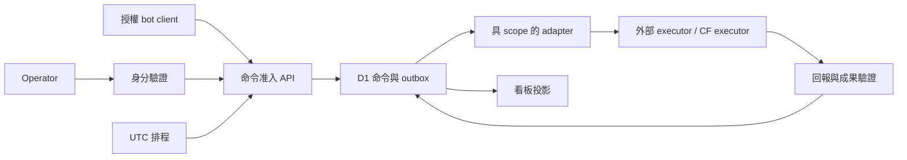

# Cloud Lab — 設計總綱

> 下文保留 M0 設計基線。已授權 M1 開發的實作範圍、協定差異與限制見 [M1 實作契約](docs/m1-implementation.md)；M0 提案不代表所有 operation 已實作。
歷史基線：0.1 proposal，2026-10-26的M0設計。下文描述當時提案；後續M1已有實作與部署，當前狀態以[SUCCESS](SUCCESS.md)與[方向調整](docs/direction-review.md)為準。

## 1. 目標與使用情境

服務單一 operator：把分散的 CF 工具、運維操作與 agent 能力放進共同知識樹，提供一致的任務入口、觀測與成果導航。能力可獨立演進及部署，按需要接 VPS、homelab 或 CF 執行器。

| 情境 | 輸入 | 可觀察結果 | 目標階段 |
| --- | --- | --- | --- |
| 查資源與健康 | 手機開看板或 bot 查詢 | 帶來源及觀測時間的資源／服務狀態 | M1 |
| 非同步唯讀檢查 | 指定資源＋已登記 Recipe | 命令 ID、執行進度、驗證結果、成果 | M1 |
| 定時檢查 | UTC schedule＋同一 Recipe | 每個排程時刻可追溯且去重的命令 | M1 |
| 受控變更 | 固定操作、參數及所需批准 | 執行證據、postcondition、失敗／未知處理 | M2 後獨立 gate |
| agent 工作 | 有界目標、執行 profile、成果要求 | 外部平台 run reference、進度及驗證連結 | M2 後獨立 gate |
| 生成小工具 | 模板＋schema＋排程／API／看板設定 | 可審閱程式、測試與部署 plan | M3 後；不自動部署 |

## 2. 本次範圍

M0 交付知識樹、模組責任、介面語義、來源映射、遷移／封存條件、分期驗收及 repo 導航。沒有伺服器程式、D1 migration、Wrangler 部署設定、排程啟用或帳號變更。

第一個 runtime milestone 是一台節點、一種唯讀 Recipe、一個授權 operator／bot client、一個看板，證明閉環及失聯行為。主機管理、LLM CLI、跨產品工作完成權威、任意 shell、完整 observability storage、通用 plugin marketplace 不屬 M1。

## 3. 知識樹與目錄原則

[知識樹](docs/knowledge-tree.md)以領域 → 能力 → 契約 → 實作 → 證據連接。能力使用穩定 ID，來源採 reference，不複製既有專案的可變狀態全文。

目標程式布局是規劃，M0 不建立空 runtime skeleton：

```text
platform/cloud-lab/
  docs/          知識樹、設計決策、驗收、來源與遷移
  contracts/     外部介面與行為契約
  core/          經實際使用證明可共用的准入／協定邏輯（後續）
  modules/       inventory、observability、automation（後續）
  apps/          控制台及經 gate 遷入的應用（後續）
  adapters/      外部主機、workload、agent、事件服務（後續）
  recipes/       已審閱操作模板及驗證定義（後續）
```

每個部署單位保留自己的 schema ownership、機密引用、配額與 release boundary。程式位置的集中不代表應共用資料庫、session、簽章金鑰或全部 bindings。

## 4. 責任與資料流

[架構文件](docs/architecture.md)定義唯一寫入者。Cloud Lab 擁有命令准入、路由及結果證據索引；既有 executor 擁有原生工作生命週期。看板只投影，bot 只作具權限的 caller。資料流：



M1 可用持久 outbox＋runner HTTPS polling。Queues 是後續可選傳輸，Workflows 是多步驟流程的可選 driver；兩者不能直接宣布外部副作用成功。詳見[命令契約](contracts/commands-runs.md)。

## 5. 設計決策

| ID | M0 決策 | 理由與後續 gate |
| --- | --- | --- |
| ADR-01 | 先集中導航、契約與責任，再搬程式 | 每個來源保留現有使用路徑；切換依遷移證據 |
| ADR-02 | 命令／外部 run／工作驗收分層 | 避免 D1、Workflows、外部平台競爭同一狀態；外部 Done 保持外部權威 |
| ADR-03 | M1 先用 outbox＋polling；不強制 Queues／Workflows | 與 Edge Ops 現行 D1 決策相容；引入新 driver 前明訂恢復及去重 |
| ADR-04 | 核心只接受已登記的 typed Recipe | 模型產生提案；權限、批准、參數與執行驗證由確定性程式處理 |
| ADR-05 | CF 與外部執行器可替換的是介面，能力可不同 | 不以抽象掩蓋程序、檔案、停止、恢復或成本限制 |
| ADR-06 | Kith 先維持聊天邊界 | 既有 no-management-tools／replay 契約不改；調度接入需獨立 ADR |
| ADR-07 | 公開框架與私人部署分開 | 只引入通用程式及 synthetic fixtures；私有來源先經公開適用性審閱 |

## 6. 不變量

- 同一資源與操作同時只有一個執行 authority；adapter 不能藉主機或服務名稱推導權限。
- command retry、queue redelivery、事件 replay 不建立新的未授權副作用。副作用是否發生不明時保留 unknown，先對帳。
- 取消請求、租約到期、逾時與程序停止證據分開；沒有證據不得宣稱 stopped／safe-to-retry。
- 登入成功不等於有操作權。bot、scheduler、runner 的 scopes 各自受限，M1 無變更主機的能力。
- 每個 run 有期限、輸出／成果上限、觀測時間與來源版本。沒有估算依據的成本記 unknown。
- 舊專案的歷史測試只證明當時範圍；遷入後重新取得新路徑及組合行為的證據。

## 7. 驗收及尚未決定事項

[SUCCESS](SUCCESS.md)列出文件 AC 與 runtime AC；[驗收計畫](docs/verification.md)給出故障場景。M0 通過只表示設計可審閱及相互一致。

實作開始前須固定：M1 target runner／身份 provisioning、實際 CF 套餐及容量預算、資料保存期限與備份目標、依賴及工具版本。這些不阻擋本次文件設計，也不以預設值冒充已批准環境。
