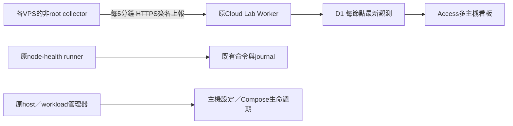

# 多VPS主機 agent：來源選擇與最小接入

狀態：CA文件設計，尚未實作多節點telemetry、安裝或變更授權。Owner要求確認現有agent、查active repo可沿用設計，並把CF資源整理成用途目錄。[目前工具映射](service-catalog.md)與本頁共同完成這輪來源查核；不是全VPS已受管的聲明。

## 現在確實有什麼

2026-11-02 UTC本機唯讀systemd查核：原runner為active/running、NRestarts=0。這只證明該次服務程序存在，不能代替所有任務成功、其他VPS連線或未來存活。runner／scheduler原期限仍是11月5日，沒有續期。

[Python runner](../adapters/node-health/README.md)是確定性系統agent：非root、向外HTTPS領取固定node-health工作，讀取load1／CPU數／根磁碟可用比例，持久化journal後回報。它不執行LLM，也不依賴瀏覽器開著。控制面目前有全域單一active命令索引、固定health-minute排程及單一resource scope；[claim](../apps/control/worker/index.mjs)先取全域命令再核scope。把相同身分／設定複製到多機會混淆節點並互相阻擋，不能作為擴展方法。

## Active來源與成熟度

GitHub連線完整分頁仍為64repo，11未封存；這裡把archived=false作active候選，不表示正在維護、部署或帳號全部repo均可見。根README／技術索引篩選後深入主機相關來源；不是11repo每個檔案的全面審計。公開newclear查核基準為`90191b1b81c86c5f044d6caf2511f635ffd4b715`，刷新main後相關Cloud Lab／Edge Ops／Fleet程式無差異。私人來源commit／檔案證據另存，公開只列角色。

| 來源 | 已核對的實作／設計 | 本輪採用與限制 |
| --- | --- | --- |
| Cloud Lab node-health | 真Python collector、outbound runner、HMAC／grant、journal與已部署Worker | 沿用Python標準庫、現有HTTPS驗證及單節點命令功能。多機觀測新增獨立資料通道，不把每筆樣本變成command。 |
| [Edge Ops agent SDD](../../edge-ops/docs/sdd/03-agent.md) | collector／courier／execd分權，CPU／memory／disk／net、boot／seq、null與離線語義；[STATUS](../../edge-ops/docs/STATUS.md)仍為契約＋loopback mock，沒有真collector接線 | 採其指標與權責設計，先做唯讀collector；不把mock公開部署，不繼承尚未完成的enrollment或遙控執行器。 |
| [公開Fleet](../../../specs/fleet/SUCCESS.md) | 真Go outbound agent、獨立heartbeat、desired／actual及Compose reconcile；[loop](../../../specs/fleet/internal/agentloop/loop.go)／[facts](../../../specs/fleet/internal/agentloop/facts.go)已有主機資訊採樣 | 作行為參考。它掌握Docker工作負載，不適合整包當無特權監控agent。facts部分讀取失敗回0，heartbeat使用預設Docker欄位；不能直接繼承為可信健康指標。完整CF入口驗收仍pending。 |
| P-HOST：私人主機管理器 | 實作本機Unix socket唯讀Docker摘要與SQLite觀測；另有受控SSH／特權初始化設計及有限平台驗證 | 保留主機設定／初始化權威；沒有現成全機OS telemetry或outbound fleet服務，不能當通用監控安裝器。 |
| P-WORKLOAD：私人工作負載管理器 | 已有一次性agent report、限定目標／期限／request ID、原子匯入；明示無常駐daemon、heartbeat或自動認證傳輸 | 借鑑有界報告、來源時間與重送語義。request ID不等於身分認證；不複製其controller。它與公開Fleet是不同實作。 |
| P-KNOWLEDGE：私人架構筆記 | 建議先做能力／狀態投影，維持host與workload權責，CLI／MCP／UI共用操作邊界 | 支持本輪read model方向，筆記不是執行或部署證據。 |
| Kith／Agent Platform／Workforce | 對話runner、原生agent run／sandbox／工作協作 | 不作主機監控daemon；原run／stop／cleanup／Done權威不轉移。 |

其他active根入口屬個人頁、研究／執行／靈感帳本、流程、遊戲、模型gateway及媒體工具，未找到應優先採用的主機agent入口。未深讀私人日記或無關內容。已退役的host／mesh前身僅由索引辨識，未審其實作；不能憑歷史binary distribution字樣直接復用updater。

## 決定：沿用小agent，先加多機唯讀觀測

使用現有Python 3.11+標準庫能力，新增可獨立運行的host telemetry模式／入口；不要把Docker socket、sudo或主機修改權加入collector。現有node-health recipe、command journal及全域單槽保持原語義。來源仍由Cloud Lab維護；不搬Edge Ops或私人程式，不建立第二個host／workload controller。

每台VPS只需出站HTTPS。Cloudflare Access維持在雲端入口；不要求為每台collector建立Tunnel或開入站管理埠。Access機器准入與應用簽名分開核對，每台獨立credential／principal／node ID及generation，不能共用現有runner憑證。機器只有自己節點的telemetry:publish，沒有command提交、主機修改或其他節點寫入權。

第一階段由operator核對節點並配置身分；不做公開自助註冊或自動更新系統。人類多機讀取必須有明確node allowlist的telemetry:read授權；現有單節點commands:read及inventory:read不自動變成全fleet權限。新scope與實際安裝目標待具體上線計畫，這份設計不改原grant或期限。

## 最小介面草案

以下是未實作的新契約，不能用現有API呼叫：

| 介面 | 身分／用途 | 必要語義 |
| --- | --- | --- |
| POST /api/nodes/{node_id}/telemetry | 該節點machine／telemetry:publish | 從已驗身分取得workspace及node；path/body必須一致，拒絕跨node／舊generation。驗權與寫入必須在D1條件寫入時再核revision／revoked，避免撤權競爭。 |
| GET /api/nodes | human／telemetry:read | 只列明確allowlist內節點；無權節點不洩露存在性。原bootstrap及命令scope保持相容。 |
| GET /api/nodes/{node_id}/telemetry | 同上，限該節點 | 回報最新觀測、received_at、來源版本、能力與缺漏；不把HTTP200當健康。 |

報告`cloudlab.host-telemetry.v1`擬含node reference、agent版本／能力、boot_id、跨重啟持久遞增seq、observed_at、採樣window與metrics；接收端另記received_at及canonical digest。單份≤16KiB。首版collector只讀固定OS檔案／API及根磁碟；不接受任意path、URL、shell或外掛。缺少／不支援的值為null並記原因，不能填0。

首批欄位：load1/5/15、CPU數與採樣窗口busy比例、memory available/total、swap、根磁碟available/total、uptime。CPU比例用單調時間與counter delta，第一次採樣／boot變更為unknown；不把load稱為CPU使用率。網卡流量、disk I/O、多mount與容器／服務探測保留後續，先不增加日誌或任意服務讀取權。

observed_at／window邊界必須是有效UTC時間且有序；server容忍最多30秒未來偏差，超過則回422 CLOCK_SKEW並拒絕更新最新觀測。相同generation內，新seq的observed_at若早於已存觀測則回409 OBSERVATION_CLOCK_REGRESSED；不刷新received_at、不把舊報告改成server時間。agent保存原時間／拒絕原因於有界診斷並將本地採集時間狀態標unknown；待時鐘修正後才送新的真實樣本。已存快照保持原時間並自然過期，拒絕不代表舊樣本仍fresh。允許範圍內的未來偏差顯示為0秒及≤30秒時間容差；received_at只供連線／接收觀測，永不提升metrics freshness。

每60秒本機採樣、每300秒上報一次最後有效樣本及其原時間；這不是5分鐘平均，也不儲存每秒時序。新表按workspace/node/generation保存最新一份，與commands／inventory分離。相同seq＋digest重送回原receipt，不刷新觀測時間或received_at；同seq不同內容與較舊seq拒絕。boot_id僅診斷，不當排序鍵；seq檔與待送內容原子保存。重裝／遺失狀態須提升generation並撤銷舊身分，不默默重設seq。恢復舊磁碟快照遇到過時seq應停止並提示對帳。

首版只保留一份有界待送最新報告；取代未確認樣本時明記dropped_count，且新seq嚴格遞增，不承諾離線完整歷史。timeout／5xx用backoff＋jitter，429尊重Retry-After；每報告最多2次額外嘗試，後續改送下一份新觀測。401／403停止該通道，schema錯誤保留診斷並停止同一payload重試。重試或丟棄不改寫observed_at。看板分開呈現「最後收到」與「最後觀測」，觀測超過10分鐘標過期；超過15分鐘沒收到有效報告標「連線未確認」，不能確診主機關機。

## 免費預算與安裝範圍

2026-11-02核對官方：[Workers Free每日100,000 requests](https://developers.cloudflare.com/workers/platform/limits/)；[D1 Free每日5million rows read／100,000 rows written](https://developers.cloudflare.com/d1/platform/pricing/)。索引、INSERT／UPDATE／DELETE及nonce清理都會計入D1工作量，配額由帳號其他服務共用。

採300秒上報，N台每日基礎報告數為`N × 288`：4台1,152、10台2,880。最多2次額外嘗試的報告通道預算分別3,456／8,640次；不包含現有runner、看板、登入、其他產品與攻擊流量。D1 rows不能由HTTP數直接推算；實作時以實際meta.rows_read／rows_written量測認證、索引、清理與寫入成本，納入既有帳號負載後決定可接台數。沒有宣稱目前帳單為零或任意台數都免費。

不要把原30秒claim輪詢複製到每台VPS：單台就有2,880次空輪詢／日，還會觸發認證資料庫工作。推送觀測也不需要新增CF Cron、Queues、DO或R2。第一版保留最新值，歷史圖表須另有明確保留／容量需求。

私人主機目錄有4台登記，但它是desired清單，未證明等於owner全部VPS、全都在線或符合安裝條件。已詢問額外台數／OS；未回覆時只列4台為候選，不當作安裝批准。首個驗證目標為Linux/systemd、Python3.11+；amd64／arm64各有實測才宣稱支援，其他OS／service manager不先承諾。首次安裝、專用OS使用者、unit、credential及開機啟動需具體目標／scope／期限／回退方案。升級先固定版本和digest、單台驗證，再擴批；沒有遠端任意URL updater。

## 下一個可驗收切片

1. TDD完成最小collector與wire validation：真Linux讀取；缺檔／權限／counter reset／不支援值為unknown；限制payload與本機狀態。先不做agent全自動安裝。
2. 在原Worker新增上述唯讀觀測通道與合成兩節點看板；測A不能寫B、撤權競爭、重送／亂序、重啟seq、未來時鐘／時鐘回退及過期資料；拒絕時原snapshot／receipt不變，資料不可因新接收時間變fresh。命令單槽、既有grant和盤點回歸保持。
3. 量測原認證＋新寫入的真workerd/D1成本；用一台具名VPS提出可review安裝／雲端變更，再按當次批准做一次上報／讀回／撤權或停止驗證。第二台驗身份隔離後才討論批量；不設固定人工待命窗口。

這輪交付的是來源選擇與可實作邊界。完整雲lab、通用運維執行、agent平台整合及全VPS部署仍未完成；不因設計合理而標為已驗收。
