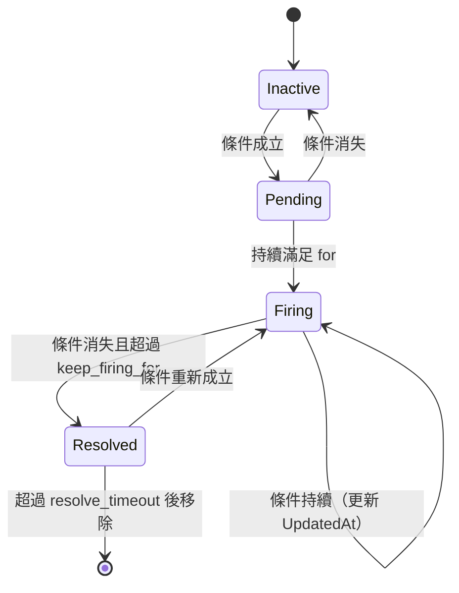

# 07 — 告警：規則、狀態機、分發、通知

套件：`internal/alerting`。設計基準：**與 Prometheus Ruler + Alertmanager 的語義完全一致**，使用者既有的規則與路由設定可原樣搬過來。

`prometheus/alertmanager` 是 Apache-2.0，`silence`、`inhibit`、`dispatch`、`pkg/labels` 可直接 import 複用；`notify` 套件依賴較重，建議自行實作（見 §6）。

## 1. 規則模型

### 1.1 檔案格式（Prometheus rule YAML，完全相容）

```yaml
groups:
  - name: host
    interval: 30s
    limit: 0                 # 該組最大告警數，0 = 無限
    rules:
      - alert: HostDiskAlmostFull
        expr: (1 - node_filesystem_avail_bytes / node_filesystem_size_bytes) > 0.85
        for: 10m
        keep_firing_for: 5m  # 選配，Prometheus 2.42+ 語義
        labels:
          severity: warning
        annotations:
          summary: "{{ $labels.instance }} 磁碟使用率 {{ $value | humanizePercentage }}"
          runbook_url: "https://wiki/runbook/disk"
      - record: job:http_requests:rate5m
        expr: sum by (job) (rate(http_requests_total[5m]))
```

### 1.2 Prism 擴充（載體未鎖定）

下面這段是舊草稿，不是已接受的語法。2026-10-20 用 promtool 2.53.0 實測，rule 上的 `prism_log_expr` 會被拒絕（`field prism_log_expr not found in type rulefmt.RuleNode`）。`prism_` 前綴不會被忽略。

```yaml
      - alert: ErrorLogSpike
        prism_log_expr: |                      # 舊草稿。promtool 2.53.0 拒絕這個欄位
          sum(count_over_time({service="api", level="error"}[5m])) > 100
        for: 5m
        labels: {severity: critical}
```

同一輪實測，`annotations.prism_log_expr` 與 `labels.__prism_log_expr__` 可以通過 `promtool check rules`，伺服器也載入。放哪裡、是否與 `expr` 互斥，都還沒鎖定。見 §10 的 AC-88。在鎖定前不得實作這段擴充。LogQL 與 PromQL 走同一條查詢路徑仍是後續評估階段的事，不是 P2-06。

### 1.3 規則來源

兩個來源並存，載入後合併：

1. **檔案**：`rules.path` 指定的目錄，`*.yml` / `*.yaml`。熱重載的接法尚未鎖定，見 §10 的 AC-92。Prometheus 2.53.0 實測沒有檔案監看。
2. **控制平面**：Postgres `rule_groups` / `rules` 表，經 `/api/console/v1/rules` CRUD，每 `rules.db_sync_interval`（預設 30s）同步。

衝突時（同名 group）：檔案優先，並記錄警告。理由：檔案是 GitOps 的載體，不應被 UI 意外覆蓋。

## 2. 評估器

```go
type Group struct {
    Name     string
    Tenant   string
    Interval time.Duration
    Rules    []Rule
    Limit    int
}
```

- 每個 Group 一個 goroutine，`time.Ticker` 驅動。
- **啟動抖動**：首次執行延遲 `hash(groupName) % interval`，避免所有組同時打爆後端。
- 組內規則**依序**評估（Prometheus 語義：後面的規則可以用到前面 recording rule 的結果）。
- 單條規則超時 `rules.eval_timeout`（預設 = interval，最多 30s）。
- 評估失敗：遞增 `prism_rule_eval_failures_total{group,rule}`，**保持告警的前一狀態不變**，連續失敗超過 `rules.max_consecutive_failures`（預設 5）時觸發內建告警 `PrismRuleEvaluationFailing`。

**「保持前一狀態不變」很重要**：後端短暫不可用時，不能讓所有 firing 告警集體 resolved（誤導成「問題解決了」），也不能讓它們集體 firing。

## 3. 告警狀態機



```go
type AlertState uint8
const (
    StateInactive AlertState = iota
    StatePending
    StateFiring
)

type Alert struct {
    Fingerprint  uint64        // labels 的 hash，身分依據
    Labels       labels.Labels // 含 alertname 與規則 labels，已套用模板
    Annotations  labels.Labels // 已套用模板
    State        AlertState
    ActiveAt     time.Time     // 條件首次成立
    FiredAt      time.Time
    ResolvedAt   time.Time
    LastEvalAt   time.Time
    Value        float64
    GeneratorURL string
}
```

- `Fingerprint` = 排序後 labels 的 xxhash64。同一規則產生的不同標籤組合是**不同告警**。
- `resolve_timeout` 預設 5 分鐘：Resolved 後仍保留在記憶體，讓 Alertmanager API 能回報 `endsAt`。
- **`ALERTS` 序列回寫**（Prometheus 語義，讓使用者能對告警歷史做 PromQL 查詢）：
  - `ALERTS{alertname="X", alertstate="pending|firing", ...原 labels} = 1`
  - `ALERTS_FOR_STATE{alertname="X", ...} = <ActiveAt 的 unix 秒>`
  - 每次評估後寫入，值消失即代表告警結束。
- 狀態持久化：每 `rules.state_flush_interval`（預設 60s）把 `ActiveAt` 寫入 Postgres `alert_state` 表，重啟後回載。**沒有這一步，重啟會讓所有 `for: 30m` 的告警重新計時**，這是自建告警系統最常見的缺陷。

## 4. 模板

`annotations` 與 `labels` 的值支援 Go template，可用變數與函式與 Prometheus 一致：

- `{{ $value }}`、`{{ $labels.xxx }}`、`{{ $externalLabels.xxx }}`
- 函式：`humanize`、`humanize1024`、`humanizeDuration`、`humanizePercentage`、`humanizeTimestamp`、`title`、`toUpper`、`toLower`、`match`、`reReplaceAll`、`printf`、`query`（限制見下）
- `query "promql"` 允許但有次數上限（`rules.max_template_queries`，預設 3/次評估），防止模板引發查詢風暴。

模板渲染失敗：使用原始字串並在 annotation 加 `__template_error__`，**不得讓整條規則失敗**。

## 5. Dispatcher（分組、靜默、抑制）

處理順序固定：**Silence → Inhibit → Group → Dedup → Notify**。

### 5.1 設定（Alertmanager 格式，完全相容）

```yaml
route:
  receiver: default
  group_by: ['alertname', 'cluster', 'service']
  group_wait: 30s
  group_interval: 5m
  repeat_interval: 4h
  routes:
    - matchers: ['severity="critical"']
      receiver: oncall
      group_wait: 10s
      repeat_interval: 1h
      continue: false

inhibit_rules:
  - source_matchers: ['alertname="HostDown"']
    target_matchers: ['severity=~"warning|info"']
    equal: ['instance']

receivers:
  - name: default
    webhook_configs:
      - url: http://example/hook
  - name: oncall
    prism_lark_configs:                 # Prism 擴充渠道以 prism_ 前綴
      - webhook_url_file: /etc/prism/secrets/lark_url
        at_all: false
```

### 5.2 行為要求

- `group_wait`：一組第一次有告警時，等這麼久再發，讓同批告警合併。
- `group_interval`：組內有**新**告警加入時，最快多久再發一次。
- `repeat_interval`：組內狀態不變時，多久重發一次提醒。
- resolved 通知：`send_resolved` 預設 `true`。
- **抑制的自我保護**：`inhibit_rules` 的 source 與 target 若能互相匹配（環），載入時直接拒絕並報錯，不得在執行期死鎖。

### 5.3 靜默

- 儲存於 Postgres `silences` 表，記憶體維護活躍集合。
- 匹配器支援 `=`、`!=`、`=~`、`!~`。
- 過期靜默保留 `silences.retention`（預設 5 天）供審計後硬刪。
- 建立靜默必須記錄 `createdBy`（來自 JWT 或 API key 名稱）與 `comment`（強制非空）。

## 6. Notifier SPI

```go
package notify

type Notifier interface {
    Name() string
    // Send 必須是冪等的：同一 DeliveryID 重送不應造成重複副作用（能做到的渠道）。
    Send(ctx context.Context, d Delivery) error
}

type Delivery struct {
    ID          string   // uuid，冪等鍵
    Receiver    string
    GroupKey    string
    GroupLabels labels.Labels
    Status      string   // "firing" | "resolved"
    Alerts      []Alert
    ExternalURL string
    Attempt     int
}

func Register(kind string, f Factory)  // kind 對應 yaml 中的 *_configs 鍵名
```

v1 必做渠道：

| kind | 說明 |
|---|---|
| `webhook_configs` | Alertmanager 相容的 JSON payload（**欄位必須逐一對齊**，讓既有的 webhook 接收端不用改） |
| `email_configs` | SMTP，支援 STARTTLS / TLS，HTML + 純文字雙格式 |
| `prism_telegram_configs` | Bot API |
| `prism_lark_configs` | 飛書自訂機器人（支援加簽） |
| `prism_dingtalk_configs` | 釘釘自訂機器人（支援加簽與關鍵詞） |
| `slack_configs` | Incoming webhook |

Phase 4 可加：`pagerduty_configs`、`opsgenie_configs`、`prism_wecom_configs`。

### 6.1 憑證處理

- 所有 `*_url`、`*_token`、`*_password` 欄位必須支援 `_file` 後綴變體（如 `webhook_url_file`），從檔案讀取。
- 設定檔中的明文憑證在載入後立即包裝成 `secret.String`，其 `String()` / `MarshalJSON()` 一律回傳 `<secret>`。
- `/api/v2/status` 回傳的 `config.original` 必須先做遮罩。

### 6.2 投遞可靠性（自建系統最容易忽略的部分）

通知**必須落庫再發送**，不可只在記憶體裡：

```sql
CREATE TABLE notification_deliveries (
    id            UUID PRIMARY KEY,
    tenant_id     TEXT NOT NULL,
    receiver      TEXT NOT NULL,
    channel_kind  TEXT NOT NULL,
    group_key     TEXT NOT NULL,
    status        TEXT NOT NULL,   -- pending|sent|failed|dead
    payload       JSONB NOT NULL,
    attempt       INT  NOT NULL DEFAULT 0,
    next_retry_at TIMESTAMPTZ,
    last_error    TEXT,
    created_at    TIMESTAMPTZ NOT NULL DEFAULT now(),
    sent_at       TIMESTAMPTZ
);
CREATE INDEX ON notification_deliveries (status, next_retry_at) WHERE status = 'pending';
CREATE INDEX ON notification_deliveries (tenant_id, created_at DESC);
```

- 重試：指數退避 `30s, 1m, 2m, 5m, 10m`，共 5 次，之後標記 `dead`。
- `dead` 觸發內建告警 `PrismNotificationDead`（發往一個**不同**的 receiver，設定於 `notify.deadletter_receiver`）。
- Console 提供投遞記錄查詢與手動重送。
- 指標：`prism_notification_sent_total{channel,status}`、`prism_notification_retry_total`、`prism_notification_dead_total`、`prism_notification_latency_seconds`。

**「通知發不出去而沒人知道」是告警系統唯一的致命故障**。上述機制加上 §8 的 watchdog 是必做項，不可推遲到後續階段。

## 7. 內建規則

`rules.builtin_enabled`（預設 true）時自動載入，租戶無法刪除但可靜默：

| 告警 | 條件 |
|---|---|
| `PrismStorageUnavailable` | `up{job="prism"} == 0` 或 `prism_storage_write_duration_seconds` 連續失敗 |
| `PrismIngestDropping` | `rate(prism_ingest_dropped_total[5m]) > 0` |
| `PrismHighCardinalityLabel` | `prism_ingest_high_cardinality_total` 增長 |
| `PrismRuleEvaluationFailing` | `rate(prism_rule_eval_failures_total[10m]) > 0` |
| `PrismNotificationDead` | `increase(prism_notification_dead_total[15m]) > 0` |
| `PrismDiskPressure` | 存儲後端磁碟 > 85% |
| `PrismAgentDown` | Agent 心跳逾時 > 3 個間隔 |

## 8. Watchdog（外部看門狗）

內建一條永遠 firing 的規則 `PrismWatchdog`，路由到一個獨立 receiver（建議指向外部的 Healthchecks.io / Uptime Kuma / cron + curl）。外部系統若在預期間隔內**沒有**收到它，就代表 Prism 本身掛了。

這是整個系統唯一不能靠自己驗證的部分，必須在 `deploy/` 提供範例設定並在 README 顯著位置說明。

## 9. 驗收標準

- A1：一份取自真實 Prometheus 專案的 rule 檔（含 recording rules 與模板）能無修改載入並正確評估。
- A2：`promtool check rules` 對 Prism 產生的規則檔通過。
- A3：`amtool --alertmanager.url=http://prismd:9090/alertmanager alert query` 與 `silence add/query/expire` 全部可用。
- A4：`for: 5m` 的告警在 `prismd` 重啟後不重新計時（透過 `alert_state` 表驗證）。
- A5：後端故障 3 分鐘期間，既有 firing 告警不變成 resolved。
- A6：webhook 接收端回 500 時，投遞進入重試，5 次後標記 dead 並觸發 `PrismNotificationDead`。
- A7：`HostDown` firing 時，同 instance 的 warning 告警被抑制且在 `/api/v2/alerts` 顯示 `status.state="suppressed"`。
- A8：模板渲染錯誤不影響告警觸發與通知發送。

A1 的「正確評估」、A3 至 A8 不在 P2-06。P2-06 的編號驗收是 §10。A2 的 promtool 版本與案例也以 §10 為準。

## 10. P2-06 驗收（AC-72 起）

這一節是文件。Owner 於 2026-10-20 打開 P2-06 的範圍，只要規格。合併這份規格前不寫程式、不寫測試。編號接在 `17` §6.5 的 AC-71 之後。

實測用的是官方 Prometheus 2.53.0 linux/amd64 壓縮檔，SHA256 `d9900a11e3c89261e6416e3c9989858bad7b206af8b6838dfe9a5392d8ddc60d`，與 `test/e2e/README.md` 的釘選相同。`promtool` 與 `prometheus` 的版本行是 `2.53.0`，revision `4c35b9250afefede41c5f5acd76191f90f625898`。模組裡已有 `github.com/prometheus/prometheus v0.53.0`，套件 `model/rulefmt` 提供 `Parse` 與 `ParseFile`。下面凡是寫「實測」的句子，都來自這兩個二進位，不是從記憶補的。

### 10.1 範圍

範圍內是 `12` 的 P2-06：`internal/alerting/rules` 載入 Prometheus 規則檔、保留實測得到的欄位、依目錄重新載入。允許路徑仍是 `internal/alerting/rules/**`。標準欄位的接受與拒絕必須跟 promtool 2.53.0 的 `check rules` 相同，解析必須走上述 `rulefmt`，不要另寫一份欄位清單。

範圍外：

- 評估、`for` / `keep_firing_for` 狀態機、`ALERTS` 回寫、Postgres `alert_state`。那是 P2-07。
- 靜默、抑制、分組、通知、Alertmanager API。那是 P2-08 至 P2-11。
- 內建規則與 watchdog。那是 P2-12。`rules.builtin_enabled` 這輪不讀。
- 控制平面 `rule_groups` / `rules` 與 `rules.db_sync_interval`。這輪不連 Postgres。
- 模板執行、PromQL 執行、LogQL 執行。載入時只做 promtool 會做的語法檢查，不算結果。
- 改 `pkg/spi`。

`cmd/prismd` 今天只把 `SIGINT` 與 `SIGTERM` 交給 `signal.NotifyContext`，沒有 SIGHUP，也沒有 `/-/reload`。程序要不要在這輪接上，是 AC-92，未鎖定。

### 10.2 實測

`promtool check rules` 的預設 lint 是 `duplicate-rules`。下面 exit 是程序結束碼。

| 輸入 | exit | 結果 |
|---|---|---|
| §1.1 的 alert（含 `for`、`keep_firing_for`、labels、annotations）加一筆 recording rule | 0 | `SUCCESS: 2 rules found` |
| 只有 recording rule | 0 | `SUCCESS: 1 rules found` |
| 缺 `expr`，或 `expr: ""` | 1 | `field 'expr' must be set in rule` |
| 同時有 `alert` 與 `record` | 1 | `only one of 'record' and 'alert' must be set` |
| 兩者都沒有，或 `alert: ""` | 1 | `one of 'record' or 'alert' must be set` |
| rule 欄位 `prism_log_expr` | 1 | `field prism_log_expr not found in type rulefmt.RuleNode` |
| group 欄位 `prism_tenant`、頂層 `extra`、`partial_response_strategy`、`eval_offset`、rule 上的 `query_offset` | 1 | `field <name> not found in type rulefmt....` |
| `annotations`、`for`、`keep_firing_for` 寫在 recording rule | 1 | `invalid field '<name>' in recording rule` |
| group 名稱空、缺 name | 1 | `Groupname must not be empty` |
| 同一檔兩個 group 都叫 `g` | 1 | `groupname: "g" is repeated in the same file` |
| 兩個檔案各有 group `same` | 0 | 各檔 `SUCCESS`。伺服器兩組都載入 |
| 同檔兩筆 alert `A`、labels 都空、expr 不同 | 0 | 仍印 `lint error 1 duplicate rule(s) found.`。`--lint-fatal` 才是 exit 3 |
| `expr: not promql !!!` | 1 | `could not parse expression`，`unexpected identifier "promql"` |
| `expr` 含 LogQL `\|` | 1 | `unexpected character: '|'` |
| `expr: '{service="api"}'` | 0 | 這是合法 PromQL，不是 LogQL 偵測 |
| annotation 裡未閉合的 `{{` | 1 | `unclosed action` |
| `interval: yesterday`、`for: -1s` | 1 | `not a valid duration string` |
| `record: "1bad"`、`record: "磁碟:滿"` | 1 | `invalid recording rule name` |
| `alert: "1bad"`、`alert: "磁碟滿"` | 0 | 伺服器載入了 `磁碟滿` |
| label 名稱空、或 `__name__` | 1 | `invalid label name` |
| `labels.__prism_log_expr__`、`annotations.prism_log_expr`（值是不含未閉合 `{{` 的 LogQL） | 0 | 伺服器把前者放進 labels，後者放進 annotations |
| `labels.severity: 1`、`on: true`、`n: 1.5` | 0 | API 裡的值是 `"1"`、`"true"`、`"1.5"` |
| `groups: []`、`rules: []`、空檔、只有註解、`groups:` | 0 | `SUCCESS: 0 rules found`。伺服器對空 groups 檔不產生 group |
| 一個檔兩個 YAML 文件（`---`） | 0 | `SUCCESS: 1 rules found`。伺服器只有第一份 |
| YAML merge key 複製出的第二筆 | 0 | 伺服器上第二筆有被複製的 `expr` 與 labels |
| 目錄當參數、不存在的路徑 | 1 | `is a directory` / `does not exist` |

伺服器是 `prometheus --config.file` 加 `rule_files` glob `*.yml` 與 `*.yaml`，`evaluation_interval: 15s`，聽在 `127.0.0.1`。`/api/v1/rules` 的觀察：

- 有 `interval: 30s` 的 group，`interval` 是 30。省略 interval，或寫 `interval: 0s`，`interval` 都是 15，也就是該程序的 `evaluation_interval`，不是 0。
- 省略 `limit` 或 `limit: 0`，API 是 0。`limit: -1` 原樣是 -1。沒有跑評估，不知道 -1 怎麼執行。
- `for: 10m` 的 `duration` 是 600。`keep_firing_for: 5m` 的 `keepFiringFor` 是 300。`for: 0s` 與省略都是 `duration` 0。
- group `query_offset: 1m` 時程序可以 ready。這個 API 沒有回傳 offset。
- `.txt` 與子目錄裡的 `nested.yml` 沒有被這兩個 glob 載入。
- 改檔後 2 秒、沒有發信號，記憶體裡的規則不變。`SIGHUP` 之後變成新內容。
- 新檔與刪檔也要等這次重載才反映。其中一個檔解析失敗時，log 是 `loading groups failed`，接著 `previous rule set restored`，API 仍是上一份成功的集合。
- 沒有 `--web.enable-lifecycle` 時，`POST /-/reload` 是 HTTP 403，本文 `Lifecycle API is not enabled.`。加上該旗標後是 HTTP 200，規則更新。
- 這 2 秒的等待裡，Prometheus 沒有自己監看檔案。

現有 `internal/config.validateRuleDocument` 比 promtool 鬆，也比它嚴：它不解析 PromQL、不拒絕未知欄位、不拒絕同時有 `alert` 與 `record`；它拒絕空的 `groups` 與空的 `rules`。目錄掃描已經是一層、只看 `.yml` / `.yaml`、超過 10000 個目錄項就錯、單檔超過 `4 << 20` 位元組就回 `file exceeds %d bytes`。這些是讀現有程式得到的，不是 promtool 的行為。

### 10.3 已對齊實測的驗收

下列 AC 的 Then 就是上面的實測。Prism 的載入器必須得出相同的接受、拒絕與保留值。錯誤文字必須包含表中的那句，可以多包路徑與 group。不在這輪執行規則。

**AC-72** Given §1.1 那個 alert 與 recording rule 寫在同一檔。When `promtool check rules` 與載入器都讀它。Then 兩者都成功。group 名 `host`，interval 30 秒，limit 0。第一筆是 alert `HostDiskAlmostFull`，`expr` 原樣保留，`for` 10 分，`keep_firing_for` 5 分，label `severity=warning`，annotation `summary` 與 `runbook_url` 等於檔內字串，模板不執行。第二筆是 recording rule `job:http_requests:rate5m`，沒有 annotations、`for`、`keep_firing_for`。順序與檔案相同。

**AC-73** Given recording rule 帶 `annotations`、`for` 或 `keep_firing_for` 其中一個。When 載入。Then 拒絕。錯誤含 `invalid field 'annotations' in recording rule`、`invalid field 'for' in recording rule` 或 `invalid field 'keep_firing_for' in recording rule`，與該欄位對應。

**AC-74** Given 缺 `expr`、`expr` 為空、同時有 `alert` 與 `record`、兩者都沒有，或 `alert` 為空字串。When 載入。Then 拒絕。錯誤含 `field 'expr' must be set in rule`、`only one of 'record' and 'alert' must be set` 或 `one of 'record' or 'alert' must be set`。

**AC-75** Given rule 欄位 `prism_log_expr`、group 欄位 `prism_tenant`、頂層 `extra`、`partial_response_strategy`、`eval_offset`，或 rule 上的 `query_offset`。When 載入。Then 拒絕。錯誤含 `field <name> not found in type rulefmt.`。`prism_` 前綴不是豁免。

**AC-76** Given label 名稱是空字串或 `__name__`。When 載入。Then 拒絕，錯誤含 `invalid label name`。Given `severity: 1`、`on: true`、`n: 1.5`。When 載入。Then 值是字串 `1`、`true`、`1.5`。Given `labels.__prism_log_expr__` 的值沒有未閉合的 `{{`。When 載入。Then 成功，該鍵留在 labels。

**AC-77** Given 同一檔兩個 group 都叫 `g`。When 載入。Then 拒絕，錯誤含 `groupname: "g" is repeated in the same file`。Given 兩個檔案各有一個 group `same`。When 一起載入。Then 兩組都在，不互相覆蓋。

**AC-78** Given `expr` 是 `not promql !!!`。When 載入。Then 拒絕，錯誤含 `could not parse expression`。Given `expr` 含 `| json`。When 載入。Then 拒絕，錯誤含 `unexpected character: '|'`。Given `expr` 是 `{service="api"}`。When 載入。Then 成功。這條不能拿來判斷 LogQL。

**AC-79** Given alert 的 annotation 有未閉合的 `{{`。When 載入。Then 拒絕，錯誤含 `unclosed action`。Given annotation 是合法模板字串。When 載入。Then 成功，保存的字串與檔案相同，不渲染。

**AC-80** Given `interval: yesterday` 或 `for: -1s`。When 載入。Then 拒絕，錯誤含 `not a valid duration string`。Given `interval: 30s`。When 載入。Then interval 是 30 秒。Given `for: 0s`。When 載入。Then for 是 0。Given `for: 10m` 與 `keep_firing_for: 5m`。When 載入。Then 分別是 10 分與 5 分。

**AC-81** Given 省略 `limit` 或 `limit: 0`。When 載入。Then 保存的整數是 0。Given `limit: -1`。When 載入。Then 保存的整數是 -1。這輪不規定評估時 0 或 -1 代表什麼。

**AC-82** Given group `query_offset: 1m`。When 載入。Then 成功，並保留 1 分。這個值不從「有沒有出現在 Prometheus 2.53 的 `/api/v1/rules`」來判斷，因為該 API 沒有這個欄位；判斷依據是載入器自己的結果，且 `promtool check rules` exit 0。Given rule 上的 `query_offset`。When 載入。Then 拒絕，同 AC-75。

**AC-83** Given `record` 名稱 `1bad` 或 `磁碟:滿`。When 載入。Then 拒絕，錯誤含 `invalid recording rule name`。Given `alert` 名稱 `1bad` 或 `磁碟滿`。When 載入。Then 成功，名稱原樣保留。

**AC-84** Given 一筆 alert 用 YAML anchor，下一筆用 merge key 覆寫 `alert` 名稱。When 載入。Then 兩筆都在。第二筆帶有被複製的 `expr` 與 labels，名稱是覆寫後的值。

**AC-85** Given `rules.path` 目錄裡有 `a.yml`、`b.yaml`、`skip.txt`，以及子目錄 `sub/nested.yml`。When 載入。Then 只讀前兩份。子目錄與其他副檔名不讀。目錄項超過 10000，或單檔超過 4194304 位元組，拒絕；後者的錯誤含 `file exceeds 4194304 bytes`。這兩個上限沿用 `internal/config` 現有的 `maxRuleFiles` 與 `maxAuxiliaryFileBytes`，不新造數字。

**AC-86** Given 已載入一份成功的規則。When 呼叫端沒有要求重新載入，期間檔案被改寫。Then 記憶體中的集合不變。When 重新載入成功。Then 集合等於磁碟上現在的 `.yml` / `.yaml`，新檔出現，已刪的檔消失。When 重新載入時任一檔失敗。Then 回錯，記憶體仍是上一份成功的集合。

**AC-87** Given 實作階段的測試。When 跑相容性。Then 使用 AC-72 至 AC-84 的同一批檔案呼叫釘選的 promtool 2.53.0 `check rules`，exit code 與載入器的接受或拒絕一致。生產路徑不得殼層呼叫 promtool。這份規格 PR 不加入該測試。

### 10.4 未鎖定

下面的 Then 不是驗收。寫成 AC 編號只是把坑占住，避免實作時自己補。Owner 鎖定前不得實作。

**AC-88** Given LogQL 擴充。When 載入。Then 未鎖定。實測只知道：rule 欄位 `prism_log_expr` 失敗；annotation 與 `labels.__prism_log_expr__` 可以成功。建議與理由放在 PR 的待決清單。

**AC-89** Given 一個檔有第二份 YAML 文件。When 載入。Then 未鎖定。實測是 promtool 與伺服器都只留下第一份，exit 0，沒有警告。

**AC-90** Given `groups: []`、`rules: []`、空檔或只有註解。When 載入器與 `--config-check` 分別讀。Then 未鎖定。promtool exit 0。現有 `validateRuleDocument` 拒絕空的 groups 與 rules。

**AC-91** Given 省略 `interval`，或 `interval: 0s`。When 載入。Then 未鎖定。Prometheus 在這次設定下兩者都變成全域 `evaluation_interval`（探針是 15 秒）。Prism 的 `rules` 沒有這個鍵。

**AC-92** Given 程序收到 SIGHUP，或收到 `POST /-/reload`。When 熱重載。Then 未鎖定。Prometheus 的實測見 §10.2：沒有信號就不會重載；失敗保留上一份；lifecycle 關閉時 HTTP 403。`prismd` 目前沒有這兩條接線。07 §1.3 寫的檔案監看，這次 2 秒內沒有發生。

**AC-93** Given 同檔兩筆規則被 promtool 的預設 duplicate-rules lint 點名。When 載入。Then 未鎖定。實測預設 exit 0，`--lint-fatal` exit 3。伺服器會載入兩筆同名 alert（該次兩筆的 labels 不同）。
