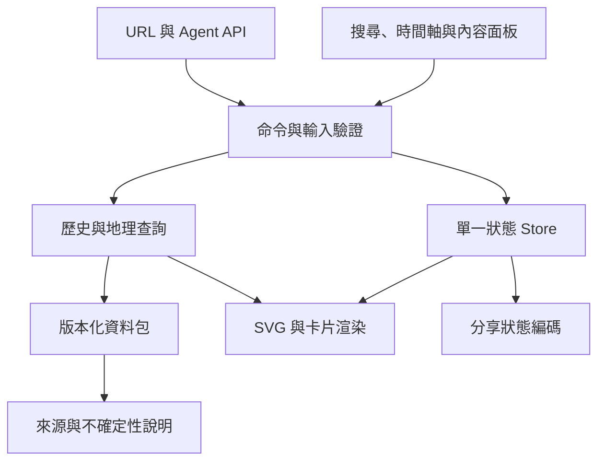

# History Atlas · 歷史時空圖譜 SDD

- 狀態：Draft／M0 設計交付；沒有網站實作或部署。
- 建立日期：2026-10-23；任務：[Issue #514](https://github.com/fallrising/newclear/issues/514)。
- 專案：`products/history-atlas/`；目前未分級，投入分級另由 owner 決定。
- newclear 基準：`a384d77a7e32f1dc35902eb94e7cf78daf68e367`。
- 行為參考：DeanChensj/jiangshan-map `5e940f6bc1f8aa50ac7fe0e2406baee7ef5ef7e7`。
- [上游分析](docs/upstream-analysis.md)、[SUCCESS](SUCCESS.md)、[任務板](docs/tasks/BOARD.md)、[驗證紀錄](docs/validation.md)。

## 1. 問題、定位與設計邊界

讀史書或詩詞時，讀者往往知道人物／地名，卻難以把年代、位置、行政沿革與行程放在同一張圖上。本案提供繁中優先、可自架的互動歷史地理閱讀工具，讓「哪一年、在哪裡、發生什麼、出處是什麼」可以同時檢視。

owner 本輪要求是先分析參考項目，再建立新專案 SDD。沿用 HTML/CSS、原生 JavaScript、SVG、自製投影及靜態資料的技術方向，自行撰寫功能與資料處理；不將上游程式、壓縮幾何、掌故庫、圖片、音樂或統計 token 複製進本案。本文件不宣稱法律上的 clean-room 認證，也不將相同技術棧當成第三方資料授權。

**這份 SDD 定義新的契約，不承諾與上游私有函式、資料鍵或所有網址完全相容。** 上游行為的觀察見分析文件；本文件未特別標示者均為本案提案，尚未實作。現代國界、名義管轄與實際控制不可混為同一事實；圖面要能揭露資料的觀點、時間與不確定性。

### 1.1 範圍層次

| 層次 | 內容 | 完成標準 |
| --- | --- | --- |
| 本輪 M0 | 上游分析、SDD、成功契約、任務板與索引 | AC-01～AC-04；Draft PR 可審查 |
| v1 產品主線 | 靜態地圖、時間軸、地點沿革、搜尋、事件／年號、人物與自訂路線、定位測驗、分享／Agent 介面、來源與驗證 | AC-05～AC-18 全部有真實證據 |
| 後續內容擴充 | 逐步增加朝代、政權、人物、詩詞與地區 | 逐資料包驗收，不以堆數量代替來源核對 |
| 後續功能 | 匯出 GeoJSON、歷史水系／工程路線、更豐富 SEO 專題、可選本地音樂 | 另立具名里程碑；未計入 v1 可用承諾 |

v1 的能力覆蓋上游核心探索流程；內容先以有界樣本資料包驗收，不承諾首版就重建兩千多年全量歷史。提議的 v1 內容下限：三個明示覆蓋的歷史時段、至少六個有來源的疆域階段、十二個不同地點、十二個事件、三位人物且每人至少四個站點、十個合法測驗題目。時段和人物具體選擇由資料工作確認，優先考慮唐、宋、明，但**本次沒有聲稱這些資料已蒐集或獲授權**。沒有合格資料時，引擎可用合成案例開發，產品 AC-16 及涉及史料的 AC 保持 pending，不能用合成圖冒充可用史圖。

非目標：多人協作、帳號／付費方案、後端資料庫、在線 LLM 生成史實、即時地理搜尋服務、全量 GIS 編輯器、精密測繪、部署營運或百萬使用者規模。

## 2. 核心使用流程與功能映射

| 流程 | 本案行為 | 對應 AC |
| --- | --- | --- |
| 看一年 | 選歷史時段／年份，讀取該年的多政權疆域、事件和圖例，對照上一個有效階段 | AC-06～AC-08 |
| 查一地 | 搜尋古今地名或點選地圖，顯示跨年代名稱、行政隸屬、事件與來源 | AC-09～AC-10 |
| 看一事 | 點事件跳到相應年份、地點及政權年號；來源月日按原始曆法顯示，不宣稱地圖有月日精度 | AC-11 |
| 跟一人 | 搜尋人物，開啟生平卡，逐站走訪；站點和地圖年份同步 | AC-12 |
| 讀一首詩／一段旅程 | 傳入同年或跨年地點清單，處理歧義後畫路線並分享 | AC-13 |
| 玩定位測驗 | 隱去答案標籤、看線索、放針／微調／確認，十題結算 | AC-14 |
| 從 Agent 開圖 | 先解析與檢查，再產生連結或定位；結果明示來源、歧義及資料缺口 | AC-15 |

首版保持內容閱讀優先：地圖、底部時間軸、搜尋與內容面板。桌面內容面板在側邊；行動版可收折成底部面板。年份、語言與資料覆蓋提示始終可見。空資料、查無結果、歧義、載入失敗均是明確狀態，不能只留下空白地圖。

## 3. 技術棧與架構

### 3.1 選型

| 部分 | 選擇 | 理由／界線 |
| --- | --- | --- |
| 主網站 | 原生 HTML、CSS、JavaScript ES modules | 靜態 HTTP 可用，避免引入應用框架和後端 |
| 地圖 | SVG 分層、自製 Mercator 投影、瀏覽器 Pointer Events | 適合有限歷史面與標籤；先確立幾何與狀態契約 |
| 資料 | UTF-8 JSON；幾何為 GeoJSON Polygon／MultiPolygon | 人可讀、可比對、可逐來源審核；v1 不複製上游 VLQ 格式 |
| 驗證 | Node 內建 test runner、資料驗證腳本 | 執行期零 npm 套件不限制測試工具；瀏覽器測試可另鎖版本 |
| 本機提供檔案 | Python 標準 HTTP server 或現成靜態 server | Python 不在瀏覽器執行路徑 |
| Agent 入口 | URL v1、瀏覽器 API v1、Python URL CLI | 不新增常駐 MCP server 或 LLM 後端 |
| 字型／素材 | 系統繁中字型為預設；需新增時本地打包並記來源 | 核心流程不依賴 Google Fonts、音樂或追蹤 CDN |

### 3.2 模組邊界

| 預定模組 | 責任 | 不負責 |
| --- | --- | --- |
| `src/core/store.js` | 接收已驗證命令、維持選年／選項／播放狀態 | DOM、網路與歷史推理 |
| `src/core/time.js` | 無公元 0 年、區間與年號換算 | 自動補齊缺失日期 |
| `src/data/repository.js` | manifest 載入、revision 檢查、同源快取與取消 | UI 或任意 URL 抓取 |
| `src/geo/projection.js`、`geometry.js` | 投影／反投影、bbox、點面命中、距離 | 判定歷史主權 |
| `src/map/renderer.js`、`labels.js` | SVG keyed updates、標籤避讓與命中回饋 | 修改來源資料 |
| `src/search/index.js` | 別名、文字正規化、排序、歧義候選 | 模型生成座標 |
| `src/history/query.js` | 某時地點、名稱、隸屬、人物與事件查詢 | 將未知視為空事實 |
| `src/ui/` | 卡片、控件、焦點與無障礙 | 新建資料主鍵 |
| `src/integration/url.js`、`api.js` | URL／API v1 與一致的錯誤格式 | 直接繞過 store 寫 DOM |
| `src/features/quiz.js` | 題目候選、seed、題序與分數狀態 | 持久化個資或排行榜 |

Store 最小狀態：`year, locale, selectedEntity, mode, route, activeStop, visibleLayers, viewport, playback, dataRevision, loadState`。相同命令經 UI、URL 或 API 進入同一驗證／查詢流程。切年請求附遞增 requestId；只允許最新請求提交畫面，舊請求取消或丟棄。查詢資料快取 key 至少含 `revision + resourcePath`，切 revision 必須清掉派生索引。

## 4. 資料模型與資料包

### 4.1 共通規則

穩定 ASCII ID 與顯示名稱分離。名稱、地理點位與隸屬各有有效期，不能因今日同名城市就視為古城同一位置。所有經緯度採 `[longitude, latitude]`、WGS84；資訊不足時 `geometry=null`，附原因，不由 LLM 補猜。資料 schema 使用 `schemaVersion: 1`，包使用不可變 revision 及檔案 SHA-256。未知 schemaVersion／hash 不符拒絕載入並顯示原因。

| 實體 | 必填核心欄位 |
| --- | --- |
| Manifest | schemaVersion、datasetId、revision、coverage[]、defaultYear、resources[]（path、sha256、byteLength）、sourceIds |
| Source | id、title、url、versionOrDate、accessedAt、locator、rights、attribution、reviewStatus |
| Place | id、names[]、locations[]、kind、sourceIds、uncertainty |
| Name | label、lang、validFrom、validToExclusive、nameType（preferred／alias／modern）、sourceIds |
| Location | id（資料包內唯一）、geometry(Point)、validFrom、validToExclusive、precision、sourceIds |
| Polity | id、names[]、validFrom、validToExclusive、sourceIds |
| BoundarySnapshot | id、validFrom、validToExclusive、features[]、sourceIds、uncertainty |
| BoundaryFeature | id、polityId、level、geometry、relation（control／claimed／influence／administrative）、sourceIds、uncertainty |
| Administration | id、placeId、parentId、polityId、validFrom、validToExclusive、relation、sourceIds |
| Event | id、title、time（year、precision、originalDateText 可空、calendar 可空）、placeIds[]、regimeId 可空、summary、sourceIds、uncertainty |
| Person | id、names[]、lifeRange、eventIds[]、sourceIds |
| Route | id 可空、kind（journey／campaign／poetic）、stops[]（placeId、year、eventId 可空）、sourceIds |
| Reign | id、regimeId、rulerId 可空、name、firstYear、validFrom、validToExclusive、sourceIds |
| QuizItem | id、placeId、year、clue、answerLocationId、sourceIds |

時間欄位可含 `null` 表示「未知」，但未知不能默認成無限延伸。若需要開放端點，必須以 `openStart/openEnd` 明示；每類 schema 固定是否允許。實際不明日期另記 `uncertainty={kind, note, sourceIds}`，可選時間範圍，不能把不確定事實製作為精確日期。

### 4.2 Source 與 rights

`rights` 包含 `licenseId/licenseUrl` 或明確的權利說明、`redistribution` 與 `adaptation`（allowed／denied／unknown）、`basis`、`reviewedAt`。授權判讀證據保存版本／定位，只有來源與實際用法均已審核的資產才能標 `reviewStatus=approved`。

程式碼自行撰寫並沿用 repo 根授權；不改 repo 既有授權。資料和素材依各自條款保留獨立通知。從公共歷史事實自行整理，也要寫清楚研究出處；不複製受保護的現代文字敘述、掃描圖或別人的幾何彙編。手動畫圖不自動解決底稿權利，轉格式／轉文字也不會改變來源條件。

公開資料建置只接受 approved 且相應權利 allowed 的項目；unknown／denied 項目留在資料待辦清單，不進發佈 manifest。用合成幾何驗證技術時，必須放在 `tests/fixtures/synthetic/`，介面證據標為合成；不得以其滿足歷史內容驗收。

### 4.3 格式與精度策略

原始可編輯 JSON／GeoJSON 是資料的權威來源。部署可採 HTTP gzip／Brotli；若日後需拓撲共用或 VLQ，必須由可追溯來源透過確定性編譯產生，保留 compiler 版本、輸入 hash 與輸出比對。第一版先避免壓縮資料難以核對的問題。

疆域是歷史重建。UI 要顯示所採來源、`relation` 與 `uncertainty`；實際控制、名義聲索與影響範圍採不同圖例，不合併成無條件的「屬於」。現代參照層有自己日期與來源，可單獨開關，不回寫歷史層。

## 5. 時間與地理語義

### 5.1 歷史年份

v1 地圖、有效期和查詢以年為粒度。事件月日僅以 originalDateText 和 calendar 保留來源文字，不參與地圖篩選；同年改元無法唯一判定時回不確定。

對外以負整數表示公元前、正整數表示公元，拒絕 0。內部 `yearOrdinal(y) = y < 0 ? y : y - 1`，讓前 1 年到公元 1 年連續。所有時間比較、排序與跨度運算以 ordinal 進行；不能直接用 JS Date 表示古代年份。

有效期統一半開區間 `[validFrom, validToExclusive)`。資料的年份均仍使用上述歷史整數；查詢前轉 ordinal。交界年屬於較晚區間；資料可有並立政權，不能要求所有 polity 區間互斥。相同圖層同來源若有非預期重疊，validator 報錯；有意並列不同重建見解，透過 scenarioId 分開，UI 讓讀者選擇。

- `-1 → 1` 正好一步；`-403` 顯示「公元前 403 年」。
- 沒有覆蓋該年的 snapshot：顯示「此年疆域尚未收錄」，保留可獨立成立的點位／事件；不把最近的邊界挪來充當該年。
- 年號以事件的 regimeId 或使用者指定政權求值；`yearOrdinal(year) - yearOrdinal(firstYear) + 1`。跨年改元／只有年精度不能可靠判定時標不確定，顯示公曆即可。
- 時間軸可按年步進或按已收錄階段跳轉，兩種操作分別標示；播放遇覆蓋缺口應暫停並說明。

### 5.2 地理

投影輸入先驗證 lon∈[-180,180]、lat∈[-90,90]；Mercator 顯示用緯度夾在約 ±85.05112878°，原始座標不改寫。以 SVG viewport/viewBox 管理縮放平移，投影、反投影與 pointer 換算共享同一套參數。

Polygon 保留外環與孔洞，MultiPolygon 可有多面。點面命中採 bbox 預篩後幾何判定，使用明示 epsilon；邊線命中回傳 `boundary` 與候選集合，孔洞回傳 outside。相鄰／重疊政權不任選第一個作唯一歸屬。

線段跨 ±180° 時拆段，避免環繞整張圖；資料驗證須有此案例。路線弧線是地理位置之間的視覺連線，若無實際行經路徑來源，顯示「站點連線示意」，不宣稱是古人逐步走過的精確道路。距離使用原始經緯度的 haversine，不能用 SVG 像素算公里。

## 6. 繁中、搜尋與歧義

預設 `zh-Hant`，保留 `en`；UI 後續可加簡中，但 v1 的繁簡輸入相容是必要條件。介面字串以鍵值詞典管理，資料名稱以 labels／names 管理；不用 DOM 全域替換或翻譯資料主鍵。

搜尋先做 Unicode／空白／英文字母大小寫正規化，再查已審核簡繁及歷史別名。完整簡繁轉換可作建置輔助，但若引入套件與詞庫，須固定版本及授權；不得僅因轉換同字就合併實體。正規化索引保存原字串，結果可顯示匹配別名。

排名：穩定 ID 精確匹配 → 指定年份有效名稱精確匹配 → 別名精確匹配 → 前綴 → 子字串。人物與地點是不同 entity type；使用者輸入人物名時回人物候選，不把其出生地當作人物座標。相同名稱多候選時顯示時段、現代位置與來源，要求選擇；API 回 `ambiguous`。無有效期的跨年代別名僅作線索，結果標為「此名稱在所選年份未使用」，不可靜默改歷史名稱。

必驗案例：長安／长安；蘇軾／苏轼；諸葛亮／诸葛亮；英文撇號與空白；皇后／後、臺／台等專名例外；跨政權或跨年代同名；不存在地點；輸入 HTML／script 字串只作純文字。

## 7. URL 與 Agent API v1

以下全為**本案規劃契約，尚無可呼叫入口**。base URL 從目前頁面所在路徑或明示 site config 推導，不硬編碼上游網域。分享連結帶 `v=1`、資料 `rev`；接收不支援的 revision 回資料版本不相容，不能偷偷換資料後聲稱同一結果。

### 7.1 URL

| 參數 | 規則 |
| --- | --- |
| `v` | 版本 1；缺省視為 1 |
| `rev` | 具體資料 revision；缺省用目前包並於分享時補入 |
| `lang` | zh-Hant 或 en；未知值拒絕並提供重設 |
| `year` | 一個或以逗號分隔的歷史整數；不得含 0 |
| `place` | 一個或逗號分隔的名稱；URL encode；保留中文逗號與箭頭作輸入便利格式 |
| `placeId` | 穩定 ID 清單；分享解析後優先輸出 ID，同時存在 place 時兩者必須一致 |
| `coordinate` | 單點查詢 lon,lat；只允許一個 year，與 place／placeId／person／quiz 互斥；分享座標查詢保留此欄位，center 不能替代 |
| `person` | 人物 ID 或可解析名稱；與自訂 route 參數互斥 |
| `quiz` | locate；與 person／route 模式互斥 |
| `center`、`zoom` | 合法經緯度及有限數值；只影響視圖，zoom 夾在規定 1～32 |

只有一個 year 時廣播到所有路線站點；多個 year 必須等於站點數，不截斷、不複用最後一個年份。最多 32 站、每個文字 token 最多 100 Unicode code points、整段 query 上限 8192 bytes；日期未知或有歧義時先回錯誤，不部分提交。沒有 year 時用 manifest.defaultYear，完整分享連結會補上。

解析順序：版本／大小／參數驗證 → 解析資料 revision → 名稱解析 → 歧義檢查 → 建立完整命令 → 一次更新 store。瀏覽器 back／forward 還原相同語義狀態。viewport 和 hover 不影響史實查詢結果；hover 不寫入歷史記錄。

### 7.2 瀏覽器 API

規劃 `window.historyAtlas`，公開 `version` 與非同步方法：

- `resolvePlace({query, year, locale})`：地點候選；不改 UI。
- `inspect({year, placeId?, place?, coordinate?})`：回傳地點、所屬候選、來源與不確定性；不改 UI。位置輸入三者恰選一。
- `locate({year, placeId?, place?, coordinate?, viewport?})`：先解析與驗證，再一次更新 UI；回傳與 inspect 同格式並附 canonicalUrl。
- `openPerson({personId, stopIndex?})`、`setRoute({stops})`：與 UI 相同命令流程。
- `getState()`：回傳序列化副本，不能讓外部直接改 store。

結果 envelope：`{apiVersion:"1", dataRevision, status:"ok|ambiguous|not_found|outside_coverage|error", data, candidates, sourceIds, uncertainty, error, canonicalUrl}`。字串中的 `|` 表示列舉選項，不是回傳多值；實作選一。error 為 `{code, message, field?}` 或 null。

固定錯誤：`INVALID_YEAR`、`INVALID_COORDINATE`、`INVALID_PARAMETERS`、`AMBIGUOUS_PLACE`、`PLACE_NOT_FOUND`、`OUTSIDE_COVERAGE`、`REVISION_UNAVAILABLE`、`DATA_LOAD_FAILED`。預期輸入問題以 envelope 回傳，不能讓未處理 exception 結束整個頁面；程式缺陷仍記錄除錯訊息且避免暴露私有資料。

Python CLI v1 只以標準函式庫驗證語法並產生 URL，退出碼 0 表示語法合法、2 表示輸入無效；錯誤寫 stderr，成功 URL 寫 stdout。**不宣稱已執行地名解析、資料 revision 可用性或史實／來源驗證**。日後 screenshot／JSON 查詢需要真實瀏覽器 adapter，另立里程碑；本次不把 headless browser 包裝成零相依能力。

## 8. 渲染、播放與測驗

SVG 分層順序：底圖／水系 → 疆域填色 → 行政界線 → 前期對照 → 路線 → 地點 → 標籤 → 互動焦點。現代參考層獨立，明示其日期。地圖改年採 keyed updates；視窗大小變更只重算投影與標籤位置，不重新編造資料。標籤依 capital／place kind／zoom 排序，確定性碰撞避讓；搜尋選中項永遠可在內容列表找到，不能因避讓就完全無法操作。

年份播放、人物播放、測驗為互斥模式；進入測驗先停止自動播放。頁面 hidden 時暫停；恢復不瞬間追趕跳過全部站點。reduced-motion 禁用自動飛行動畫，保留直接定位及手動下一站。

QuizItem.answerLocationId 必須指向同一 placeId 內唯一且有效期包含題目 year 的 Location.id；不存在、過期、存在未釐清多重位置或 geometry=null 都不得出題。

測驗預設十題、無重複合法 place/year；合法題目不足十題時顯示資料不足，不能補猜或重複充數。答案需已核對位置和來源，線索不得含現代答案標籤。固定 seed 決定題序，便於重現。

距離 d 以公里為單位，地球半徑採 6371.0088 km；單題分數 `round(1000 * exp(-d/200))`，範圍 0～1000，十題加總 0～10000。測試 d=0 得 1000、d=200 得 368，並驗證距離增加時分數不增加。放針可調整，只有確認提交才鎖定一次分數；不以第二次 click 重複加分。提供鍵盤移動十字與數值經緯度輸入的等價方式，不以滑鼠作唯一操作。

## 9. 品質、安全與測試策略

### 9.1 內容與安全

所有資料文字使用 textContent 或等效安全 DOM API，外部出處連結僅允許 http／https。資料包只由同源 manifest 註冊路徑載入，拒絕絕對跨網域 URL、目錄穿越與超額資源。URL 不帶任意 HTML、私有筆記內容或可執行命令；不讀取外部會話、帳號或主機資訊。無預設統計、遙測或音樂載入。

史實與權利審核各自有狀態；「格式通過」不等於歷史正確，「已找到出處」不等於可再散布。不同見解可以並列但要標來源，不能把一個出處自動當成權威結論。

### 9.2 驗證層

1. 純函式：年份邊界、年號、投影反算、Polygon 孔洞／邊界、距離與計分、名稱正規化、URL round-trip。
2. 資料：schema、穩定 ID 唯一性、外鍵、有效期、GeoJSON 環閉合、經緯度、來源／權利、人物事件序列、測驗可用性。
3. 控制器：模式互斥、快速切年競態、取消載入、revision 改變、網路失敗重試、inspect 無 UI mutation。
4. 瀏覽器：真實 Chromium 與 WebKit，至少 desktop 1280px 和 mobile 360px；需記錄確切版本與資料 revision。Node DOM 替身只能驗 controller，不代表觸控、視覺或 Safari 實測。
5. 人工內容審閱：v1 全部收錄史料逐筆來源／日期／精度核對；無法自動化的判斷留待人工認可。

### 9.3 效能目標與測量

以下是待驗證的設計預算，**不是已量測結果或已鎖定的上游效能承諾**：v1 首屏核心 JS/CSS 未壓縮 ≤300 KiB（不含資料／字型）；初次必要資料 ≤1 MiB；一次載入 snapshot ≤500 KiB；名稱查詢 p95 ≤100 ms；已載入資料的切年到可互動 p95 ≤200 ms。固定測試環境為當時鎖定 Chromium、1280×800、同源 localhost、固定 v1 包，五次冷啟動與至少五十次暖查詢／切年，分別報告結果與硬體。行動版另做 WebKit 360px 核心流程，不將桌面時間外推手機。

首輪實作需實測後在證據記原始數字；達不到時先記 FAIL 與原因，再透過 SDD PR 審閱調整，不能改測法後抹掉舊失敗。M0 未跑以上 runtime／效能測試。

## 10. 分期、依賴與停止點

| 里程碑 | 交付 | 依賴與驗收 |
| --- | --- | --- |
| M0（本輪） | 分析、SDD、契約、任務板、索引及 Draft PR | AC-01～AC-04；owner 審閱；不開始 runtime |
| M1 | 資料 schema／來源台帳、合法有界史料包、SVG 地圖、年份、搜尋、地點卡與圖例 | AC-05～AC-10、AC-16；史料不足保持 pending |
| M2 | 事件／政權紀年、人物行跡、自訂路線及分享狀態 | AC-11～AC-13；沿用 M1 資料契約 |
| M3 | 測驗、瀏覽器 API／URL CLI、行動可用性、完整回歸與性能證據 | AC-14～AC-15、AC-17～AC-18；v1 主線完整驗收 |

後續可以平行切分為資料整理、地理核心、介面和整合測試，但由單一資料／API 契約協調；各任務只改認領元件並回報對應 AC。資料定義更改須同步受影響測試與消費端，不能兩份不相容 schema 各自宣稱通過。

公開資料權利／來源不足時，只暫停受影響資料包和產品驗收；合成引擎測試仍能提供技術證據。資料覆蓋不到某年份時呈現缺口。達到本輪預算或重試限制，保存文件／失敗與唯一下一入口，不擴張另一個里程碑。

## 11. 固定驗收條件

狀態和證據以 [SUCCESS](SUCCESS.md) 為準；此表是規格權威。M0 通過不代表 v1 產品完成，產品需 AC-05～AC-18 全部完成且經必要審查／合併後，才可能另行申請 usable tag。以下新設計案例目前為提案，實作前應以真實計算／參考程式建立期望值；不能把尚未跑過的 runtime 案例標為已驗證。

| ID | 里程碑 | Given／When／Then |
| --- | --- | --- |
| AC-01 | M0 | Given 固定上游 SHA 與可定位的程式／文件，When 完成功能與技術分析，Then 每項主要能力都有來源、限制與採用決策，歷史測試不冒充本輪重跑。 |
| AC-02 | M0 | Given owner 要求相同技術棧獨立重作，When 閱讀 SDD，Then 可依模組、資料、時間、搜尋、網址及 API 契約拆工，且文件、v1 主線、後續擴充範圍清楚分開。 |
| AC-03 | M0 | Given 新產品目錄，When 檢查 README、AGENTS、SUCCESS、任務板與根索引，Then 入口一致、AC 編號一致，mainline 為 incomplete、usable_tag 為 none。 |
| AC-04 | M0 | Given 本輪候選文件，When 執行官方 scoped checker、精確索引、連結、AC 對照與 staged whitespace 檢查並提交，Then 保留真實結果與未跑項，交付可回讀的 commit 和 Draft PR。 |
| AC-05 | M1 | Given v1 靜態成品與資料包，When 在網站根及 /atlas/ 子路徑以 HTTP 開啟，Then 無需建置、登入、外部 API 或資料庫即可完成核心流程，主站無未宣告跨網域請求。 |
| AC-06 | M1 | Given 有明確覆蓋與不連續年份的資料包，When 選年、前後步進或播放，Then 依 yearOrdinal 與半開區間選快照，-1 下一年為 1，缺口顯示未收錄且不偷用最近疆域。 |
| AC-07 | M1 | Given 合法 Polygon／MultiPolygon、孔洞、點位與邊界案例，When 投影、反投影、縮放、命中與切換年份，Then 幾何及選取一致、孔洞不誤判、邊界回傳候選而不捏造唯一歸屬。 |
| AC-08 | M1 | Given 同時並立政權與可選圖層，When 切換圖例、前期對照或現代參考，Then 標籤、圖層和圖例一致，歷史與現代來源及時效清楚分別標示。 |
| AC-09 | M1 | Given 繁中、簡中、英文別名及跨年代同名資料，When 搜尋或以 URL／API 解析，Then 同一實體簡繁得到同 ID，同名回傳候選，過期名稱有說明，未知詞不猜座標。 |
| AC-10 | M1 | Given 有有效期與來源的地點沿革，When 選點或點擊地圖，Then 顯示按時序排序的名稱、行政隸屬與事件；無來源、無覆蓋及名義／實際管轄明確表達。 |
| AC-11 | M2 | Given 有並立政權年號與定位事件，When 選事件或顯示紀年，Then 使用所屬 regime 的年號，無法判定時只顯示公曆與原因，不用主朝年號誤套所有政權。 |
| AC-12 | M2 | Given 至少三位已校訂人物與每人四個有效站點，When 選人物、前後跳站或播放，Then 年份、事件、路線與選中站同步；快速切換不被較舊請求覆蓋。 |
| AC-13 | M2 | Given 同年及跨年自訂路線輸入，When 編解碼 URL 或選站，Then 同年一個年份可廣播、多年份必須逐站相配，無效或歧義在變更畫面前拒絕，重開連結還原同一語義狀態。 |
| AC-14 | M3 | Given 至少十個合法題目及固定 seed，When 完成十題定位測驗，Then 先放針確認、每題只計分一次，以 WGS84 大圓距離及規定公式計分，重新開始清除舊狀態，鍵盤也可完成。 |
| AC-15 | M3 | Given v1 API 與 CLI 契約，When API 查詢已載入資料或 CLI 產生連結，Then API 回版本、revision、狀態與來源 ID 且 inspect 不改畫面、locate 座標可用 URL 重現；CLI 僅回語法合法的 URL 與穩定退出碼，不冒稱資料及來源已驗證。 |
| AC-16 | M1 | Given 每筆史實／幾何／素材及來源台帳，When 建立公開資料包，Then 全部可追溯且再散布與衍作審核均通過，未知權利資料不進產物，合成測試與歷史資料不混用。 |
| AC-17 | M3 | Given 360px 行動視窗、鍵盤及 reduced-motion 使用者，When 操作時間軸、搜尋、卡片、路線和測驗，Then 無阻斷的橫向溢出、焦點可回復、主要觸控區至少 44px、減少動態偏好有效。 |
| AC-18 | M3 | Given 固定資料 revision、瀏覽器版本與量測環境，When 跑資料驗證、失敗載入、快切年份與效能量測，Then 結構／參照／來源檢查通過，舊請求不覆蓋新狀態，實測指標與未達目標如實留存。 |

## 12. 整合、維護與待確認事項

- 新元件在 README、PROJECTS、inventory 及根 llms 索引登錄，狀態一律標設計中。M0 不建立虛假的可執行 capability file。
- 未來 CI 放在 repo 根 `.github/workflows/history-atlas-ci.yml`，按元件路徑觸發，採根 CI 的 pinned runtime/action、唯讀權限、timeout 與 concurrency 規則。M0 不新增部署 workflow。
- 預定開發入口是靜態 HTTP；待有成品後才寫實測 quickstart。目前沒有可執行 index.html，不能聲稱啟動成功。
- 後續資料更新以不可變 revision 發佈；URL 能辨識版本過期。原始資料、來源、編譯和檢查版本一起追蹤；不覆寫舊包的含義。
- 待確認但不阻擋本輪 SDD：v1 三個具體時段及最小內容表、各資料來源可用版本、長期投入分級、實際站點 URL。沒有選定網站網域也能設計／測試子路徑部署。
- 下一個唯一入口：owner 審閱本 SDD 後，為 M1 建立有界實作任務並先交資料 schema、來源台帳與可重現的幾何／時間測試。此文件 PR 本身不授權自動進入 M1。

## 13. 參考依據

1. [上游固定版本](https://github.com/DeanChensj/jiangshan-map/tree/5e940f6bc1f8aa50ac7fe0e2406baee7ef5ef7e7)：使用情境及技術觀察，細項連結見分析。
2. [上游貢獻指南](https://github.com/DeanChensj/jiangshan-map/blob/5e940f6bc1f8aa50ac7fe0e2406baee7ef5ef7e7/CONTRIBUTING_ZH.md)：原生 JS／SVG、資料與驗證布局。
3. [上游 llms.txt](https://github.com/DeanChensj/jiangshan-map/blob/5e940f6bc1f8aa50ac7fe0e2406baee7ef5ef7e7/llms.txt)：原版 URL／API 觀察；本案 v1 契約自行定義。
4. [上游授權更正 PR #125](https://github.com/DeanChensj/jiangshan-map/pull/125)、[CHGIS V6 官方條款](https://chgis.fas.harvard.edu/data/chgis/v6/)：資料來源必須獨立核對的原因；本輪沒有匯入相關內容。
5. [newclear 主線與驗收](../../docs/project-success.md)、[分類](../../docs/taxonomy.md)、[CI](../../docs/specs/monorepo-ci.md)：新項目治理依據。
