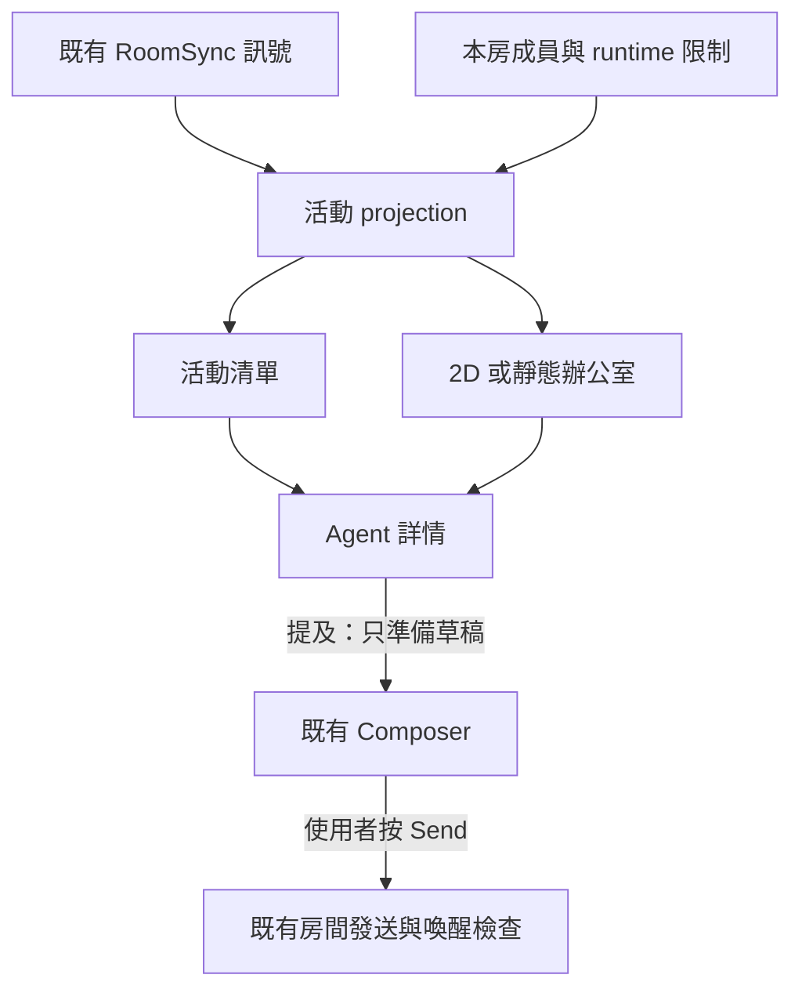

# Agent 活動視圖與辦公室動畫 — 開發計畫

- 日期：2026-10-25；版本：0.1。
- 文件工作：[Issue #629](https://github.com/fallrising/newclear/issues/629)。本次為 AV-0 文件里程碑；程式里程碑均為 `NOT_STARTED`。
- 定位：Kith 現有房間的活動呈現與提及入口。沿用 [SDD](../../SDD.md)、[v2 契約](../v2/README.md)、[成本控制](../cost-safety.md)；本計畫不改 INV-01–19。
- 授權：2026-10-25 owner 明確追加更新文件、開 PR 並合併；本輪完成 AV-0 文件、必要檢查／審查、PR 合併及遠端回讀。以下程式切片是後續規劃，沒有因文件合併而自動取得實作、付費或部署授權。

## 1. 目標與設計決定

讓使用者進入 Kith 房間後，看見每個 Agent 最近回報的活動；點選角色查看既有對話與工具摘要，再透過現有輸入框提及該 Agent。其後，同一份活動資料可以呈現為工區、工位與 2D 角色動畫。

這次採用的方向是先在 Kith 增加視圖。Kith 繼續擁有房間、成員、對話與顯示權限；工作調度、CLI 執行、桌面控制與成果驗收由原執行系統負責。外部平台可以在後續透過明訂契約的 adapter 提供活動，首版不依賴任何尚未接通的外部平台。

| 已選定的方向 | 實作含義 |
| --- | --- |
| 先活動卡，再 2D 辦公室 | 先驗證資訊與互動，動畫是同一 projection 的另一個 renderer |
| 先本房、現有 Agent 成員 | 以 `room_id + member_id` 定位，不新增帳號、員工資料庫或另一套 Agent 身分 |
| 點選與送出分開 | 點選只看資料；「提及此 Agent」只填草稿；使用者按 Send 才送訊息 |
| 顯示來源與新鮮度 | 最近觀測不等於完整 runtime 真相；無資料、斷線與過時都必須可見 |
| 展示用途與資料公開分開 | 真實資料沿用房間授權；公開示範先使用合成資料 |
| 保留既有產品邊界 | 不新增 scheduler、訂閱池、私訊、遠端 CLI 控制或第二份成果狀態 |

跨房員工大屏、精細工具動作、日／週工作統計、真正公開的即時看板、3D 和 PiP 都列為後續範圍。它們不阻擋本房活動卡與 2D 展示，也不因有動畫就算完成。

## 2. 上游參考與已確認的差異

查核版本：`Charonyuu/whatsmyagentdoing` [c9dc82f7bca2503fa32fadb40db86cd15946df71](https://github.com/Charonyuu/whatsmyagentdoing/tree/c9dc82f7bca2503fa32fadb40db86cd15946df71)，`package.json` 為 0.3.0，查閱日期 2026-10-25。以下為文件與原始碼查核，沒有啟動上游或執行其 runtime 驗收。

| 項目 | 上游現況 | Kith 採用方式 |
| --- | --- | --- |
| 活動來源 | 唯讀解析本機 Claude Code、Codex、Gemini session logs，再以 SSE 顯示 | 首版讀 Kith 已授權的 status、draft、message、trace；不掃使用者 HOME 或登入資料 |
| 呈現 | List、2D Canvas、按需載入的 3D 辦公室；角色可顯示 session 卡片 | 保留清單與角色互通的體驗；首版沿用 Kith React／設計系統，2D 延後載入 |
| 選定對話 | UI 複製 CLI resume 指令，沒有直接發話或接管 session 的 API | Kith 使用既有房間 composer 的明確提及流程；不執行複製出的 shell 指令 |
| 公開展示 | HTTP 綁定 loopback 並檢查 localhost Host；沒有公開分享或多使用者授權契約 | 真實活動限定既有房間授權；公開示範僅用合成資料 |
| 靜默與完成 | `server.js` 有以靜默時間推測 done／idle 的行為 | Kith 超時改成 stale／unknown，不推測任務已完成或正在休息 |
| 私密模式 | `--private` 隱藏部分文字，仍可能保留 cwd、session ID、model、error 等欄位 | 不把該輸出直接用作公開 payload；真實公開分享需另外的伺服器端欄位白名單 |
| 素材 | 程式 MIT；Kenney 模型 CC0；provider logos 有獨立商標說明 | 此次只寫文件，不複製程式或資產。後續優先使用原創圖形；採用素材時逐項記來源、授權及必要聲明 |

來源：[README](https://github.com/Charonyuu/whatsmyagentdoing/blob/c9dc82f7bca2503fa32fadb40db86cd15946df71/README.md)、[server](https://github.com/Charonyuu/whatsmyagentdoing/blob/c9dc82f7bca2503fa32fadb40db86cd15946df71/src/server.js)、[CLI](https://github.com/Charonyuu/whatsmyagentdoing/blob/c9dc82f7bca2503fa32fadb40db86cd15946df71/bin/cli.js)、[UI](https://github.com/Charonyuu/whatsmyagentdoing/blob/c9dc82f7bca2503fa32fadb40db86cd15946df71/public/index.html)、[MIT](https://github.com/Charonyuu/whatsmyagentdoing/blob/c9dc82f7bca2503fa32fadb40db86cd15946df71/LICENSE)、[角色 CC0](https://github.com/Charonyuu/whatsmyagentdoing/blob/c9dc82f7bca2503fa32fadb40db86cd15946df71/assets/kenney/LICENSE-mini-characters.txt)、[家具 CC0](https://github.com/Charonyuu/whatsmyagentdoing/blob/c9dc82f7bca2503fa32fadb40db86cd15946df71/assets/kenney/LICENSE-furniture-kit.txt)、[provider icons 說明](https://github.com/Charonyuu/whatsmyagentdoing/blob/c9dc82f7bca2503fa32fadb40db86cd15946df71/assets/agents/README.md)。

## 3. Kith 現況與重用位置

查核基準：`newclear@cfc68b97e0ee77a185807cbaf9695a29fcbcc48e`。程式存在、歷史測試與真實 provider 驗收分開看；聊天室 AC-04 仍依 [SUCCESS](../../SUCCESS.md) 的 pending 狀態，不以本文件提升資格。

| 既有來源 | 可以重用 | 必須保留的限制 |
| --- | --- | --- |
| [RoomPage](../../web/src/app/RoomPage.tsx)、[RoomSync](../../web/src/sync/RoomSync.ts) | 當前房間的同步、重連、歷史補洞與送訊息 | 新視圖共享同一 RoomSync；不為每個角色新增 WS／SSE 或輪詢 |
| [status store](../../web/src/store/statuses.ts) | accepted、running、replying、blocked、failure 等觀測 | `at` 是瀏覽器收件時間；目前無可靠 event ID、來源時間、generation／attempt 關聯 |
| [AgentDetail](../../web/src/features/members/AgentDetail.tsx) | Agent 名稱、runtime 與限制資訊 | 配置正常不等於正在工作；一般成員不能改用 operator 專屬 API 取資料 |
| [TraceCard](../../web/src/features/timeline/TraceCard.tsx) | 已有工具摘要與按需讀取完整紀錄 | 歷史摘要不證明現在正在執行；不可 hover 一個角色就載入所有 trace |
| [Composer](../../web/src/features/composer/Composer.tsx) | 提及、草稿、焦點與既有送出流程 | 保留草稿及 room／thread；填入提及不自動 send |
| [runner](../../runner/runner.ts)、[MCP](../../worker/mcp.ts)、[Room](../../worker/room.ts) | 現行狀態與紀錄來源 | runner 在開始時回報 accepted／running，沒有持續 running heartbeat；trace 通常在 CLI 返回後上傳 |

現行 `post_status` 即使輸入有 thread／generation 欄位，也沒有完整傳成可關聯的 WS 活動事件；非空 body 還可能覆蓋 state。不得從任意 body 文字猜工具、進度或審批狀態。現有「收到某 sender 的 message 後清除 reply」也不是該 Agent 所有工作的完成證據。

## 4. 使用流程與可見範圍

### 4.1 當前房間活動

1. 使用者從現有房間進入「Agent 活動」。空房顯示沒有 Agent；無權限、同步中與資料過時使用不同狀態。
2. 清單／卡片顯示本房 Agent 的名稱、來源標籤、最近觀測、最後收到時間、runtime 限制與可用操作。每房仍遵守既有 32 名成員上限。
3. 點選卡片或動畫角色開啟同一個詳情面板，可定位既有訊息／thread、展開既有 trace；所有讀取沿用房間 membership。
4. 選擇「提及此 Agent」後，把正確的 `@handle` 加入本房目前 composer；有草稿時保留原文，不默默替換目標或清空文字。重複點選同一目標不重複插入同一提及。
5. 使用者檢查文字後按 Send，沿用既有 `RoomSync.send`、`client_message_id`、重送與錯誤處理。

點選、切換 renderer、展開詳情、重連和可見性恢復都不能發 message／status、啟動模型／CLI、重播歷史 mention，或變更 provider／attention／quota／paid flags。歷史載入保持有界，完整 trace 僅在使用者明確展開時讀取。

「提及」不是私訊或獨占回覆：房內其他成員仍可讀；其他明確提及與 keyword／ambient 規則照常運作。Thread 也仍是同房可見。首版不承諾只有被點選的 Agent 回覆，不恢復原生 CLI session。

### 4.2 發送與權限

- 真實活動只有登入且有該房 membership 的使用者可見；operator 也不能因能列房間就繞過房間讀寫檢查。
- `operator_personal` 保留醒目限制。非 operator 可以按既有行為留下提及文字，但不得啟動該訂閱的 hosted／runner；不得因這次受限提及宣稱「已接手」，也不遮蔽其他合法工作的既有觀測。
- Provider 已設定不表示 paid inference 已開啟；所有送出仍受現行 opt-in、admission、quota、generation／runtime epoch 與 [cost-safety](../cost-safety.md) 約束。
- 封存房間保持唯讀；送出前目標已移除、切房、權限失效或 session 過期時，保留未送草稿並明確拒絕，不自動找另一個 room／Agent。
- 詳情不額外暴露 operator 專屬 generation error、憑證、原生 session ID 或私有路徑。顯示名稱、自由文字、摘要及連結沿用既有安全 Markdown／文字渲染。

### 4.3 展示模式

| 模式 | 資料與行為 | 階段 |
| --- | --- | --- |
| 房間活動 | 已授權房間的實際 projection，可查看紀錄並準備提及 | AV-1 |
| 房間展示 | 同一授權範圍的 2D／靜態畫面，可隱藏詳情以便投影；隱藏是 UI 偏好，不新增讀取權限或公開安全保證 | AV-2 |
| 公開 demo | 明確標示 DEMO；只載入合成成員／事件，不連房間 API、不帶 session token、不提供 Send | AV-2 |
| 真實公開看板 | 另設可撤銷的發布授權與伺服器端 allowlist projection；來源 room、受眾、欄位、有效期與撤回流程需完整驗收 | 後續，未排程 |

真正公開的 payload 不得先載入全部房間資料再用 CSS 隱藏。後續至少要限定公開別名、粗粒度活動及 freshness；訊息／trace、cwd、原生 ID、錯誤詳情與其他房間資料預設不輸出。公開 demo 規劃為與正式登入 origin 分離的靜態入口，以避免瀏覽器自動帶入既有登入 cookie；使用合成 fixture，不複製任何登入狀態。本輪不建立公開 endpoint、分享 token 或匿名互聊能力，也不部署 demo。

## 5. 活動 projection 與動畫語意

### 5.1 四種資訊分開

以下是待實作的前端 view model，不是現有 API／DB schema：

| 欄位 | 來源與定義 |
| --- | --- |
| `room_id`, `member_id` | 已授權 members 的既有身分；顯示名稱和角色位置不作資料鍵 |
| `runtime_status` | 既有 Agent 配置／限制，保留原始語意 |
| `observer_connection` | 既有 RoomSync.phase，表示此瀏覽器的房間連線 |
| `observed_activity` | 可識別的最近 status／draft 訊號；缺少則 unknown |
| `received_at` | 本次連線中瀏覽器收到訊號的時間；不是 Agent 開始時間 |
| `freshness` | fresh／stale／unknown；與觀測內容分開 |
| `recent_history_refs` | 本房既有訊息／trace 參照，按需讀取；不轉成現在的 runtime 狀態 |

`runtime_status=ok` 不表示工作中；RoomSync live 不表示 Agent 在線；沒有 status 不表示 idle。首版不提供工作完成數、精確耗時、token／成本、員工績效或工作利用率。

現有 status store 會在 idle／reply ended 時刪除 reply，也不保存任意 body。AV-1 若要保留「最後回報」文字，須在現有 RoomSync 的 status ingress、完成 room／member 檢查後，更新一份有界、僅供顯示的記憶體 projection：每個當前成員最多一筆，沿用既有 status payload 上限，切房／登出即清除。它共用原連線，不發送事件、不持久化、不另開事件匯流排。若首片未加入這個接入點，idle／未知 body 一律降為 unknown，不可聲稱從既有 selector 取到了已丟棄的資訊。

### 5.2 狀態到畫面的映射

| 已收到的訊號 | 顯示與 2D 行為 | 不作的推導 |
| --- | --- | --- |
| exact accepted | 「最近回報：已接收」；角色就位 | 不宣稱 CLI 已開始或排程保證 |
| exact running | 「最近回報：執行中」；一般工作動作 | 不猜正在改哪個檔案、跑哪個工具 |
| replying／有效串流草稿 | 「最近回報：回覆中」；回覆提示 | 不等於 token 級思考展示，也不展示隱藏推理 |
| exact blocked | 「來源回報受阻」；提示圖示 | 不自動稱為等待人工批准，不提供新 approve API |
| reply failed／已知失敗訊號 | 「最近回報失敗」；錯誤提示 | 不把歷史失敗套到其他未關聯執行 |
| exact idle | 「來源回報閒置」；靜止 | 不視為工作成果已驗收 |
| reply ended／收到 message 而清 reply | 結束該回覆提示，歷史可查 | 不新增 done／任務成功狀態 |
| 無訊號、未知 body、資料過時、斷線 | 「尚無狀態／資料過時／連線中斷」；停止忙碌動畫 | 不播放完成、休息或下班來掩蓋缺資料 |

AV-1 使用目前 `REPLY_STALE_MS=300000` 作為預設觀測新鮮度門檻；這只影響新視圖，不改既有 timeout 或來源 TTL。到期即標 stale，保留最後回報文字與時間供解讀。長 CLI 仍可能正在執行，不自動取消、重啟或補發 heartbeat。未知 body 只作有權讀取的安全文字，不解析成活動 enum。

資料處理順序：先驗證目前 room／member 與權限，再套 runtime disabled／連線狀態，最後判斷觀測 freshness。切房／登出／成員移除時清除該視圖的資料與選取；舊房非同步結果不得回填新房。Reconnect 不從歷史 message／trace 重建「正在工作」，需等待新的可識別訊號。已知 runtime_epoch 變更、runtime 切換或 disabled 時，該成員的舊觀測也須失效，新訊號前顯示 unknown；使用既有 AgentRuntimeSummary 可提供的 runtime_epoch 與實際觀測到的配置變更，不假設配置變更會即時推送到瀏覽器。現行 status 無來源 epoch／generation correlation，仍須標明無法關聯；收到新封包也不能保證其屬於新的執行。需要這種保證時進 AV-3，不以視圖宣稱已解決跨 generation 亂序。

### 5.3 投影與呈現分離

動畫 renderer 只消費已投影的資料，不持有 bot token、不自行訂閱來源、不根據碰撞／點擊／倒數觸發工作。List 與 2D 共用選取、文字狀態和詳情，關閉動畫不損失功能。

## 6. 工區、工位、角色與外部平台的後續邊界

首版以當前房間作工區、Agent 成員作可選工位。工位 id／座標／avatar／顯示角色屬 presentation metadata，不是新的 member_id、provider account 或執行權限；房間的 owner／member 權限角色也不等於畫面中的工作職務。

後續若加入「以員工為單位，動起來的是其 Agent」，再定義明確的顯示 binding：人類成員參照、工作職務、Agent member 參照及有效期間。一個人可有多個工位，一個 Agent 可以扮演不同展示角色；同一 Agent 的多張卡片不能被重複算成多個執行者。缺少 owner／role 映射時顯示未指定，不從對話、email、handle 或模型名稱猜測。

[Agent Workforce](../../../../platform/agent-workforce/README.md) 的 [SDD](../../../../platform/agent-workforce/SDD.md) 已區分 worker／route／session／attempt，可作後續模型對照；[Agent Platform](../../../../platform/agent-platform/README.md) 擁有工程任務執行工作台。這些是邊界參考，尚未因本計畫接通。Kith 不複製它們的執行 ledger、不承擔外部 command 的 Done 判斷，也不公開私有平台的實作資訊。

精細活動 adapter 的後續契約至少需要：

- 來源身分與版本、已授權的 room／member 映射；不能信任 payload 自報他人 member_id。
- 穩定 event ID、來源順序、observed／received 時間、freshness 規則、generation／attempt correlation 與 runtime epoch。
- 重送去重、亂序、舊 attempt 遲到、斷線、重啟、未知終態與覆蓋缺口的案例。
- structured tool／waiting／turn-completed 事件的來源證據；完成回合與業務成果驗收分開。
- 有界傳輸、欄位白名單與 room 授權；不把原始 prompt、log 或登入資料上傳。

以上沒有現成 endpoint。實作前須另立 ADR／版本化契約與測試向量；不可直接把新 JSON 塞進自由文字 `post_status` body，或把活動投影變成第二條可喚醒的訊息匯流排。日／週統計需先有可去重的耐久事件與明確統計定義，不能拿 ephemeral status 次數充當完成數。

## 7. 開發切片、失敗案例與驗收

### 7.1 里程碑

| 階段 | 交付範圍 | 依賴與停止條件 | 目前狀態 |
| --- | --- | --- | --- |
| AV-0 | 本文件、來源、導航、SUCCESS、task／report | 文件 AC、必要 CI／審查通過後合併 PR，回讀遠端並收尾；不啟動程式階段 | 文件驗證通過；合併與收尾紀錄見 report／任務板 |
| AV-1 | 本房活動清單／卡片、projection、詳情、提及草稿入口 | 只用現有資料；現有欄位不足就顯示 unknown，不擴充後端或發明狀態 | NOT_STARTED |
| AV-2 | 同一 projection 的 2D／靜態 renderer、合成公開 demo | AV-1 驗收；先決定性 fixture，再加動畫。3D／公開真實資料不在此片 | NOT_STARTED |
| AV-3 | 精細活動的 ADR、版本化事件及一種明確來源 adapter | 另立工作，固定來源與相容矩陣；以真實來源證據驗收，先保留缺口 | NOT_STARTED |
| 後續 | 員工／角色 binding、跨房工作區、日週統計、公開 live projection、可選 3D／PiP | 各自定義需求／權限／驗收；不預設所有平台已接線 | 未排程 |

AV-1 建議新增 `web/src/features/activity/` 及專用 projection／selector，連接現有 RoomPage、RoomSync、members、status／draft stores、AgentDetail、TraceCard、Composer。上述新路徑是規劃，尚未建立。AV-2 renderer 維持獨立、按需載入；不得把 three.js 或模型素材加進初始聊天 bundle。既有初始 JS 預算依 [v2 決策 Q-31](../v2/10-decisions.md)，不因新視圖自行放寬。

### 7.2 FM 與未來程式驗收

先固定失敗案例，再實作相應切片。以下均為未執行的 Given／When／Then 驗收，不能引用成本次測試通過。

| ID／階段 | Given / When / Then |
| --- | --- |
| E2E-AV1-01／觀察副作用 | Given 合成 Agent 與記錄 send／模型／CLI 次數的 fixture，When 開活動頁、點角色、切詳情、重連，Then 三種執行次數增量均為 0，連線數不隨角色數增加 |
| E2E-AV1-02／未知與過時 | Given 無 status、exact idle、未知 body 及一次 running，When 檢查 ingress 保存並推進可控時鐘超過新鮮度門檻或斷線，Then idle 只可由明確訊號取得，未知文字安全保存或降 unknown，各觀測會過時並停止忙碌動畫；reply 欄位缺失不能推成 idle／done |
| E2E-AV1-03／錯房與撤權 | Given 房 A 的延遲事件及房 B 的畫面，When 切房、移除 membership、收到 401／403 或確認 runtime／epoch 已切換，Then A 的資料不進 B，失權資料和選取被清除，舊 runtime 觀測失效，沒有跨房讀寫 |
| E2E-AV1-04／歷史不執行 | Given durable trace 與 replay mention，When 展開紀錄或 reconnect 補洞，Then 只顯示歷史，不產生新的 running／accepted 或模型／CLI 啟動 |
| E2E-AV1-05／明確提及 | Given 本房 Agent 與既有草稿，When 點「提及此 Agent」兩次，Then 保留草稿且只插入一次目標提及；When 使用者 Send，Then 使用既有送出與相同 client_message_id 重試語意，只有一筆耐久訊息 |
| E2E-AV1-06／訂閱與成本 | Given 非 operator 提及 personal Agent 或 hosted paid opt-in 關閉，When 按 Send，Then 既有訊息處理與拒絕理由可見，受限模型／CLI 啟動為 0，畫面不因這次受限提及宣稱已接手，其他合法工作的觀測不被遮蔽 |
| E2E-AV1-07／thread 與房間狀態 | Given thread 草稿、封存房間或已移除目標，When 嘗試提及／送出，Then 不誤送到別房或別 thread，唯讀與成員規則生效；UI 清楚說明同房可見 |
| E2E-AV1-08／XSS 與資料範圍 | Given 惡意顯示名稱／body／trace 與一般成員，When 開詳情，Then 不執行 HTML／腳本、不讀 operator 專屬 error 或其他房間資料 |
| E2E-AV1-09／耐久邊界 | Given D1 INSERT 成功但 broadcast 前 crash，When 既有機制重連補洞，Then 訊息維持同一 id／seq、活動保持 unknown 直到新訊號，沒有重送推論 |
| E2E-AV2-01／同一資料兩種視圖 | Given 決定性活動 fixture，When 切換 List／2D 並點相同角色，Then 文字狀態、選取、詳情相同；畫面不因動畫自行更新活動 |
| E2E-AV2-02／無障礙與降級 | Given 桌面、390px 手機、鍵盤、zh-TW／en、reduced-motion 與 renderer 載入失敗，When 操作同一流程，Then 可用清單／靜態畫面完成；隱藏分頁停止動畫，恢復後重算 freshness |
| E2E-AV2-03／公開 demo | Given 公開 demo route 與合成資料，When 點角色、查看網路請求與 payload，Then 有 DEMO 標示、無房間 API／憑證／真實紀錄，也沒有可送出的對話 |
| E2E-AV3-01／事件來源 | Given 重複／亂序／舊 attempt／偽造 member／來源中斷的 adapter fixture，When 接入版本化事件，Then 授權、去重、correlation 和未知終態成立；實際來源另有同版證據 |

### 7.3 驗證方式與交接

AV-0 只執行文件驗證：連結與來源版本、變更白名單、無私人來源／執行資料、SUCCESS 格式及獨立設計審查。現有 CI 仍按 [.github/workflows/kith.yml](../../../../.github/workflows/kith.yml) 與 [Project success contracts](../../../../.github/workflows/project-success.yml) 執行；本輪不改 workflow，也不新增鏡像文件內容的測試。

程式階段沿用 [v2 驗證](../v2/08-testing-e2e.md) 的證據格式與目前 [README](../../README.md) 的本地瀏覽器政策。每片實作前固定 FM、測試 fixture、實際 spec 路徑與精確命令；本文件的 E2E-AV IDs 不是已存在的 test 檔。用可控時鐘與合成 provider／CLI，保留 trace、截圖、network／invocation 計數；開發期只跑該片，PR 前依現行 gate 補回歸。不要把 mock 畫面、單張截圖或 build 成功宣稱為真實 Agent 整合。

下一個可執行工作為 AV-1：先細化 projection 與 composer 的有界介面，驗證 E2E-AV1-01–09，再做活動卡。AV-0 的完成不解除 AC-04 的真 provider／原生 CLI 缺口，也不自動開啟 AV-1。

## 8. 本次文件驗收

| ID | Given / When / Then | 證據 |
| --- | --- | --- |
| AC-AVDOC-01 | Given 固定上游與 Kith 版本，When 對照程式與文件，Then 參考能力、差異、來源及素材邊界可追溯 | §2–3；[工作報告](../../tasks/629-agent-activity-design/report.md) |
| AC-AVDOC-02 | Given owner 的展示與對話方向，When 閱讀本計畫，Then 可分辨現況、提案、觀測語意、權限、切片與尚未執行的驗收 | §1、§4–7；[工作報告](../../tasks/629-agent-activity-design/report.md) |
| AC-AVDOC-03 | Given 本輪僅文件變更，When 執行文件／SUCCESS 檢查與獨立審查，Then 導航及證據完整，不把程式里程碑或聊天室主線標成完成 | [任務](../../tasks/629-agent-activity-design/task.md)、[工作報告](../../tasks/629-agent-activity-design/report.md) |
