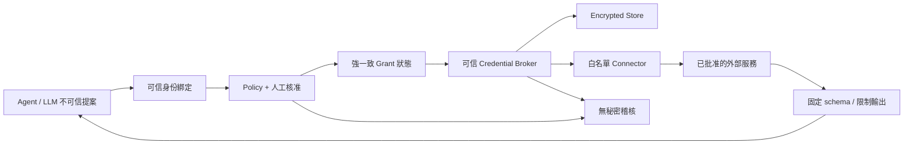

# Agent Secrets — Software Design Document

- 版本：0.1；日期：2026-11-02；狀態：Draft / spec-only。
- 授權：本輪只建立規格與專案文件；後續開發、merge、release、deploy 各自需要明確授權。
- 上游基準：`meathill/hsm@0f753b6e393dd938bc53d04294b0bb8ae5b3bb5e`（2026-10-30）。
- newclear 基準：`244c7f7b416508aedd8f5f8d4a082ae2bb17d022`。
- 來源索引：[SOURCES.md](SOURCES.md)；決策狀態：[ADR.md](ADR.md)；驗收入口：[SUCCESS](../SUCCESS.md)。

## 1. 目的、規格層級與非目標

建立小型加密秘密儲存及未來 Agent 憑證使用邊界。可保存 API token、密碼、私鑰字串、小型敏感設定；保存私鑰不代表具備硬體內簽章能力。「合法」指擁有人批准及系統授權，不是法律或合規認證。

本文的 U-* 是固定上游觀察，不是新系統的安全承諾；R-* 是後續實作必須滿足的要求；E-* 是待批准擴充。只有經明確批准的里程碑可以實作。規範詞 MUST／不得為該里程碑的必要條件。

| 層級 | 內容 | 本輪狀態 |
| --- | --- | --- |
| U：相容參考 | Workers＋KV、HTTP CRUD、HKDF／AES-GCM、MCP 三個工具 | 已記錄來源，未執行 |
| R：安全修正 | 誠實威脅模型、明確身份／輸入界線、秘密不記錄、協定驗證 | 規格要求，未實作 |
| E：Agent Broker | 最小權限、審批、短效有界 grant、use-without-reveal、稽核／撤銷 | Proposed，未授權開發 |

不做硬體 HSM、通用 KMS、PKI、憑證簽發、多租戶 SaaS、密碼管理器 UI、完整 Agent 平台或任意 shell 代執行。不得宣稱零知識、端對端加密、永不洩漏、絕對安全。P0 本地加密模式不是原版能力，不列入 M1 承諾。

## 2. 使用者與情境

Operator 管理服務與憑證；Credential Owner 決定可用範圍；Trusted Host 綁定工作負載身份；Agent 提出操作請求；Broker 依政策執行；外部服務接受真正的憑證。

U-01：可信程式把合成 token 存於一個邏輯 path，之後用同一 Part B 取回、覆寫或刪除。

E-01：Agent 請求使用某個 credential_ref 執行白名單唯讀 action；Broker 核對 principal、任務、目標及政策，必要時等待人在模型外核准，執行後只回傳已限制的業務結果。

E-02：任務取消、grant 過期或 owner 撤銷後，後續使用被拒絕；先前已交給外部服務的請求與已外洩的原始秘密不能被魔法收回。

## 3. 固定上游的模組與依賴

| 模組 | 上游路徑 | 觀察到的責任 |
| --- | --- | --- |
| HTTP router | `src/index.ts` | Hono；GET／PUT／DELETE `/keys/*`；CORS 與 OPTIONS |
| CRUD／所有權 | `src/handlers/keys.ts` | request header、長度檢查、KV 查找、解密式覆寫／刪除保護 |
| HKDF | `src/crypto/hkdf.ts` | Part A＋Part B＋salt 派生 KEK |
| Envelope／AES | `src/crypto/envelope.ts`、`aes-gcm.ts` | DEK、KEK、AES-GCM、AAD、Base64 |
| 索引混淆 | `src/crypto/hmac.ts` | path 經 HMAC-SHA256 成為 KV key |
| MCP bridge | `scripts/hsm-mcp-stdio.mjs` | 本機 Node 程序把工具呼叫轉為 HTTP；原樣回傳 API payload |
| 建置／測試 | `package.json`、README | pnpm、Wrangler、TypeScript、Vitest、Biome；靜態文件建置另有依賴 |

服務執行依賴 Cloudflare Workers、KV binding `KV`、Web Crypto；服務端秘密為 `CF_SECRET_PART`、`INDEX_SECRET`。MCP 橋需 Node 與 `HSM_BASE_URL`、`HSM_SECRET`。上游 package 的版本範圍不是本專案已選定的 lockfile；開發時重新固定版本。靜態站品牌資源不是密碼運算必需依賴，不承諾移植。[S1–S8]

## 4. U 層：HTTP 相容參考契約

所有 `/keys/:path` 操作以 `X-HSM-Secret` 傳送 Part B；上游將 URL pathname 去掉 `/keys/` 前綴作為 path。這不是明確的租戶 namespace 或權限模型。

| 介面 | 請求 | 成功回應 | 已觀察錯誤 |
| --- | --- | --- | --- |
| PUT `/keys/:path` | JSON `{"value":"SYNTHETIC_TEST_VALUE"}` | 201，`{"success":true,"data":{"path":"demo/item"}}` | 缺 header／value、長度過長等通常 400；既有 key 所有權失敗 403 |
| GET `/keys/:path` | 無 body | 200，`{"success":true,"data":{"path":"demo/item","value":"SYNTHETIC_TEST_VALUE"}}` | 不存在 404；缺 header／解密失敗走一般錯誤，通常 400 |
| DELETE `/keys/:path` | 無 body | 200，`{"success":true,"data":{"path":"demo/item"}}` | 不存在 404；既有 key 所有權失敗 403 |
| OPTIONS `/keys/*` | CORS preflight | Hono middleware 處理 | 不代表業務授權 |

上游錯誤 shape 為 `{"success":false,"error":"..."}`；未知 route 為 404。不得在新契約誤寫「所有錯誤 secret 都回 403」。上游 CORS 是 `origin: '*'`，允許 Content-Type／X-HSM-Secret 與以上方法；這不提供身份驗證。[S2–S3]

U-02：上游以 `value.length > 8192` 判斷上限，實際為 JavaScript UTF-16 code units，不是 UTF-8 bytes；空字串被拒絕。HTTP handler 的 runtime 型別檢查不完整，不能把 TypeScript 型別當 JSON 驗證。

R-01：後續新服務 MUST 嚴格接受非空字串，保留 8192 code units 的相容限制，另有 body byte 上限與路徑上限。路徑 grammar、percent encoding、空 segment、dot segment 與最大 byte 數須在 M1 定案並加入測試；不可悄悄改寫既有 path 的 AAD。非相容的輸入／錯誤修正要列在變更表，不以還原缺陷作為相容目標。

R-02：管理端 MUST 有獨立入口身份驗證與最小權限，不能只因任意 Part B 非空就允許公共匿名建 key。CORS 預設不開放，確有瀏覽器管理介面時才列明允許來源。禁止把 Part B 編入前端 bundle。

## 5. U 層：密碼與資料格式

```text
storage_key = "key:" + Base64(HMAC-SHA256(INDEX_SECRET, UTF8(path)))
IKM         = UTF8(PartA + PartB)          # 上游為字串直接相接
KEK         = HKDF-SHA256(IKM, salt16, info="hsm-kek") -> AES-256-GCM key
DEK         = 隨機 AES-256-GCM key
payloadEnc  = AES-GCM(DEK, UTF8(value), payload_iv12, AAD=UTF8(path))
dekEnc      = Base64(dek_iv12) + "." + Base64(AES-GCM(KEK, UTF8(Base64(DEK)), dek_iv12, AAD))
```

上游以 Web Crypto 產生隨機 salt／DEK／兩個獨立 IV；KEK deriveKey 設為不可匯出，DEK 會匯出並包裝。注意被 KEK 加密的是 DEK 的 Base64 字串之 UTF-8 bytes，不是直接裸 DEK bytes。[S4–S6]

KV value 是 JSON：

```json
{
  "salt": "BASE64_SALT",
  "v": 1,
  "dekEnc": "BASE64_DEK_IV.BASE64_WRAPPED_DEK",
  "iv": "BASE64_PAYLOAD_IV",
  "payloadEnc": "BASE64_CIPHERTEXT_AND_TAG"
}
```

上例是格式占位符，不是有效密文。`v` 是 envelope 格式版本，不是 secret revision。上游格式沒有 tenant、owner、權限、TTL、輪替 key id、revision、刪除 tombstone 或稽核資料。[S3–S6]

PUT：查找既有 key；存在則先用此次 Part B 解密證明所有權；產生新 salt／DEK／IV，寫入 envelope。GET：讀 KV、派生 KEK、解開 DEK、解密 value，回傳明文。DELETE：讀 KV、解密驗所有權，再刪除。

R-03：不得改用自製密碼原語。必須有跨實作 round-trip、錯誤 Part A／B、未知 v、損壞密文、AAD 換路徑與非 ASCII 測試。原版兩段輸入不是 Shamir sharing、threshold crypto 或多方安全運算；未來若改為有長度前綴／domain-separated 輸入，必須升級 envelope 版本並有遷移規格。

## 6. 信任邊界與不能省略的安全限制

| 情境 | 能保護／不能保護 | 後續要求 |
| --- | --- | --- |
| 僅 KV 資料外洩 | envelope 保護靜態內容；仍可能暴露數量與存取形態 | 高熵 Part A／B、INDEX_SECRET 分離保管；不以人類弱密碼充當隨機秘密 |
| Worker 執行環境或部署權被控制 | PUT 收到 value 與 Part B；GET 在 Worker 解密；可擷取後續明文 | 明確信任服務執行端，不能宣稱服務端不可解密 |
| KV 管理權被控制 | 可刪除密文、回填同 path 舊密文 | AEAD 防修改不等於防刪除／防回滾；需要備份、版本與外部權威 |
| 知道 path 但非 owner | 原版既有 key 覆寫／刪除試解密會擋；新 path 可遭搶占 | 明確身份、namespace 與 create 權限；不以 path 保密代替權限 |
| 併發寫入 | 先 GET 後 PUT 不是原子比較交換 | 不得宣稱原子所有權／強一致；並發測試與序列化方案是 gate |
| 模型或 prompt injection | MCP 原版 get 會回傳秘密 | 將 Agent 與可信 Broker／管理端隔離；政策在模型外執行 |
| 憑證下游被濫用 | 合法使用也可能造成高權限副作用 | 白名單 action／target、短期限額、必要審批、下游原生最小權限 |

「服務端不持久化 Part B」只說明存儲方式，不代表服務端取不到它。HTTPS 也不會對 Worker 本身隱藏 HTTP header／body。path 的 HMAC 只混淆 KV 索引，不會隱藏 HTTP URL、應用程式或管理日誌中的 path。[S1–S7]

R-04：所有 transport response 的秘密敏感路由設 `Cache-Control: no-store`；禁記 header、value、原始下游 body、完整 tool args、grant bearer 值與帶 query 的敏感 URL。錯誤採 allowlist code，不回傳底層 crypto 或 provider 的秘密訊息。log redaction 不是密鑰隔離的替代品。

R-05：本地 P0 要求若啟用，MUST 由可信本機程序在上傳前加密，解密材料不提供給遠端。這是獨立 profile／里程碑；不得把原版 Part B 上傳 Worker 的流程標成 P0。

## 7. 目標模組與資料流（E：Proposed）

| 模組 | 責任 | 不應取得／承擔 |
| --- | --- | --- |
| Encrypted Store | 上游 envelope 與管理端 CRUD；後續版本化儲存 | 不自行判定 LLM 指令可信 |
| Identity Adapter | 將可信 transport／host session 綁定 principal 與 workload | 不接受模型自報 principal、admin 或 tenant |
| Policy／Approval | 固定 action、credential_ref、目標、任務、期限、核准 | 模型說「已獲批准」不能變成批准 |
| Credential Broker | 取得有界憑證，在可信程序內注入固定 connector | 不提供任意 shell、任意 URL 或 raw export 工具 |
| Connector | 固定目的地與動作，驗證參數與輸出 schema | 不追隨未批准 redirect；不把 Authorization 回顯 |
| Grant／Audit Store | 原子消耗、撤銷、版本、操作紀錄與恢復 | 不以最終一致 cache 作授權真相 |
| MCP Adapter | 暴露受限工具與無秘密結果 | 不承載決策權威，不將秘密直接回傳模型 |



第一個方向為可信本機 Broker，置於 Agent sandbox 之外。憑證不得放入 Agent 能讀取的環境、檔案、同權限 process dump 或 shell argv。只把流程畫成兩個程序不代表已達隔離；M2 必須驗證 OS／容器／執行器邊界。現有 Agent Platform 只作未來 adapter 消費端，不是本次修改範圍。[S11]

## 8. Agent 授權與工具契約（E：Proposed）

E-03：每次授權必須綁定 `principal_id`、`workload_id`、`task_ref`、`credential_ref`、`action_id`、`target_id`、`arguments_digest`、`policy_version`、`output_policy`、`expires_at`、`max_uses`。身份由可信 host／transport 注入；模型只提交 action 的業務參數。第一版建議最多 5 分鐘、單次使用，屬待批准預設，不是上游功能。

| 工具 | 模型可給的輸入 | 模型可見輸出 |
| --- | --- | --- |
| `credentials_request_use` | credential_ref、固定 action_id／target_id、已驗證的 arguments、task_ref | request_id；DENIED／PENDING_APPROVAL／GRANTED；允許時給短效 opaque grant_ref |
| `credentials_execute` | grant_ref、相同 arguments、request_id | 狀態、operation_id、已限制的 result；永不含原始長期憑證 |

`grant_ref` 自身是有界 capability，也要保護；不可假設它公開無害。Broker 在 execute 時再次驗證 principal、digest、目前政策、期限、撤銷與剩餘次數，不只在 grant 建立時檢查。

示例為合成 request，並非可直接呼叫的已實作 API：

```json
{
  "credential_ref": "cred_demo_readonly",
  "action_id": "demo.list_items",
  "target_id": "demo-service",
  "task_ref": "task_demo",
  "arguments": {"limit": 5}
}
```

E-04：核准只能來自模型外已驗證 owner；綁定完整動作 digest，不接受任意「approve=true」。修改目的地、參數、憑證版本、政策或輸出範圍後舊核准失效。工具中的 reason 只是顯示文字，不是權限。

E-05：`use-without-reveal` 是預設；把 secret 注入 Agent 自己可執行任意程式的環境不能稱為不揭露。未來如需環境注入或 raw export，必須獨立里程碑、明示降級風險與新的 AC，不作第一版捷徑。下游支援時優先使用 provider 原生短效且窄權限憑證。

E-06：Connector 只接受已設定 target／action；不接受模型指定完整 URL、header、shell 或任意檔案路徑。防 SSRF、redirect、DNS rebinding、query token、header 回顯及錯誤洩漏；輸出採固定 schema 與大小上限，不能只靠字串替換保證不漏。

## 9. MCP 相容性邊界

上游提供 `hsm_put_key(path,value)`、`hsm_get_key(path)`、`hsm_delete_key(path)`；HSM_SECRET 由本機 bridge 環境送至 Worker，get 的 value 會進入 tool text result。故原版三工具只能列為可信管理端的相容參考，Agent profile MUST 不暴露這些 raw 工具。[S7]

固定來源橋使用 `Content-Length` 標頭 framing；MCP 2025-06-18 stdio 規格要求 newline-delimited JSON-RPC。新橋不能照抄後就宣稱 Cursor／Claude／其他宿主已相容。M1 要固定 SDK／協定版本、測 initialize、tools/list、tools/call、錯誤、分段輸入及 stderr／stdout 分離；至少一個真實宿主互通需獨立證據，未跑不得稱已支援。[S9]

MCP 協定本身不授予 secret 存取權。stdio 的身份要由可信宿主與程序隔離保證；若未來改為遠端 MCP，再另訂 TLS、Origin 驗證與認證，不將本機信任假設直接搬到公開 HTTP。

## 10. 一致性、撤銷與恢復

Cloudflare KV 為最終一致，跨位置可能讀到舊值或不存在快取；官方不建議用它做需原子 read-modify-write 的控制狀態。M1 不承諾即時刪除／撤權、原子所有權或線性一致；M2 的 policy／grant／tombstone 必須放在選定的強一致權威中，不能只換 KV cacheTtl。[S10]

E-07：grant 狀態為 `PENDING_APPROVAL -> GRANTED -> EXECUTING -> SUCCEEDED|FAILED|UNKNOWN`；執行前也可至 `DENIED|REVOKED|EXPIRED`。一次性 grant 必須在同一權威交易中驗證並消耗；重複 request_id 回傳既有 operation，不再呼叫外部服務。不得以分開 GET／PUT 實作一次性消耗。

E-08：在外部操作後、成功紀錄前 crash 時記為 UNKNOWN，保留消耗狀態；沒有 provider idempotency／可核對回執不得自動重試副作用。第一個 connector 限唯讀，但仍須處理重試造成費用／資料外洩的風險。

E-09：撤銷成功回應之後，所有尚未通過權威消耗／dispatch 邊界的使用必須被拒；已經 dispatch 的操作不能承諾可取消。Broker 重啟或控制儲存故障時 fail closed；不可回退至舊政策、cache grant 或公開 raw GET。跨 region／多 Broker 的權威選型未完成前只驗證有界單 Broker。

若密文資料仍放 KV，版本指標、tombstone、grant 綁定的 secret revision 應由強一致權威控制；讀到舊版本、hash 不符或暫不可見時拒絕／有界重試，不得降級讀舊密文。所有寫入必須經同一權威；繞過 Broker 的 legacy 寫入需停用或明確隔離到參考 namespace。密文 v 與業務 revision 不能混用。

## 11. 金鑰生命週期、備份與營運

Part A、Part B、INDEX_SECRET 必須有不同用途、存放權限、環境隔離與恢復責任。Part B 是 bootstrap secret，不會因放進保管庫就消失；不得交給模型來解決啟動問題。

上游沒有獨立 rotation API。直接替換 Part A／B 會使舊資料無法依原方式解密；換 INDEX_SECRET 會失去原索引定位。M1 必須先寫可回復的遷移與備份規格；M2 才可在批准後做 key version、rewrap、受控路徑清冊及新舊索引遷移。沒有可信 path 清冊，不能假設可由 HMAC 索引還原業務路徑。

備份至少包含密文、版本／政策／稽核控制資料、必要 path 清冊；密鑰材料另行受保護備份。保留期、RPO／RTO 與成本須由部署者定案，不能承諾零成本或立即永久抹除。刪除可由 tombstone 拒絕新使用，但 provider token 撤銷、KV 傳播、既有備份與已回傳明文的處理是不同問題。

稽核只記時間、request／operation id、受限 principal ref、action、target ref、policy／secret revision、核准者 ref、結果 code；不記值或完整參數。保留期與誰可讀由政策配置。普通應用表不等於防管理員竄改的稽核帳本；M2 應選定持久化、寫入故障處理與核對機制。

CI 只使用合成秘密與隔離測試資料，不注入 production secrets。沒有明確批准不得建立付費資源或執行 deploy；本輪無實際啟動命令。

## 12. 驗收與可追溯性

以下 Given／When／Then 是完整驗收條件；當前狀態與證據在 [SUCCESS](../SUCCESS.md)。文件驗收不代表 runtime 驗收。

| ID | Given / When / Then | 驗證方式 |
| --- | --- | --- |
| AC-001 | Given 固定上游 SHA；When 對照來源；Then 模組、HTTP、密文及安全差異可追溯且不混稱實作 | SOURCES 與 SDD §3–6、9 靜態核對 |
| AC-002 | Given 本輪 docs-only；When 接手閱讀；Then 範圍、資料流、介面、錯誤、恢復及非目標明確 | SDD §1–12 完整性檢查 |
| AC-003 | Given Agent 憑證使用構想；When 檢視設計；Then 模型不作授權權威且 raw export 非預設，擴充標 Proposed | SDD §7–10、ADR |
| AC-004 | Given 新專案；When 從索引進入；Then inventory、PROJECTS、README、SUCCESS、AGENTS、任務板可導航且標 spec-only | project-success 與本地連結檢查 |
| AC-005 | Given 文件候選 commit；When 交付 Draft PR；Then 實際檢查與未跑項、head 回讀、無 merge／deploy 均有紀錄 | PR checks、HANDOFF、GitHub 回讀 |
| AC-101 | Given 合成 value／Part A／B；When PUT／GET／overwrite／DELETE；Then 成功與 400／403／404、8192 邊界、Unicode 符合批准契約 | M1 真 handler 測試，不只 mock 回傳 |
| AC-102 | Given 正確 envelope；When 換 A／B／AAD、改密文或未知 v；Then 拒絕解密且不回傳秘密 | crypto vectors、交叉格式與損壞測試 |
| AC-103 | Given 固定 MCP 版本與真宿主；When initialize／list／call／分段輸入；Then framing 相容、stdout 只有協定資料、Agent 不見 raw 工具 | M1／M2 互通紀錄 |
| AC-104 | Given 無權或被 prompt injection 操控的 Agent；When 偽造身份／核准、換 target／args、要求 raw secret；Then deny 且不發下游請求 | M2 對抗與固定 connector 測試 |
| AC-105 | Given 單次 grant；When 併發、過期、撤銷、重啟／斷線與舊 KV 讀取；Then 至多一次權威消耗、撤銷邊界生效、UNKNOWN 不盲重試 | M2 故障注入與強一致儲存實測 |
| AC-106 | Given 合成秘密與允許動作；When 檢查模型結果、錯誤、日誌、trace、檔案與程序邊界；Then 無原始憑證且輸出符合 allowlist | M2 秘密外洩／隔離測試及獨立審查 |
| AC-107 | Given 備份與舊版本測試資料；When 還原、輪替、失去金鑰或控制儲存；Then 可核對還原或明確 fail closed，不假稱可復原 | 經批准的還原／輪替演練 |

## 13. 開發切片與停止條件

M0（本輪）：規格、來源、差異、任務認領、驗收契約、索引與 Draft PR。停止在文件，不執行 runtime。

M1（待授權）：固定授權與工具鏈，使用合成資料建立 encrypted-store 與管理端 API，相容測試、輸入／入口安全及 MCP 互通。這是受限參考原型，不是 Agent-safe 或 production-ready。

M2（待授權及 ADR 定案）：單 principal／單 Broker／單唯讀 connector，實作身份、policy、外部審批、強一致 grant、撤銷、輸出限制與稽核，完成 AC-104–107 及安全審查後才考慮真憑證試用。

多租戶、遠端 MCP、動態憑證、跨 region HA、P0／本地密碼運算及更多 connector 全為後續具名里程碑；不能因本文件出現就自動加入當前工作。

阻擋條件：上游授權不明、無可信身份來源、無強一致撤銷／消耗機制、無獨立隔離或輸出測試、未決策略與資料格式衝突。保留失敗與未驗證，不以文件完整或 CI 綠燈宣稱產品安全可用。
